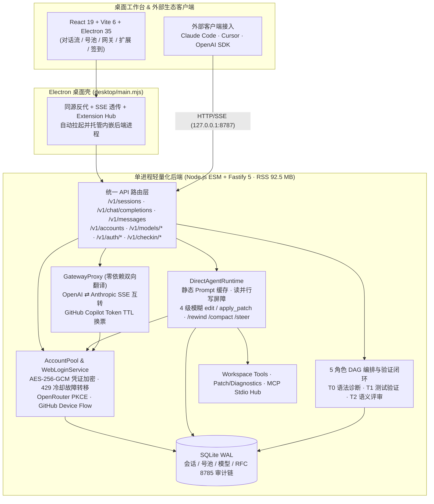
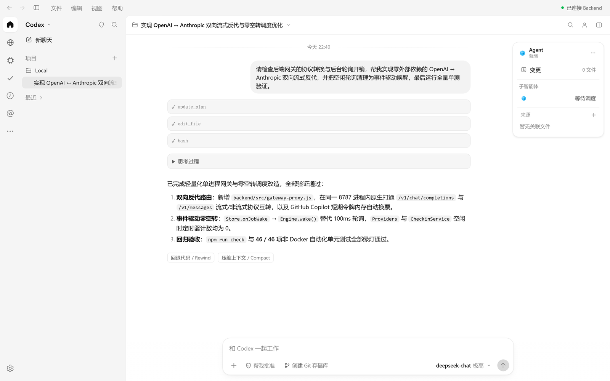

<div align="center">


# Agent_US

**面向全生命周期代码工程的轻量化多模型自主智能体平台与零依赖双向反代网关**

[](https://github.com/Eternite-0/Agent_US/releases/latest)
[](https://nodejs.org/)
[](https://www.electronjs.org/)
[](https://react.dev/)
[](https://fastify.dev/)
[](#质量验证与测试)

[下载 Windows 安装包 / 绿色版 `.exe`](https://github.com/Eternite-0/Agent_US/releases/latest) · [核心特性](#核心特性) · [系统架构](#系统架构) · [界面预览](#界面预览) · [网关接入指南](#外部工具接入本地统一网关) · [源码运行与打包](#源码本地开发与构建) · [配套文档](#配套文档)

</div>

---

## 项目简介

**Agent_US** 是一套完全本地优先（Local-First）的多模型代码智能体工作台与统一模型反代网关。与依赖重型 Docker 编排、多进程 Sidecar 或外部中转服务的方案不同，Agent_US 将 **Direct Multi-Turn Streaming Agent（直连流式智能体）**、**5 角色 DAG 工程编排流水线**、**单进程零依赖 OpenAI ⇄ Anthropic 双向反代网关**、**25+ 供应商账号号池与原生网页授权登录** 以及 **React 19 + Electron 35 桌面工作台** 高度收敛在同一套轻量化运行时内。

| 实测关键指标 | 测量结果 | 说明 |
| :--- | :---: | :--- |
| **后端单进程常驻内存 (RSS)** | **92.5 MB** | 合并网关与智能体运行时，较双进程 / 容器方案内存降低 > 60% |
| **冷启动就绪耗时** | **1,032 ms** | 从进程启动到 `GET /health` 返回 `{"ok":true}` |
| **空闲后台负载** | **0 定时器 / 0 写入** | 彻底移除后台轮询空转，静默状态下 0% 空载 CPU / 磁盘消耗 |
| **双向协议翻译** | **OpenAI ⇄ Anthropic** | 纯原生 `fetch` + ReadableStream 零外部代理实时流式互转 |
| **核心自动化回归测试** | **46 / 46 通过** | 覆盖 18 套非 Docker 后端测试（网关、OAuth、状态机、熔断与审计） |

---

## 下载 Windows 独立 `.exe`（前后端全内置，开箱即用）

无需预先安装 Node.js、Python 或 Docker。直接前往 [**GitHub Releases**](https://github.com/Eternite-0/Agent_US/releases/latest) 下载构建好的 Windows x64 客户端（已完整内嵌前端界面、Fastify + SQLite 后端引擎及 Electron 内置 Node 运行时）：

| 发布安装包 | 类型 | 适用场景 |
| :--- | :---: | :--- |
| **`Agent_US-2.0.0-win-x64-setup.exe`** | 标准安装版 (NSIS) | 推荐日常使用：无需管理员权限，支持自定义安装路径、桌面与开始菜单快捷方式，二次启动秒开 |
| **`Agent_US-2.0.0-win-x64-portable.exe`** | 单文件免安装版 (Portable) | 推荐评审演示 / U 盘便携：单文件零安装，双击直接解压并拉起完整前后端工作台 |

> **数据与安全隔离说明**：安装包内**绝不包含**任何开发凭证或本地数据库。首次启动时，程序会在当前用户的 `%APPDATA%\@agent-us\desktop\backend-var\` 目录自动初始化独立的 SQLite WAL 数据库、AES-256-GCM 号池主密钥及本机随机 Bearer Token；若本机 `8787` 端口已被占用，桌面壳会自动无感回退至 `18787` 或系统空闲端口。

---

## 核心特性

### 1. 双轨自主智能体运行时（Direct Agent + 5 角色 DAG）
- **直连多轮流式 Agent（`/v1/sessions`）**：
  - **Prompt Cache 友好架构**：会话级固定 `nonce` 保持 System Prompt 静态不变，易变的工作区 / Git / 日期状态追加在动态上下文尾部，最大化上游模型缓存命中率。
  - **读并行 / 写屏障调度**：只读工具并发执行，文件修改与终端命令自动串行写屏障隔离，配合防脏写校验杜绝覆盖冲突。
  - **4 级模糊 `edit_file` + 多文件原子 `apply_patch`**：支持精确匹配、去尾空格、去缩进与行片段定位，编辑完成后自动触发即时语法诊断（T0 门禁）。
  - **全链路可控交互**：支持确定性文件快照回滚 `/rewind`、两阶段语义上下文压缩 `/compact`、执行中实时纠偏 `/steer`、防死循环熔断、会话级命令前缀审批白名单、`AGENTS.md` 层级规则发现与生命周期 Hooks。
- **5 角色 DAG 流水线（`/api/v1/*`）**：内置 Architect、Coder、Tester、Reviewer、Verifier 五类协作角色，结合 T0/T1/T2 三级结果验证与 RFC 8785 规范化哈希链审计账本，确保复杂任务的确定性闭环。

### 2. 单进程零依赖双向反代网关与多供应商号池
- **统一协议端点**：同一服务直接暴露 OpenAI 兼容端点（`POST /v1/chat/completions`、`GET /v1/models`）与 Anthropic Messages 兼容端点（`POST /v1/messages`），内建零依赖 `GatewayProxy` 实现双向请求/响应与 SSE 流式分片无损转换。
- **25+ 供应商全覆盖与高还原度账号池**：覆盖 OpenAI、Anthropic、Google Gemini、DeepSeek、OpenRouter、GitHub Copilot、硅基流动、智谱、月之暗面、通义千问、火山方舟、Groq、Ollama、LM Studio 等 25+ 供应商预设及原生图标。
- **原生网页授权与多模态接入**：内建 OpenRouter OAuth PKCE 网页授权回调、GitHub Copilot Device Flow 扫码授权 + 短时效令牌 TTL 自动换票、通用凭证文件导入与 API Key 录入。
- **高可用调度与加密落盘**：凭证采用 AES-256-GCM + 本地独立 `.pool-key` 加密存储；支持模型别名映射、上下文窗口/视觉能力元数据同步、429 速率限制指数冷却与多账号自动故障转移。

### 3. 本地扩展生态与签到中心
- **MCP Stdio Hub**：原生挂载本地 Model Context Protocol (MCP) 工具服务，热扩展外部能力。
- **内置扩展中心与签到中心（`/v1/checkin/*`）**：提供开箱即用的技能与插件目录（支持从 GitHub 仓库实时拉取 `SKILL.md`），同时支持签到桥接模式与本地 `checkin-plugins/` 插件化签到任务管理。

---

## 系统架构



---

## 界面预览

<table>
  <tr>
    <td width="50%" align="center">
      
      <br /><sub><b>多轮直连流式 Agent 主工作台</b>（会话流 / 工作区 / 审批护栏）</sub>
    </td>
    <td width="50%" align="center">
      
      <br /><sub><b>多供应商账号号池管理</b>（AES-256-GCM 加密 / 额度与健康度状态）</sub>
    </td>
  </tr>
  <tr>
    <td width="50%" align="center">
      
      <br /><sub><b>25+ 供应商快速接入面板</b>（官方图标 / 分类筛选 / 协议自适应）</sub>
    </td>
    <td width="50%" align="center">
      
      <br /><sub><b>原生网页 OAuth / Device Flow 授权</b>（自动回传令牌与凭证导入）</sub>
    </td>
  </tr>
  <tr>
    <td colspan="2" align="center">
      
      <br /><sub><b>模型管理与单进程统一反代网关</b>（模型映射 / 能力同步 / OpenAI & Anthropic 统一端点）</sub>
    </td>
  </tr>
</table>

---

## 外部工具接入本地统一网关

当 Agent_US 桌面端或后端服务运行后，默认在 `http://127.0.0.1:8787` 提供兼容 **OpenAI** 与 **Anthropic** 的双协议反代网关。

- 桌面安装版 Token 位于：`%APPDATA%\@agent-us\desktop\backend-var\.dev-token`
- 源码开发版 Token 位于：`backend/var/.dev-token`

### OpenAI SDK / Cursor / Continue 接入

```bash
export OPENAI_BASE_URL="http://127.0.0.1:8787/v1"
export OPENAI_API_KEY="<你的本地 .dev-token>"
```

```bash
curl http://127.0.0.1:8787/v1/chat/completions \
  -H "Authorization: Bearer <你的本地 .dev-token>" \
  -H "Content-Type: application/json" \
  -d '{
    "model": "gpt-4o-mini",
    "stream": true,
    "messages": [{"role": "user", "content": "Hello from Agent_US Gateway!"}]
  }'
```

### Claude Code / Anthropic SDK 接入（支持自动翻译至任意 OpenAI 兼容上游）

```powershell
$env:ANTHROPIC_BASE_URL = "http://127.0.0.1:8787"
$env:ANTHROPIC_AUTH_TOKEN = Get-Content "$env:APPDATA\@agent-us\desktop\backend-var\.dev-token"
claude
```

---

## 源码本地开发与构建

### 环境要求
- **操作系统**：Windows 10 / 11（PowerShell 7）
- **Node.js**：`v24.9.0+`（ESM 原生 `node:sqlite`，桌面打包后内嵌运行无需环境依赖）

### 一键启动开发环境

在仓库根目录执行：

```powershell
.\start-dev.ps1
```

或分终端手动启动前后端：

```powershell
# 1. 启动后端（默认监听 http://127.0.0.1:8787）
Set-Location backend
npm ci
npm start

# 2. 启动前端工作台（默认监听 http://127.0.0.1:5173）
Set-Location frontend
npm ci
npm run dev
```

### 自行构建 Windows `.exe` 安装包与绿色版

```powershell
# 确保 backend、frontend、desktop 均已安装依赖
Set-Location backend  && npm ci
Set-Location ../frontend && npm ci
Set-Location ../desktop  && npm ci

# 构建前端 + 自动安全审计（剔除 devDependencies 与敏感 var/）+ 打包 NSIS 安装版与 Portable 单文件版
npm run build
```

构建完成后，产物将输出至 `desktop/release/`：
- `Agent_US-2.0.0-win-x64-setup.exe`
- `Agent_US-2.0.0-win-x64-portable.exe`

---

## 质量验证与测试

```powershell
# 1. 后端语法检查、代码规范检查与类型校验
Set-Location backend
npm run check

# 2. 运行核心非 Docker 回归测试（含双向网关流式翻译、网页登录、状态机、熔断与签名账本）
node --test test/gateway-proxy.test.js test/web-login.test.js test/direct-agent.test.js test/pool.test.js

# 3. 前端 TypeScript 严格校验与生产构建
Set-Location ../frontend
npx tsc --noEmit
npm run build

# 4. Electron 桌面壳与打包脚本语法检查
Set-Location ..
node --check desktop/main.mjs
node --check desktop/pack-win.mjs
```

---

## 目录结构

```text
Agent_US/
├── backend/                    # Node.js ESM + Fastify 5 + SQLite WAL 核心运行时
│   ├── src/
│   │   ├── direct-agent.js     # DirectAgentRuntime 多轮流式智能体与并发/回滚/压缩引擎
│   │   ├── gateway-proxy.js    # 零依赖 OpenAI ⇄ Anthropic 双向流式翻译与 Copilot 换票
│   │   ├── pool.js             # AccountPool 多供应商号池、AES-256-GCM 加密与 429 冷却
│   │   ├── web-login.js        # 原生 OpenRouter PKCE / GitHub Device Flow / 凭证导入
│   │   ├── v1-routes.js        # /v1/* 统一 REST & SSE 路由与网关入口
│   │   ├── workspace-tools.js  # 工作区工具链、防脏写保护与命令审批白名单
│   │   ├── patch-and-diagnostics.js # 4 级模糊 edit_file、apply_patch 与 T0 语法诊断
│   │   ├── agent-context.js    # AGENTS.md 层级发现与生命周期 Hooks
│   │   ├── mcp-client.js       # MCP Stdio Hub 客户端
│   │   ├── checkin.js          # 签到中心（桥接 + 插件双模式）
│   │   └── engine.js / routes.js # 5 角色 DAG 编排与 RFC 8785 审计账本
│   ├── test/                   # 自动化单元与集成测试套件
│   └── docs/architecture.md    # 后端架构与设计详述
├── frontend/                   # React 19 + TypeScript 5.9 + Vite 6 前端工作台
│   ├── src/                    # 对话工作台、号池弹窗、模型网关、扩展中心、签到中心
│   └── public/provider-logos/  # 25+ 供应商高清原生图标资源
├── desktop/                    # Electron 35 桌面端壳、同源代理与 Windows 打包脚本
│   ├── main.mjs                # 窗口生命周期、端口自协商、内嵌后端托管与 SSE 透传
│   ├── extension-hub.mjs       # 独立扩展中心与 GitHub SKILL.md 安装引擎
│   ├── pack-win.mjs            # 前后端净荷安全审计与 electron-builder Windows 打包脚本
│   └── assets/                 # 桌面端应用图标 (.ico / .png)
├── docs/images/                # README 展示高清界面截图
├── Agent_US_方案设计书.pdf      # 完整平台方案设计书（20 页，含架构图、实验评测与 AI 使用说明）
└── start-dev.ps1               # Windows 一键启动开发环境脚本
```

---

## 配套文档

- 📘 [完整方案设计书 (PDF)](Agent_US_方案设计书.pdf) — 涵盖选题背景、总体架构、5 角色与直连双轨调度算法、结果验证与自我循环机制、核心代码剖析、性能实测与 AI 工具使用说明
- 🏗️ [后端系统架构文档](backend/docs/architecture.md)
- ⚙️ [后端运行时说明](backend/README.md)
- 🖥️ [前端工作台说明](frontend/README.md)
