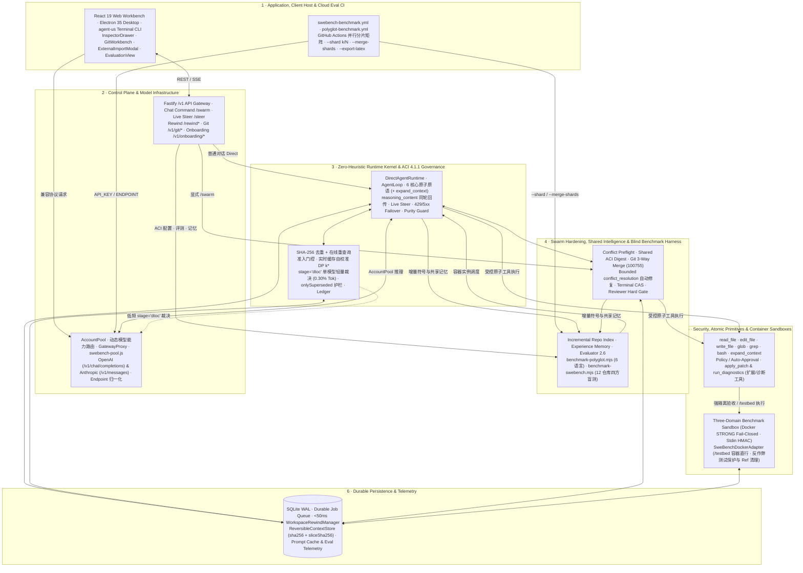
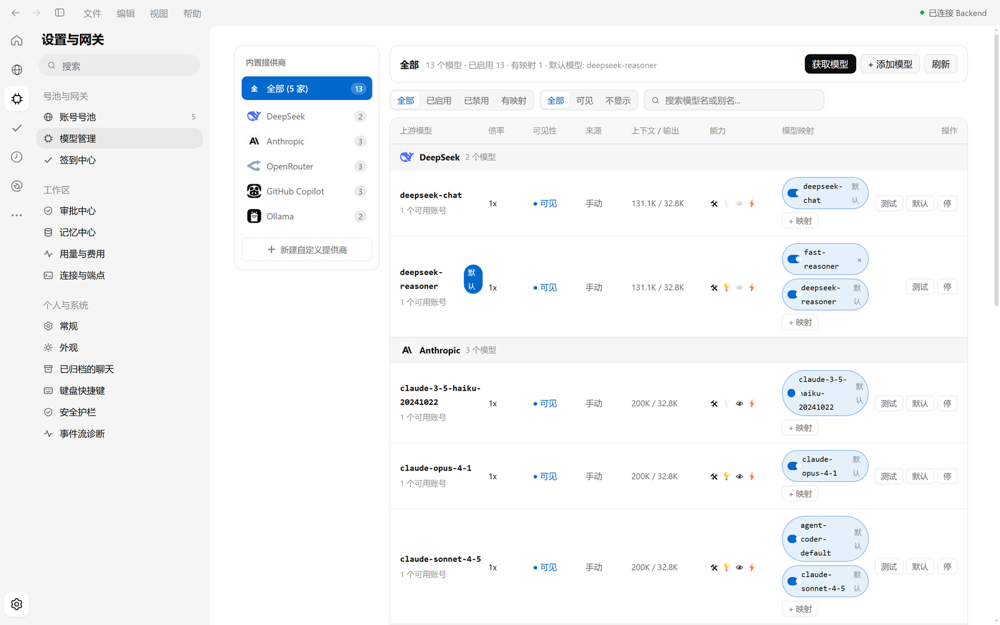

<div align="center">


# Agent_US

**Local-First Autonomous Engineering Platform · Instant Rewind & Live Steer · Adaptive Context Intelligence · Fail-Closed Sandbox**

面向复杂软件工程任务的本地优先自主智能体框架

[](https://github.com/Eternite-0/Agent_US/releases/latest)
[](https://github.com/Eternite-0/Agent_US/actions/workflows/ci.yml)
[](https://nodejs.org/)
[](https://www.electronjs.org/)
[](https://react.dev/)
[](backend/sandbox/Dockerfile.benchmark)

[核心创新](#核心创新与能力体系) · [ACI 治理流程](#adaptive-context-intelligence-流程) · [系统架构](#系统架构) · [实证 Benchmark](#实证-benchmark-结果) · [界面预览](#界面预览) · [Swarm 与网关](#swarm-命令与外部网关) · [本地开发](#本地开发与验证) · [文档与报告](#文档与实证报告索引)

</div>

---

## 关键实证指标总览

| 维度 | 核心能力与阶段 | 实测基线 vs 演进结果 | 验证环境 |
| --- | --- | --- | --- |
| **4.0–4.1 · 零启发式通用内核与跨领域四方盲测（Polyglot-36 + SWE-bench Diverse-36）** | **Agent_US 4.0–4.1.1**（净删 **`-3,153`** 行核心特判、`6` 原子原语 + `expand_context`、`generalization-purity-guard.test.js` 防泄漏守卫 · 在线重查询期望成本准入门控 · 实时缓存命中率自校准 DP 最优后缀切分 `k*` · 单模型低频 `stage='dtoc'` 语义裁决 + `onlySuperseded` 活跃工作集护栏 · 详见 [4.1 综合实证报告](backend/docs/4.1-generalist-aci-and-blind-benchmarks-report.md)） | **Polyglot-36**（6 语言 144 轮）：`raw_full` **`100.00% (36/36)`** / `full_aci` **`97.22% (35/36)`**，较 `Claude Code` 省 **`58.93%`** Token（`2.05M` vs `5.00M`，配对省 `61.60%`，缓存 `90.20%`）<br/>**SWE-bench Diverse-36**（12 仓库）：`full_aci` v4.1.1 **`36/36` 零接口断流**，严格 **`52.78% (19/36)`** / 完赛 **`59.38% (19/32)`** / 四方同口径 **`64.29% (18/28)`**，11/12 仓持平 `raw_full`，16/16 DTOC 已解题零回退<br/>缓存命中 **`94.69%`**（`34` 次 DTOC、`116` 次裁决占 **`0.30%`** Token）· 对 `Claude Code` 18 题配对省 **`17.98%`**（`15.31M` vs `18.66M`）· 长程 10 题（`raw_full >= 30` 步）消耗 **`9.91M`** 同时胜 `raw_full`（**`-11.55%`**）与 `Claude Code`（**`-26.74%`**） | `deepseek-v4.1-flash`<br/>Polyglot-36（6 语言）<br/>SWE-bench Diverse-36（12 仓库）<br/>同模型四方外部盲测 |
| **3.1–3.2 · 缓存感知 ACI 与 SWE-bench 外部真机实证（50 题 · 100 轮容器）** | **Agent_US 3.1–3.2**（`cache_aware_v31` `48k` 地板 + `0.35 * invalidatedSuffixTokens` 摊销门控 · `reasoning_content` 同轮回传 & `promptOutput` 前缀保真 · `42k` `read_file` 工作集保护 · `DUPLICATE` 前置去重 · `EXEC_ERROR_TOOLS` 边界 · `>6k` `bash`/`>4.5k` `grep` 摘要 · 同模型推理监督器 `0 ms` 旁路 · `/testbed` 容器 + GitHub Actions 分片） | `raw_full` vs `full_aci`：Resolved **`36.00% (18/50) -> 42.00% (21/50)`**（**`+6.00 pp`** / 相对 **`+16.7%`**）<br/>同题配对省 Token **`+30.03% (n=13)`** · Tokens/Resolved **`3,314,561 -> 2,963,502 (-10.59%)`** · KV Hit **`97.09% (n=49)`** vs **`96.69% (n=50)`**<br/>耗时 **`14,471s -> 13,552s (-6.35%)`** · Non-Empty Patch **`98.0% -> 100.0% (50/50)`** · Supervisor 延迟 **`0 ms`**<br/>分仓：`sphinx-doc/sphinx` **`16.0% -> 28.0% (+75.0%)`** · `django/django` 净省 Token **`20.37%`** | `deepseek-v4.1-flash`<br/>SWE-bench Verified Mini (`paper-50`)<br/>Docker `/testbed` · 5 分片并行 |
| **3.0 · 零成本回滚与全栈工作流** | **Agent_US 3.0**（`<50ms` 零 Token 真回滚/Redo · 运行中无损插话 `Live Steer` · `429`/`5xx` 热备切换 · 显式外部配置一键导入 · `agent-us` 终端 CLI & GUI 同步 · 原生 Git 交付台） | 单文件/整轮快照还原与 Redo **`<50ms`**（零 Token、绝不误伤未触碰脏改动）<br/>运行中 `/steer` 零中断注入且 **100% 保持静态 System Prompt KV 前缀** · 首包前 `429`/`5xx` 号池自动容灾<br/>只读扫描 `~/.claude` / `~/.codex` 经确认一键导入（原外部文件 **SHA-256 零改写**，外部 MCP 默认 `untrusted`）<br/>全仓 **`576/576`** 后端单测（`110` 文件）· **`73/73`** 前端单测 · `visual.spec.mjs` **`26/26`** 零失败 | Node.js 24 + Fastify `/v1/*`<br/>Docker `29.6.1` 全链路 E2E |
| **ACI 2.6 · 轨迹驱逐与原生体验** | **Agent_US 2.6**（`trajectory_eviction_v26` · 过期输出置换 · 局部哈希恢复 · 防死磕 · `query_symbol_graph` · Swarm 自动解冲突 · Codex 原生交互） | Arm D 通关率 **`57.1%`（`8/14`**, CI `[32.6%, 78.6%]`）领先 Arm A/C（`50.0%`, `7/14`），唯一攻克 `aci-06`<br/>成功归一化成本 **`304,125`** tok/pass（较 Arm C `370,548` 降 **`17.9%`**）· 同题配对节省 **`+11.3%`（`n=5`）** vs Arm C `+2.5%`<br/>Arm A `Sup Tok = 0` · Arm D **`21` Epochs / `45` 次过期驱逐（省 `20,972` tok，总 DTOC 省 `39,189` tok）** · **`15/15` (`100%`)** 哈希恢复（`13` 次局部）<br/>全仓 **`558/558`** 后端单测（`106` 文件）· **`69/69`** 前端单测 · `visual.spec.mjs` **`26/26`** 零失败 | `deepseek-v4.1-flash`<br/>Docker `strong`（`42` 试次 `aci26`） |
| **ACI 2.5 · 工程闭环** | **Agent_US 2.5**（`phase_watermark_v25` · 完工宽限 · `8s` 熔断 · `apply_patch` · Swarm 三方合并） | Arm C / D 通关率 **`25.0% → 58.3%`（`+33.3 pp`** · CI `[31.9%, 80.7%]`）<br/>成功归一化成本 **`670,619 → 288,998–298,849` tok/pass（`−55.4% ~ −56.9%`）**<br/>同题双通配对节省 **`+5.22%`** · Arm D KV Hit **`81.57%`** · **`0/10`** 诱饵恢复 · 全仓 **`533/533`** 单测 | `deepseek-v4.1-flash`<br/>Docker `strong`（`36` 试次 `aci25`） |
| **注入前上下文治理** | **Agent_US 2.4 Stage 4**（Pre-Injection Admission · Supervisor · SHA-256 恢复） | Arm C 通关率 **`33.3% → 75.0%`（`+41.7 pp`）**<br/>关键上下文召回 **`100%`** · FNR **`0`** · 注入前减负 **`54.8%–64.8%`**<br/>Arm D KV Hit **`84.78%`** · 短任务 KV 差 **`-0.64 pp`** · **`0/6`** 诱饵恢复 | `deepseek-v4.1-flash`<br/>Docker `strong`（`48 + 6` 试次） |
| **能力感知工具选择** | **Agent_US 2.3.7**（Tool Intelligence · 动态目录与提示对齐） | Bash 拒绝次数 **`96 → 27`（`−71.9%`**, `p = 0.000122`）<br/>工具选型匹配 **`86.2% → 95.4%`** · 总 Token **`−23.6%`** | 真实 Provider<br/>`14` 题 × `5` 轮（`140` 轮） |
| **三域强隔离沙箱** | **Agent_US 2.3.1**（Trusted Judge · RO Supervisor · Worker + Stdin HMAC） | 阻断 **`7/7`** 隐藏验收绕过向量（`exit(0)` / `SIGTERM` / 伪造信封等）<br/>`STRONG` / `DOCKER` 无 Docker 时严格 **Fail-Closed** | Windows 11 + Docker Desktop<br/>`agent-us/benchmark:node24` |
| **自主推理与经验闭环** | **Agent_US 2.3–2.4 S3**（契约感知 · 根因台账 · 只读校验 · 可信经验） | `compute_file_digest` 使 `ar-09` **`0/3 → 2/3`**（`65.1s` Pass）<br/>可信经验闭环（`ar-03,05,09`）Pass **`+33.3 pp`** · 耗时 **`−45.9%`**<br/>OSS 外部基准 **`4/4`** · `tj/commander.js` **`1393/0/2`** | `deepseek-v4.1-flash`<br/>Docker `strong` 实测 |

---

## 项目定位：Why Agent_US

Agent_US 将 **Durable Agent Kernel**、**Pre-Injection ACI Governance**、**Contract-Aware Reasoning**、**Shared Repository Intelligence**、**Explicit `/swarm` Orchestration** 与 **Three-Domain OS Sandbox** 融合为端到端可审计的自主软件工程运行时，同时通过内置 `AccountPool` 与 `GatewayProxy` 向外部 OpenAI / Anthropic 兼容客户端暴露统一基础设施。

| 维度 | 普通 AI 编程助手 | Agent_US |
| --- | --- | --- |
| **人机协同与多端流转** | 运行中无法纠偏、回退靠手写命令、CLI 与桌面端会话割裂 | 运行中 `Live Steer` 无损插话纠偏、`<50ms` 零 Token 快照真回滚/Redo、`agent-us` 终端 CLI 与 Web/Desktop 实时双向同步、原生 Git 暂存提交与外部配置显式导入 |
| **上下文供给** | 盲目全量读取文件、诱饵/旧档污染前缀或盲删破坏缓存 | 零启发式 `6` 核心原子原语 + `expand_context`、SHA-256 去重与在线重查询成本准入门控、实时缓存自校准 DP 最优后缀切分 `k*`、单模型低频 `stage='dtoc'` 语义裁决与 `onlySuperseded` 活跃工作集护栏 |
| **推理与修改** | 凭直觉改代码、手算哈希/盲猜需求 | `extractTaskContract` 提取硬约束与排序规则、前置失败复现、根因消退验证与零 Shell 安全校验原语 `compute_file_digest` |
| **多智能体协同** | 固定角色模板、手动复制上下文 | 显式 `/swarm` 驱动动态编排、共享渐进式代码索引、独立 Git Worktree 并行执行与只读 Independent Reviewer |
| **安全性与验收** | 同进程跑测试、易被 `process.exit(0)` 欺骗 | Trusted Judge + 只读容器 Supervisor + 每用例独立 Worker、Stdin HMAC 验签、Docker `network=none` + Hard Veto |
| **容错与持续学习** | 进程崩溃丢状态、经验混入未验证噪声 | SQLite WAL + Checkpoint 崩溃恢复、`ContextEvidenceLedger` 全链审计、`trusted_server_verifier` 可信经验冷暖闭环 |

---

## 核心创新与能力体系

### 1. Agent_US 4.0–4.1.1：零启发式通用内核与双层自适应 ACI（4.0 – 4.1.1）

- **v4.0 零启发式极简内核与架构防泄漏守卫**：核心运行时 `backend/src/`（不含 `evaluation/`）执行减法重构，净删 **`-3,153`** 行特判与启发式拦截代码（`93,289 -> 90,136` 行），彻底移除所有测试框架正则、`/testbed` 路径泄漏、`benchmarkMode` 双标与结案拦截器；默认编码工具面收敛为 **6 个语言无关核心原子原语**（`read_file`、`edit_file`、`write_file`、`glob`、`grep`、`bash`）+ `full_aci` 按需挂载的单个只读展开原语 **`expand_context`**（全局严格 `<= 7`）；[`generalization-purity-guard.test.js`](backend/test/generalization-purity-guard.test.js) 在 CI 中持续静态扫描 13 项禁用特征词并锁定工具面边界，确保零过拟合泛化纯度。
- **在线重查询期望成本准入门控（Layer 1）**：[`aci-admission.js`](backend/src/context/aci-admission.js) 在工具结果写入历史前先对只读重复调用执行 **SHA-256 无损 `DUPLICATE` 前置去重**，随后由 `evaluateAdmissionRequeryGate` 与在线轨迹步数估计 `estimateRemainingHorizon`（`H_t`）校验损益不等式 `estHorizon * deltaTokens > requeryRisk * Math.max(P_t, Math.floor(contextWindow * 0.08))`（常规载荷风险 `0.25`，报错/非零退出载荷风险 `0.65`）：仅当多轮预期节省严格超过重查询期望代价时才压缩摘要，否则原文放行；所有压缩载体均写入 [`ReversibleContextStore`](backend/src/context/aci-store.js) 供 `expand_context` 按行精确无损回查。
- **实时缓存命中率自校准 DP 最优后缀切分点 `k*`（Layer 2）**：[`aci-engine.js`](backend/src/context/aci-engine.js) 的 `solveOptimalEpochSplit` 消费真实上游遥测 `observedCacheHitRate`（`ρ_t`）与剩余轨迹步数 `H_t`，在动态规划中求解使净缓存调整收益最大化的切分点 `k*`（满足 `netCacheAdjustedGain(k) > 0` 且 `H_t * S(k) > max(0.6 * P_t, ρ_t * I(k))`），仅对后缀 `[k*..n-1]` 执行压缩，保证前缀 `[0..k*-1]` **字节级 100% 零改动**；v4.1.1 进一步收敛触发频率（`DEFAULT_V31_EVICTION_COOLDOWN_STEPS = 10`、`DEFAULT_V31_AGED_MIN_AGE_STEPS = 7`、`superseded = 0`，单次净省门槛自适应 `Math.floor(Math.max(effectivePromptTokens, contextWindow * 0.12) * 0.14)`）。
- **单模型低频 `stage='dtoc'` 语义裁决 + `onlySuperseded` 活跃工作集护栏**：[`supervisor.js`](backend/src/context/supervisor.js)、[`agent-loop.js`](backend/src/kernel/agent-loop.js)、[`swebench-pool.js`](backend/src/evaluation/swebench-pool.js) 与 [`polyglot-eval.js`](backend/src/evaluation/polyglot-eval.js) 在 `auto_epoch_main_model` 模式下对高频 `stage='admission'` 保持零延迟跳过，仅在低频 `stage='dtoc'` 复用主模型执行单题至多 `4` 次轻量只读 JSON 裁决（输出 `keepRefs` / `compressRefs`）并据此重算 `k*`（Diverse-36 全集 `116` 次裁决仅占总 Token **`0.30%`**）；当裁决未触发或降级且处于非紧急水位（`singleStepRatio < 0.70`）时，自动启用 `onlySuperseded: true` 护栏，仅驱逐已被修改/重读覆写的过期载体，杜绝盲删活跃 `aged` 工作集文件。

### 2. Agent_US 3.1–3.2：缓存感知长程 ACI 与 SWE-bench 云端容器评测（3.1 – 3.2）

- **`reasoning_content` 同轮回传与 `promptOutput` 前缀保真**：[`agent-loop.js`](backend/src/kernel/agent-loop.js)、[`pool.js`](backend/src/pool.js)、[`gateway-proxy.js`](backend/src/gateway-proxy.js) 与 [`direct-agent.js`](backend/src/direct-agent.js) 在多轮工具调用链中保留并同轮回传 assistant `reasoning_content`；工具结果入库与后续轮次重放严格使用准入压缩后的 `promptOutput`（上限 `32k` excerpt）而非原始 `output`，防止前缀逐轮偏移撕裂上游 KV Cache。
- **缓存感知双门控驱逐（`cache_aware_v31`）**：[`aci-engine.js`](backend/src/context/aci-engine.js) 新增 `cache_aware_v31` 策略，设定 **`48k`** 最小上下文地板（`DEFAULT_V31_MIN_PROMPT_TOKENS = 48000`）、`3,500` 基础净省门限与 `6` 步驱逐冷却期（`DEFAULT_V31_EVICTION_COOLDOWN_STEPS = 6`）；在非紧急水位（`singleStepRatio < 0.80`）下施加 **`0.35 * invalidatedSuffixTokens`** 摊销门控，仅当组合净省 Token 跨过 `max(3500, ceil(0.35 * invalidatedSuffixTokens))` 时才执行淘汰，避免频繁破坏长程缓存前缀。
- **`42k` `read_file` 工作集保护、`DUPLICATE` 前置去重与 `EXEC_ERROR_TOOLS` 边界**：[`aci-admission.js`](backend/src/context/aci-admission.js) 将 `DEFAULT_WORKING_SET_READ_MAX_CHARS` 设为 **`42,000`** 保护非诱饵 `read_file` 主工作集直通；将 `READ_ONLY_DEDUP_TOOLS` 的 **`DUPLICATE` 哈希去重前置**于 `isErr` 检查、工作集直通与超长摘要之前；并以 **`EXEC_ERROR_TOOLS`**（`bash`、`start_process`、`run_diagnostics`）限定运行期报错嗅探与非重复写入边界，避免误将读取源码中的错误字面量标为命令失败。
- **超长 `bash` / `grep` 结构化摘要与 `artifact://` 恢复**：`bash`/`start_process`/`run_diagnostics` 输出 **`>6,000`** chars 触发 `oversized_exec_log_fidelity_summary`（压至 `<=3,200` chars，保留 Head + Failures/Tracebacks + Tail）；`grep`/`glob` 非诱饵输出 **`>4,500`** chars 触发 `oversized_search_clustered_summary`（压至 `<=2,800` chars，按文件/目录聚类计数并给出 Top Matches），两者均保留 `artifact://sha256` 指针供 `expand_context` 按行精确回取。
- **同模型与推理模型监督器零延迟分流**：[`supervisor.js`](backend/src/context/supervisor.js) 与 [`swebench-pool.js`](backend/src/evaluation/swebench-pool.js) 在 `auto` 模式下检测主模型为推理/思考模型或号池中无独立轻量非推理副模型时，自动短路外部 LLM 监督调用并回退确定性准入（`auto_skip_same_or_reasoning_model_deterministic` / `reasoning_main_deterministic_fallback`），在 SWE-bench 50 题实证中实现 **`Supervisor Cost = 0 calls / 0 tok / 0 ms`**。
- **`/testbed` 容器原生适配与 GitHub Actions 分片并行架构**：[`swebench-docker.js`](backend/src/evaluation/swebench-docker.js)、[`swebench-pool.js`](backend/src/evaluation/swebench-pool.js)、[`swebench-dataset-eval.js`](backend/src/evaluation/swebench-dataset-eval.js) 与 [`benchmark-swebench.mjs`](backend/scripts/benchmark-swebench.mjs) 实现 Epoch/Official SWE-bench `/testbed` 容器直行、反作弊 Git Ref 清理（屏蔽 `commit`/`checkout`/`log` 等历史窥探命令）与多协议 Endpoint 归一化；配合 [`.github/workflows/swebench-benchmark.yml`](.github/workflows/swebench-benchmark.yml) 通过 `--shard k/N` 与 `--merge-shards` 在云端并行调度 1–10 路 Runner，执行 6 级质量去重合并并导出 `summary.md` 与 `swebench-paper-table.tex`。

### 3. Agent_US 3.0 开发者高频工作流跃迁（3.0 Product Leap）

- **毫秒级零 Token 真回滚与单文件还原（`True Instant Rewind & Redo`）**：[`checkpoint.js`](backend/src/durable/checkpoint.js)、[`session-fork.js`](backend/src/routes/session-fork.js) 与 [`v1-routes.js`](backend/src/v1-routes.js) 在每轮首次修改前记录精确快照与 `fileStats` 清单，支持“仅还原文件”、“文件 + 对话回退”、单文件 `POST /v1/sessions/:id/rewind/file` 与一键 Redo（`<50ms`，绝不误伤未触碰的用户脏改动）；前端 [ThreadView](frontend/src/components/ThreadView.tsx)、[FileChangeCard](frontend/src/components/FileChangeCard.tsx) 与 [InspectorDrawer](frontend/src/components/InspectorDrawer.tsx) 原生联动。
- **运行中无损插话纠偏（`Live Mid-Turn Steering`）与号池热备切换**：[`direct-agent.js`](backend/src/direct-agent.js)、[`agent-loop.js`](backend/src/kernel/agent-loop.js) 与 [Composer](frontend/src/components/Composer.tsx) 支持运行中通过 `POST /v1/sessions/:id/steer`（`插话引导`）投递实时引导消息，在工具批次边界零中断注入且不破坏静态系统提示词 KV Cache 前缀；[`inference.js`](backend/src/kernel/inference.js) 与 [`pool.js`](backend/src/pool.js) 在流式首包前遭遇 `429`/`5xx` 时自动切换健康备用账号重试（`turn/route_failover`），[`shell-tools.js`](backend/src/tools/builtin/shell-tools.js) 实时推送 `tool/output` 增量流并拦截交互等待卡死。
- **显式外部生态检测与一键原生导入向导（`Explicit Onboarding Wizard`）**：[`agent-context.js`](backend/src/agent-context.js) 与 [ExternalImportModal](frontend/src/components/ExternalImportModal.tsx) 提供只读扫描 `GET /v1/onboarding/detect-external`（检测 `~/.claude`、`~/.codex` 与工作区遗留规则/命令/技能/MCP，未经确认绝不自动混读或改写原文件），确认后经 `POST /v1/onboarding/import-external` 转换为 Agent_US 原生资产（外部 MCP 默认标记 `untrusted`）并动态刷新 `/` 斜杠命令与技能列表。
- **全功能 `agent-us` 终端 CLI、GUI 双向同步与原生 Git 交付闭环**：[`agent-us.mjs`](backend/bin/agent-us.mjs) 与 [`cli.js`](backend/src/cli.js) 支持后台服务自启、单次执行、`<piped_stdin>` 管道注入、交互式 REPL（`/steer`、`/undo`、`/redo`、`/git`、`/import`、`/swarm`）、终端内审批及 `--resume` 跨 CLI/Web/Desktop 共享 SQLite+SSE 会话实时同步；[`workspace-git.js`](backend/src/routes/workspace-git.js) 与 [GitWorkbench](frontend/src/components/GitWorkbench.tsx) 提供按文件 Stage/Unstage、敏感文件拦截、Commit 与分支 Merge 闭环。

### 4. ACI 2.5–2.6 上下文准入、轨迹驱逐与局部恢复（2.4 S4 – 2.6）

> 从 2.4 Stage 4“注入前精筛 + 无损恢复”、2.5“双门控水位 + `8s` 熔断 + 完工保留金”及 2.6 `trajectory_eviction_v26` 演进至 **3.1–3.2 的 `cache_aware_v31`、`42k` 工作集保护、`>6k`/`>4.5k` 超长工具结构化摘要与同模型零延迟分流**，在保持 96%+ 上游 KV 命中的同时压缩长程噪声。

- **五级注入前准入（`PreInjectionAdmissionController`）**：[`aci-admission.js`](backend/src/context/aci-admission.js) 在工具批写入历史前结合 JS/TS/Python 符号、`.json` 顶层键（`json_key@L...`）、调用链与诱饵特征输出 **`DIRECT`**、**`SUPPORTING`**、**`DEFER`**、**`DUPLICATE`** 与 **`IRRELEVANT`**；五大关键域（`auth`、`permission`、`persistence`、`contract`、`hidden_acceptance`）与目标/报错文件受硬护栏锁定**绝不降级至 `SUPPORTING` 以下**（FNR `= 0`）；`grep:`/`glob:` 要求全部非空采样行命中诱饵才压制。
- **预算轨迹预测与过期输出主动置换（`trajectory_eviction_v26`）**：[`aci-engine.js`](backend/src/context/aci-engine.js)、[`agent-loop.js`](backend/src/kernel/agent-loop.js) 与 [`direct-agent.js`](backend/src/direct-agent.js) 完整兼容 `cache_aware_v31`、`trajectory_eviction_v26`、`phase_watermark_v25` 与 `adaptive_single_step`：**Tier 1**（`supersededTriggered`）确定性置换被后续修改/重读覆盖的旧读取、多行 `SUPPORTING` 片段及已解决旧失败日志；**Tier 2**（`[0.78, 0.90]` 轨迹水位）保护头部 KV Cache 前缀（`<3` 消息）、契约文档（`SPEC.md`/`CONTRACT.json`/`CONSTRAINTS.md`/`AGENTS.md`）、近 2 步活跃读写及最新未解决报错 `latestUnresolvedErrorIndex`。
- **只读 `ContextSupervisor`（`tools: []`）与 `8s` 连续超时熔断**：[`supervisor.js`](backend/src/context/supervisor.js) 将单次超时收敛至 **`8000` ms**（`maxOutputTokens = 2048` 避免长 JSON 截断，连续 `>= 2` 次超时开启 `60s` 熔断短路至确定性回退），并在同模型/推理模型或 `<16k` 批场景自动零延迟旁路；可在 [AdaptiveContextPanel](frontend/src/components/AdaptiveContextPanel.tsx) 与会话流 `aciTelemetry` 实时观测五级准入分布、水位与熔断状态。
- **局部 SHA-256 校验恢复、防死磕守卫与完工保留金**：[`aci-store.js`](backend/src/context/aci-store.js) 与 [`meta-tools.js`](backend/src/tools/builtin/meta-tools.js) 扩展 `expand_context` 支持 `symbol` / `symbols` / `startLine..endLine` 按块精准恢复（`extractBoundedSymbolSpans`），同步校验父 `sha256` 与切片 `sliceSha256` 并统计 `partialRecoveries` / `recoveryTokensSaved`；[`execution-reasoning.js`](backend/src/kernel/execution-reasoning.js) 对同一文件连续失败修改 `>= 2` 次触发 **Anti-Thrashing** 尾部根因与调用链引导；[`budget-estimator.js`](backend/src/planning/budget-estimator.js) 为过测交付预留 **`postTestReserveActive`** 与唯一纯文本宽限步（`tools: []`），[`lease-guard.js`](backend/src/durable/lease-guard.js) 每 `5000ms` 续租。

### 5. 核心编码原语、符号图谱与增量诊断（2.5–2.6）

- **双格式乐观锁精确补丁（`apply_patch`）**：[`patch-and-diagnostics.js`](backend/src/patch-and-diagnostics.js) 与 [`fs-tools.js`](backend/src/tools/builtin/fs-tools.js) 扩展 `apply_patch` 透明解析 Codex 补丁与标准 unified diff（`--- a/` / `+++ b/` / `@@`），写盘前执行 SHA-256 **原子乐观并发锁**与 `.js/.mjs/.cjs/.json` **原子语法预校验**，并将结构化 `hunks`、`+add`/`-del` 与 `sha256After` 透传至前端 [FileChangeCard](frontend/src/components/FileChangeCard.tsx) 与 [InspectorDrawer](frontend/src/components/InspectorDrawer.tsx)（支持 **`Alt+↑/↓`** hunk 快捷键跳转与 **`>6` 行无变更上下文按需折叠展开**）。
- **增量 TypeScript 类型检查与结构化测试诊断（`run_diagnostics`）**：`run_diagnostics`（`syntax`/`typecheck`/`test`/`lint`/`auto`）自动定位最近 `tsconfig.json` 执行 `tsc --noEmit --pretty false` 提取 `source: 'tsc'` 报错，精准解析 `node --test` `AssertionError` 的 `expected` vs `actual` / `operator` / `file:line:column` 并压平千行噪声；前端 [DirectActivity](frontend/src/components/DirectActivity.tsx) 支持点击诊断条直达 `InspectorDrawer` 目标行高亮。
- **增量符号缓存与直调符号图谱（`query_symbol_graph`）**：[`repo-intelligence.js`](backend/src/repo-intelligence.js) 与 [`repo-symbols.js`](backend/src/repo-symbols.js) 基于 `(size, mtimeMs, sha256)` 缓存未变文件符号解析；[`workspace-tools.js`](backend/src/workspace-tools.js) 新增只读工具 **`query_symbol_graph`**，单次调用即可联合返回符号定义、`findCrossFileReferences` 跨文件调用/导入方与 `findRelatedTests` 关联单测，并在 [`tools/selection.js`](backend/src/tools/selection.js) 联动优先推荐。

### 6. 自主推理、根因台账与可信经验记忆（2.4 Stage 1–3）

- **契约感知推理（`Contract-Aware Reasoning`）**：[`contract-reasoning.js`](backend/src/kernel/contract-reasoning.js) 抽取 `SPEC.md` / `CONTRACT.json` / `CONSTRAINTS.md` 中的交付清单、禁用修改列表、`C1..Rn` 约束与优先级规则（过滤反引号语法示例避免误报），保持系统提示词逐字节静态以维护 KV Prompt Cache。
- **根因验证与免 Shell 校验**：[`execution-reasoning.js`](backend/src/kernel/execution-reasoning.js) 核对修复前报错指纹消退、Anti-Thrashing 连续失败拦截与 `doc` 免重验；[`meta-tools.js`](backend/src/tools/builtin/meta-tools.js) 提供零 Shell 的 `compute_file_digest` 与局部 `expand_context`；[`ExperienceMemoryService`](backend/src/memory/service.js) 仅吸纳经 `trusted_server_verifier` 验证的经验。

### 7. Swarm 协同硬化、自动冲突消解与三域强隔离沙箱（2.3.1 – 2.6）

- **Swarm 协同硬化与自动冲突修复闭环（2.5–2.6）**：[`planner.js`](backend/src/swarm/planner.js) 实施同级写路径冲突预检；[`mailbox.js`](backend/src/swarm/mailbox.js) 跨 Worker 传递 `<=1600` 字符 `[Shared Swarm ACI Digest]`；[`artifacts.js`](backend/src/swarm/artifacts.js) 通过 `mergeFileThreeWay`（`git merge-file` 三方合并，保留 `100755` 权限）识别同行冲突并提取结构化 `conflictBlocks`，由 [`orchestrator.js`](backend/src/swarm/orchestrator.js) 自动派发至多 1 次受控 `conflict_resolution` 修复步（仅携带冲突 hunk 与双方节点目标）并经 [`reviewer.js`](backend/src/swarm/reviewer.js) `evaluateConflictResolutionGate` / `evaluateReviewerHardGate`（零冲突标记 + 真实 `git diff` + 测试 `exitCode === 0`）验真放行；[`node-state-machine.js`](backend/src/swarm/node-state-machine.js) 与 [`run-deadline.js`](backend/src/swarm/run-deadline.js) 落实 SQLite 终态 CAS 与超时优雅降级（[AutonomousRunPanel](frontend/src/components/AutonomousRunPanel.tsx) 展示 `reviewerVerification` 硬门禁状态）。
- **OS 级强隔离与三域隐藏验收（2.3.1）**：[`benchmark-sandbox.js`](backend/src/tools/benchmark-sandbox.js) 与 [`Dockerfile.benchmark`](backend/sandbox/Dockerfile.benchmark) 提供 `--network=none`、非 root `65534:65534`、`--ipc=none` 的 Docker `STRONG` Fail-Closed 隔离（无 Docker 时显式走受限 `NODE_PERMISSION`）；[`hidden-acceptance.js`](backend/src/evaluation/hidden-acceptance.js) 与 [`hidden-acceptance-supervisor.mjs`](backend/src/tools/hidden-acceptance-supervisor.mjs) 配合 Stdin 单次 `hmacKey` 与 [`judge.js`](backend/src/evaluation/judge.js) Hard Veto 彻底阻断 `7/7` 绕过向量。

### 8. 能力感知工具治理、评估器与 Codex 原生工作台（2.3.7 – 4.1）

- **工具治理与权限模式**：[`tools/selection.js`](backend/src/tools/selection.js)、[`tools/policy.js`](backend/src/tools/policy.js)、[`tools/auto-approval.js`](backend/src/tools/auto-approval.js) 与 [`dispatcher.js`](backend/src/tools/dispatcher.js) 约束工具目录对齐与 Composer 分级审批；[`prompt-cache.js`](backend/src/observability/prompt-cache.js) 监测缓存稳定性。
- **论文评估器与原生消融界面**：[`aci-governance-benchmark.js`](backend/src/evaluation/aci-governance-benchmark.js) 与 [`benchmark-aci-governance.mjs`](backend/scripts/benchmark-aci-governance.mjs) 驱动 `aci26` 消融评测；[`benchmark-swebench.mjs`](backend/scripts/benchmark-swebench.mjs) 与 [`swebench-dataset-eval.js`](backend/src/evaluation/swebench-dataset-eval.js) 驱动 SWE-bench Verified 分片实证与 LaTeX 论文表自动生成；[`intelligence-routes.js`](backend/src/routes/intelligence-routes.js) 提供只读 `GET /v1/evaluations/aci-ablation`，前端 [EvaluationView](frontend/src/components/EvaluationView.tsx) 原生展示通过率置信区间、同题配对省 Token 率与一键复制 LaTeX 论文表（严守 [`NATIVE-VISUAL.md`](frontend/NATIVE-VISUAL.md) 扁平无阴影与 `reduced-motion` 规范）。
- **多账号网关**：[`AccountPool`](backend/src/pool.js) 与 [`GatewayProxy`](backend/src/gateway-proxy.js) 维护多账号路由与 OAuth 原生登录，提供 OpenAI (`/v1/chat/completions`) 与 Anthropic (`/v1/messages`) 兼容端点。

---

## Adaptive Context Intelligence 流程

> 4.1.1 双层自适应 ACI 闭环：工具返回先经 **SHA-256 精确去重**与**在线重查询损益不等式门控**决定原文放行或摘要索引；主循环依据真实 **`observedCacheHitRate`** 与 **DP 最优后缀切分点 `k*`** 探测长程压缩机会，交由低频 **`stage='dtoc'` 单模型轻量裁决**输出 `keepRefs` / `compressRefs`（降级或非高压 `<0.70` 时由 **`onlySuperseded: true`** 护栏锁定活跃工作集），重算 `k*` 确保 **`[0..k*-1]` 前缀 100% 字节零改动**，并支持 **`expand_context`** 无损按行回查。

```mermaid
flowchart LR
    TOOLS["6 核心原子原语返回\nread_file · edit_file · write_file · glob · grep · bash"] --> DEDUP{"SHA-256 精确去重\nREAD_ONLY_DEDUP_TOOLS"}
    DEDUP -->|"同路径/同切片哈希未变"| SKIP["[ACI-SKIP] DUPLICATE\n单行去重占位 · 零重复注入"]
    DEDUP -->|"新内容或变更后重读"| REQUERY{"在线重查询损益准入门控\nH_t * deltaTokens > requeryRisk * max(P_t, 0.08*W)\n常规 0.25 · 报错 0.65"}
    REQUERY -->|"损益未达阈值 / 活跃工作集"| DIRECT["DIRECT 原文放行\n零信息损耗注入"]
    REQUERY -->|"多轮净省严格覆盖重查询代价"| SUMMARY["SUPPORTING / DEFER 压缩注入\n写入 artifact://sha256 索引"]

    DIRECT & SUMMARY & SKIP --> HISTORY["主对话历史与 KV 前缀保真\npromptOutput + reasoning_content 同轮回传"]
    HISTORY --> DP{"实时 observedCacheHitRate + DP 最优切分 k*\ncooldown=10 · aged>=7 · 14% 自适应净省门槛"}
    DP -->|"未触发或净缓存收益 <= 0"| KEEP["保持历史不变\n前缀 100% 零改动"]
    DP -->|"触发 DTOC 候选集"| ADJUD{"stage='dtoc' 单模型轻量裁决\nauto_epoch_main_model · 单题 <= 4 次\n输出 keepRefs / compressRefs"}
    ADJUD -->|"裁决成功 (0.30% Token)"| RECALC["按 keepRefs / compressRefs 重算 k*\n[0..k*-1] 前缀 100% 零改动 · 仅压 [k*..n-1]"]
    ADJUD -->|"降级/未调用且 singleStepRatio < 0.70"| GUARD["onlySuperseded: true 活跃工作集护栏\n仅驱逐覆写过期载体 · 绝不盲删活跃 aged 文件"]
    GUARD --> RECALC

    RECALC & KEEP -.->|"expand_context (按行无损回查)"| STORE[("ReversibleContextStore\nartifact://sha256 + sliceSha256 校验")]
    STORE -.->|"精确切片回注"| HISTORY
    DEDUP & ADJUD & STORE -.->|"telemetry 合流"| LEDGER[("ContextEvidenceLedger\n准入 · DP k* · 裁决占比 · Paired 节省")]

    classDef safe fill:#ecfdf5,stroke:#10b981,color:#064e3b;
    classDef sup fill:#eff6ff,stroke:#3b82f6,color:#1e3a8a;
    classDef store fill:#fffbeb,stroke:#f59e0b,color:#78350f;
    classDef skip fill:#f8fafc,stroke:#94a3b8,color:#334155;
    class DEDUP,REQUERY,DIRECT,KEEP,GUARD safe;
    class SUMMARY,HISTORY,DP,ADJUD,RECALC sup;
    class STORE,LEDGER store;
    class SKIP skip;
```



---

## 系统架构

> 清晰分层的六层 Local-First + Cloud-Scale 架构：以 `/v1/*` 为唯一主控制面，`Direct` 会话、显式 `/swarm`、6 语言 Polyglot 与 12 仓库 SWE-bench `/testbed` 云端容器分片评测共享同一零启发式运行时内核、工具安全边界与持久化底座（legacy `/api/v1/*` 仅作历史兼容挂载）。



---

## 实证 Benchmark 结果

> 所有真实模型测试均完整保留失败、取消与超时样本（**零剔除、零樱桃采摘**），并在每次修改后于独立隔离 Docker 容器与真实 Provider 上实测产出。

### 1. Agent_US 4.0–4.1.1 — 跨领域四方同模型外部盲测（Polyglot-36 & SWE-bench Diverse-36）

- **测试条件**：全量基于零启发式纯净内核（`generalization-purity-guard.test.js` 零特判通过），统一真实模型 **`deepseek-v4.1-flash`**，在 **Aider Polyglot 六语言（36 题）** 与 **SWE-bench Verified 十二仓库分层集（36 题，maxSteps=60）** 上与外部标杆 **`Claude Code`** 及 **`mini-swe-agent`** 执行同模型四方外部盲测。完整方法论、公式推导与逐题数据见 [4.1 — 零启发式通用内核与跨领域外部盲测实证报告](backend/docs/4.1-generalist-aci-and-blind-benchmarks-report.md)，原始汇总见 [Polyglot-36 实测汇总](backend/docs/evidence/polyglot-36/summary.md)、[SWE-bench Diverse-36 实测汇总](backend/docs/evidence/swebench-diverse36/summary.md) 与 [Diverse-36 LaTeX 论文表](backend/docs/evidence/swebench-diverse36/swebench-paper-table.tex)。

#### （1）Aider Polyglot-36 六语言盲测（C++ / Go / Java / JS / Python / Rust · 144 轮）

| 模式 | Solved | Input / Output Tokens | Total Tokens | Tokens / Solved | Cache Hit | Mean Steps | Mean Latency | 较 Claude Code 节省 | Tamper |
| --- | ---: | ---: | ---: | ---: | ---: | ---: | ---: | ---: | ---: |
| **`raw_full`** | **`36/36` (`100.00%`)** | `1,631,203` / `102,116` | **`1,733,319`** (`1.73M`) | `48,148` | `89.14%` | `6.25` | `33.6s` | **`−65.33%`** | `0` |
| **`full_aci`** | **`35/36` (`97.22%`)** | `1,934,346` / `119,235` | **`2,053,581`** (`2.05M`) | `58,674` | **`90.20%`** | `7.06` | `34.7s` | **`−58.93%`** *(配对 `−61.60%`)* | `0` |
| `claude_code` | `35/36` (`97.22%`) | `4,867,049` / `132,563` | `4,999,612` (`5.00M`) | `142,846` | `87.64%` | `7.36` | `42.9s` | 基线 (`0.00%`) | `0` |
| `mini_swe_agent` | `35/36` (`97.22%`) | `438,598` / `59,272` | `497,870` (`0.50M`) | `14,225` | `66.42%` | `4.03` | `16.7s` | `−90.04%` | `0` |

- **六语言分项矩阵（解决数 / 总 Token）**：

| 语言 | `raw_full` | `full_aci` | `claude_code` | `mini_swe_agent` |
| --- | ---: | ---: | ---: | ---: |
| `cpp` (`6`) | `6/6` (`180,780`) | `6/6` (`249,013`) | `6/6` (`446,034`) | `6/6` (`53,110`) |
| `go` (`6`) | `6/6` (`247,975`) | `6/6` (`231,453`) | `6/6` (`1,311,315`) | `6/6` (`72,581`) |
| `java` (`6`) | `6/6` (`333,865`) | `6/6` (`421,868`) | `6/6` (`555,852`) | `6/6` (`72,542`) |
| `javascript` (`6`) | **`6/6`** (`195,173`) | `5/6` (`477,409`) | `5/6` (`532,442`) | `6/6` (`131,116`) |
| `python` (`6`) | `6/6` (`167,146`) | `6/6` (`172,045`) | `6/6` (`932,877`) | `5/6` (`62,142`) |
| `rust` (`6`) | `6/6` (`608,380`) | `6/6` (`501,793`) | `6/6` (`1,221,092`) | `6/6` (`106,379`) |
| **合计 (`36`)** | **`36/36` (`100.00%`)** | **`35/36` (`97.22%`)** | **`35/36` (`97.22%`)** | **`35/36` (`97.22%`)** |

#### （2）SWE-bench Verified Diverse-36 十二仓库分层盲测（12 仓库 · 144 轮 Docker `/testbed`）

| 模式 | Completed / 36 | Strict Solved (`/36`) | 完赛 / 有效评测解决率 | 四方无断流同口径 (`/28`) | Total Tokens (`In + Out`) | Cache Hit (`n`) | Steps (Mean) | Non-Empty Patch | DTOC / Supervisor 成本 |
| --- | ---: | ---: | ---: | ---: | ---: | ---: | ---: | ---: | --- |
| `raw_full` | `29/36` *(3 `env_error`, 3 cancel, 1 fail)* | `20/36` (`55.56%`) | `20/33` (`60.61%`, 有效评测) | `19/28` (`67.86%`) | `25.53M` (`24.33M + 1.20M`) | `96.05%` (`n=34`) | `1,328` (`36.89`) | `86.11%` (`31/36`) | `0` / `0` |
| **`full_aci` (v4.1.1)** | **`32/36`** *(**0 `env_error`**, 4 cancel)* | **`19/36` (`52.78%`)** | **`19/32` (`59.38%`, 完赛)** | **`18/28` (`64.29%`)** | `35.03M` (`33.43M + 1.61M`) | **`94.69%`** (`n=36`) | `1,428` (`39.67`) | **`91.67%`** (`33/36`) | **`34`** Epochs · `116` 次 / `105,603` tok (**`0.30%`**) |
| `claude_code` | `29/36` *(7 fail: 3 zero-tok, 3 timeout, 1 exit1)* | `20/36` (`55.56%`) | `20/36` (`55.56%`, 评测) | `19/28` (`67.86%`) | `38.41M` (`37.47M + 0.94M`) | `96.28%` (`n=33`) | `1,378` (`38.28`) | `88.89%` (`32/36`) | `0` / `0` |
| `mini_swe_agent` | `19/36` *(17 fail: 10 maxSteps, 6 HTTP400, 1 timeout)* | `17/36` (`47.22%`) | `17/36` (`47.22%`, 评测) | `16/28` (`57.14%`) | `18.40M` (`17.71M + 0.70M`) | `95.32%` (`n=32`) | `1,250` (`34.72`) | `83.33%` (`30/36`) | `0` / `0` |

- **同解配对效率与长程子集对比（核心优势区间）**：

| 配对切片 | 样本数 | `full_aci` (v4.1.1) | 对照方实测 | 净省 Token 与核心结论 |
| --- | ---: | ---: | ---: | --- |
| **全集配对 vs `Claude Code`** | `n=18` | **`15.31M`** (`763` 步 · **`20.1k`/步** · 缓存 `93.88%`) | `Claude Code` **`18.66M`** (`669` 步 · `27.9k`/步) | 净省 **`17.98%`**（`-3,354,191` tok） |
| **长程三方同解（`raw_full >= 30` 步）** | `n=10` | **`9.91M`** (`445` 步 · **`22.3k`/步** · `13` DTOC · 缓存 `94.18%`) | `raw_full` `11.21M` (`514` 步)<br/>`Claude Code` `13.53M` (`447` 步 · `30.3k`/步) | 同时击败 `raw_full`（**`−11.55%`**）与 `Claude Code`（**`−26.74%`**） |
| **长程二方同解（`raw_full >= 30` 步）** | `n=11` | **`11.56M`** (`505` 步) | `raw_full` `11.97M` (`555` 步) | 长程净省 **`3.42%`**（`-409,927` tok） |
| **短程三方同解（`raw_full < 30` 步）** | `n=8` | `5.39M` (`318` 步) | `raw_full` `1.24M` (`135` 步) / `Claude Code` `5.13M` (`222` 步) | 坦诚边界：短程题受模型探索步数方差主导，非 ACI 压缩发力区 |

- **十二仓库分项解决率**：`full_aci` (v4.1.1) 在 **11/12 仓库与 `raw_full` 完全一致**（`astropy 2/3` · `django 4/4` · `matplotlib 2/3` · `seaborn 1/2` · `flask 1/1` · `requests 0/3` · `xarray 3/3` · `pylint 1/3` · `pytest 1/3` · `sphinx 0/4` · `sympy 2/4`），唯一差题为 `scikit-learn`（`raw_full 3/3` vs `full_aci 2/3` / `claude_code 2/3`，差异题 `scikit-learn-12973` 全程 **`0` 次 DTOC**）；全部 **`16/16`** 道触发过 DTOC 压缩且 `raw_full` 已解的题目实现 **零精度回退**。

#### （3）`v4.0 -> v4.1 -> v4.1.1` 客观消融演进摘要（SWE-bench Diverse-36 `full_aci`）

| 版本 | 核心机制变更 | 状态分布 (`36` 题) | 解决率 | 真实缓存命中 | DTOC 压缩 / 裁决成本 | 关键诊断案例（`pytest-7205` & `astropy-13579`） |
| --- | --- | --- | --- | ---: | --- | --- |
| **v4.0** ([归档](backend/docs/evidence/archive/swebench-diverse36-v40-full_aci/telemetry.full_aci.jsonl)) | 零启发式减法 + 静态 `48k` 地板 | `30` completed / `4 env_error` / `1` cancel / `1` fail | 严格 `19/36` (`52.78%`) · 评定 `19/32` (`59.38%`) | `96.10%` (`n=32`) | **`0`** 次 / `0` 次 | 静态地板过高导致 DTOC 全程零激活 |
| **v4.1** ([归档](backend/docs/evidence/archive/swebench-diverse36-v41/summary.md)) | 启用在线 DP `k*`，无单模型语义裁决且盲删 `aged` | `7` completed / `26 env_error` *(API 故障)* / `3` fail | 评定 `6/10` (`60.00%`) · 严格 `6/36` (`16.67%`) | **`87.47%`** (`n=15`) / **`88.08%`** (10 评定题) | **`63`** 次（10 题占 `60` 次）/ `0` 次 | `pytest-7205` 盲删 `6` 次致 `failed` + **`resolved=false`**；`astropy-13579` 盲删 `9` 次耗尽 60 步 `failed`（缓存跌至 `87.51%`，仅 step-60 diff 侥幸 `resolved=true`） |
| **v4.1.1** ([主表](backend/docs/evidence/swebench-diverse36/summary.md)) | 单模型低频 `stage='dtoc'` 裁决 + `onlySuperseded` 护栏 + 频率收敛 | **`32`** completed / **`0 env_error`** / `4` cancel | 严格 **`19/36` (`52.78%`)** · 完赛 **`59.38%`** · 同口径 **`64.29%`** | **`94.69%`** (`n=36`) · 同 10 题 **`94.30%`** | **`34`** 次（同 10 题 `60 -> 16`）/ `116` 次 (**`0.30%`**) | **`pytest-7205` 与 `astropy-13579` 双双恢复 `completed` + `resolved=true`**（均收敛至 `2` 次 epoch，缓存 `93.19%` / `94.34%`） |

### 2. Agent_US 3.2 — SWE-bench Verified Mini 全量 50 题双臂真机实证（100 轮 Docker 容器）

- **测试条件**：数据集 `hf:verified-mini` `--subset paper-50`（`seed=42`，`django/django` `n=25` + `sphinx-doc/sphinx` `n=25` 共 50 题），真实模型 `deepseek-v4.1-flash`，`--max-steps 60`，`--docker-preset epoch`（每题独立 `/testbed` Docker 容器，非本地 mock），`raw_full` vs `full_aci`（`cache_aware_v31`）共 **100 轮容器实测**，通过 GitHub Actions 5 路分片并行执行并经 `--merge-shards` 汇总。详析报告见 [3.2 — 编码上下文缓存与 SWE-bench 实证报告](backend/docs/3.2-coding-cache-and-swebench-report.md)，原始汇总与 LaTeX 论文表见 [SWE-bench 50 题实测汇总](backend/docs/evidence/swebench-mini50/summary.md) 与 [LaTeX 论文表源码](backend/docs/evidence/swebench-mini50/swebench-paper-table.tex)。

| 指标 | `raw_full` (基线) | `full_aci` (`cache_aware_v31`, 3.2) | 对比变化与核心发现 |
| --- | ---: | ---: | --- |
| **Resolved Rate (`resolved / 50`)** | `36.00%` (`18/50`) | **`42.00%` (`21/50`)** | **`+6.00 pp`**（相对提升 **`+16.7%`**） |
| **Tokens / Resolved** | `3,314,561` | **`2,963,502`** | 每次成功解决成本降 **`−10.59%`** |
| **Paired Resolved Token Reduction** | `0.00%` (`n=18`) | **`+30.03%` (`n=13`)** | 同题双通（`16.28M → 11.39M` tok）净省 **`30.03%`** |
| **Real Provider Cache Hit Rate** | `97.09%` (`n=49`) | `96.69%` (`n=50`) | 全程保持 **`96.7%+`** 高位 KV 命中，前缀零撕裂 |
| **Total Input / Output Tokens** | `58,497,753` / `1,164,337` | `61,124,185` / **`1,109,362`** | 输出 Token 降 `4.72%`，Mean `1,193,242` vs `1,244,671` |
| **Total Steps (Mean)** | `1,630` (`32.60`) | `1,792` (`35.84`) | 复杂题探索步数更充裕（`sphinx` 尤为显著） |
| **Wall-Clock Time (Total / Mean)** | `14,471s` (`289.4s`) | **`13,552s` (`271.0s`)** | 总耗时缩短 **`−6.35%`**（省 `919s`） |
| **Non-Empty Patch Rate** | `98.00%` (`49/50`) | **`100.00%` (`50/50`)** | 消除空补丁失败，全 50 题产出有效补丁 |
| **ACI Admission Reduction / DTOC Epochs** | `0.00%` / `0` | **`20.31%`** (`235,519 / 1,159,547`) / **`4`** | 注入前压降超两成候选载荷，全过程仅 4 次克制驱逐 |
| **Supervisor Cost** | `0` / `0` / `0 ms` | **`0 calls / 0 tok / 0 ms`** | 同模型推理监督器零延迟分流，无额外 LLM 调用 |

- **分仓库分层对比（`django/django` `n=25` vs `sphinx-doc/sphinx` `n=25`）**：

| 仓库子集 | 指标 | `raw_full` | `full_aci` (3.2) | 关键机制解释 |
| --- | --- | ---: | ---: | --- |
| **`django/django`** (`n=25`) | Resolved Rate | `56.0%` (`14/25`) | `56.0%` (`14/25`) | 高基线仓库保持同等解决率 |
| **`django/django`** (`n=25`) | Total Tokens / Wall-Clock | `21,979,110` / `6,720.1s` | **`17,500,956` (`−20.37%`)** / **`4,833.6s` (`−28.07%`)** | `760 → 670` 步更快收敛，净省 **`20.37%`** Token 与近 3 成耗时 |
| **`sphinx-doc/sphinx`** (`n=25`) | Resolved Rate | `16.0%` (`4/25`) | **`28.0%` (`7/25`, `+75.0%`)** | 相对基线提升 **`+75.0%`**，Non-Empty Patch `96.0% → 100.0%` |
| **`sphinx-doc/sphinx`** (`n=25`) | Total Tokens / Steps | `37,682,980` / `870` | `44,732,591` (`+18.71%`) / `1,122` | 摘要去噪使模型在复杂跨文件调用链中多推进 `252` 步有效探索而非早退 |

- **`test_patch_apply_failed` 规避与补丁精确性提升**：逐题评测归因显示，`raw_full` 共有 `18` 题因模型生成补丁与隐藏测试补丁冲突/位置偏移触发 `test_patch_apply_failed`，`full_aci` 降至 `15` 题；其中 **`full_aci` 在 `7` 个 `raw_full` 触发 `test_patch_apply_failed` 的题目上成功规避了该失败，并有 `6` 例直接转化为最终 `Resolved`**（`django-12039`、`django-12308`、`django-11999`、`django-12325` 与 `sphinx-9281`、`sphinx-9230`），证明 `42k` 工作集保护与长输出结构化摘要有效抑制了上下文污染导致的误改。

### 3. Agent_US 2.6 — `trajectory_eviction_v26` 与跨模块演进三臂实证（`aci26` 七题 · `42` 试次）

- **测试条件**：冻结集成分支 `feat/2.6`（`f60b7065` 前同代码快照），`deepseek-v4.1-flash`（本地 AccountPool/Gateway），Docker **`strong`**（`agent-us/benchmark:node24`），`--suite aci26`（`aci-01`..`06` 含 `aci-06=240k` + 新增 21 文件高压力跨模块演进 `aci-07=220k`）× **Arm A / C / D × 2 轮重复 = 42 试次**（`--concurrency 12` + `--resume`）。完整逐试次数据、根因校准与 LaTeX/Markdown 导表见 [2.6 — ACI 2.6、工程诊断与 UI 实证报告](backend/docs/2.6-aci-agent-ui-report.md) 及 [论文归档表格](backend/docs/evidence/aci-26-ablation-paper-tables.md)（[LaTeX 源码](backend/docs/evidence/aci-26-ablation-paper-tables.tex)）。

| 指标 | Arm A (`raw_full`) | Arm C (`retrieval_supervisor`, `phase_watermark_v25`) | Arm D (`full_aci`, `trajectory_eviction_v26`) | 核心发现 |
| --- | ---: | ---: | ---: | --- |
| **Pass Rate (`passed / 14`)** | `50.0%` (`7/14`) | `50.0%` (`7/14`) | **`57.1%` (`8/14`)** | **Arm D 领先 Arm A/C `+7.1 pp`**，且唯一攻克 **`aci-06`（`1/2`）** |
| **Pass Rate Wilson 95% CI** | `[26.8%, 73.2%]` | `[26.8%, 73.2%]` | **`[32.6%, 78.6%]`** | — |
| **Critical Recall / Precision** | `100.0%` / `85.1%` | `100.0%` / `97.4%` | **`100.0%` / `97.6%`** | **关键上下文零漏召**，精确率全场最高 |
| **Useful Token Ratio** | `61.8%` | `92.7%` | **`97.3%`** | 较基线 A 抬升 **`+35.5 pp`** |
| **Tokens per Completed Pass** | `327,339` | `370,548` | **`304,125`** | **全场最低成功交付成本（较 C 降 `−17.9%`）** |
| **Mean Tokens (Passed Trials)** | `161,944` | `184,804` | **`154,568`** | 成功样本平均总消耗最优 |
| **Paired-Pass Token Reduction** | `0.0%` (`n=7`) | `+2.5%` (`n=3`) | **`+11.3%` (`n=5`, 最优)** | 同题同轮双通配对净省 **`+11.3%`**（C 为 `+2.5%`） |
| **Supervisor Tokens (`Sup Tok`)** | **`0`** | `87,415` | `86,943` | 修复 `isAciSupervisorWireRequest` 后 **Arm A 严格归零** |
| **DTOC Epochs / Superseded Evictions** | `0` / `0` | `0` / `0` | **`21` Epochs / `45` 次（省 `20,972` tok）** | 打破 2.5 `ep=0`，**总 DTOC 节省 `39,189` tok** |
| **Partial Recoveries / Assisted Pass** | `0` / `0.0%` | `13`（省 `8,782` tok）/ `28.6%` | **`13`（省 `2,232` tok）/ `62.5%`** | `15/15` (`100.0%`) 哈希验签恢复，恢复辅助通关率 **`62.5%`** |

### 4. Agent_US 2.5 — ACI 2.5 三臂平行对照实证（`aci25` 六题 · `36` 试次）

- **测试条件**：冻结代码提交 `9459b5b`，`deepseek-v4.1-flash`（`http://127.0.0.1:3065/v1`），Docker **`strong`**（`agent-us/benchmark:node24`），`--suite aci25`（原 4 题 + 新增多模块补丁 `aci-05` 与 Swarm 契约 `aci-06`）× **Arm A / C / D × 2 轮重复 = 36 试次**（`--concurrency 12` + `--resume`）。完整逐细胞矩阵、LaTeX/Markdown 导出表及机制轨迹见 [2.5 — ACI 2.5 与工程能力实证报告](backend/docs/archive/2.5-aci-and-engineering-report.md)。

| 指标 | Arm A (`raw_full`) | Arm C (`retrieval_supervisor`) | Arm D (`full_aci`, `phase_watermark_v25`) | 核心发现 |
| --- | ---: | ---: | ---: | --- |
| **`finalTaskSuccessRate` (`passed / 12`)** | `25.0%` (`3/12`) | **`58.3%` (`7/12`, `+33.3pp`)** | **`58.3%` (`7/12`, `+33.3pp`)** | **Arm D 追平 Arm C 并压倒基线 A**（攻克 `aci-04` 与 `aci-05`） |
| **Pass Rate Wilson 95% CI** | `[0.0889, 0.5323]` | **`[0.3195, 0.8067]`** | **`[0.3195, 0.8067]`** | — |
| **Critical Recall / FNR** | `1.0000` / `0` | `1.0000` / `0` | **`1.0000` / `0`** | 全 36 试次关键上下文零漏召、零误杀 |
| **Context Precision / UsefulTok** | `0.8318` / `0.5951` | **`0.9785`** / `0.9139` | `0.9487` / **`0.9267`** | Arm D **有效 Token 比重全场最高 (`92.67%`)** |
| **Pre-Injection `admissionTokenReduction`** | `0` | `57.44%` | **`59.03%`** | 注入主上下文前稳定省下约 6 成冗余载体 |
| **Success-Normalized `tokensPerCompletedPass`** | `670,619` | **`288,998` (`−56.9%` vs A)** | **`298,849` (`−55.4%` vs A)** | 每次成功交付的平均 Token 成本砍半以上 |
| **同题双通配对节省率 (`pairedPassTokenReduction`)** | `0` (`n=3`) | `+3.32%` (`n=2`) | **`+5.22%` (`n=2`, 最优)** | 同题同轮双方均通过时 Arm D **净省 +5.22%** |
| **`cacheHitRate`** (`cacheRead / in`) | `64.84%` (`11/12`) | `74.26%` (`12/12`) | **`81.57%` (`12/12`, `+16.73pp`)** | `phase_watermark_v25` 零震荡，`ep = 0` |
| **Hash 校验恢复 (`assistedPass` / 诱饵误恢复)** | `0` | `14/14` (`1.0`, `55.6%`) | **`10/10` (`1.0`, `42.9%`, `0/10` 诱饵)** | **Arm D `10/10` 全数命中真文件** |

- **关键 2.5 机制真实轨迹实证**：`aci-01 D rep=0` 触发 `postTestReserveActive` + Stage-1 裁剪 + **唯一 1 次 `tools: []` 宽限步**，在 `usedTokens = 162,490 > 160,000` 时免于 `TOKEN_BUDGET` 并成功 `PASS`；`aci-03 C rep=1` 两次在 `8s`（`8,001 / 8,112 ms`）精确超时后熔断器开启（`supervisorCircuitOpen: true`），后续准入 **`durationMs = 0` 瞬时旁路** 并借助 `expand_context` + `apply_patch` 顺利通关；`aci-05 D rep=1` 由 Supervisor 拦截 3 份旧档后经 `run_diagnostics(kind: "syntax")` 检查并一次 `PASS`。

### 5. Agent_US 2.4 Stage 4 — ACI 注入前治理四臂消融对比（冻结实测 · `48 + 6` 试次）

- **测试条件**：冻结代码提交 `2bce1db6`，`deepseek-v4.1-flash`（主模型与 Supervisor 一致，本地代理 `127.0.0.1:3065/v1`），Docker **`strong`**（`agent-us/benchmark:node24`），4 项高噪声复杂多文件工程任务（每项含 17–18 个文件、7–8 个高干扰诱饵、Docker 隐藏验收与防篡改 Veto）× **4 臂 × 3 轮重复 = 48 试次**。详表与逐试次原始轨日志见 [2.4 Stage 4 实证评估报告](backend/docs/archive/2.4-stage4-aci-governance-report.md)。

| 评估指标 | Arm A (`raw_full`) | Arm B (`deterministic_progressive`) | Arm C (`retrieval_supervisor`) | Arm D (`full_aci`) | 核心发现 |
| --- | ---: | ---: | ---: | ---: | --- |
| **Final Task Success Rate** (`pass / 12`) | `33.3%` (`4/12`) | `58.3%` (`7/12`, `+25.0pp`) | **`75.0%` (`9/12`, `+41.7pp`)** | `50.0%` (`6/12`, `+16.7pp`) | B / C / D 全部显著优于原文基线 A；**C 较 A 相对提升 +125%** |
| **Critical Context Recall** | `1.0000` | `1.0000` | `1.0000` | **`1.0000`** | 全 48 试次关键上下文**零漏召** |
| **Context Precision** (`filePrecision`) | `0.8301` | **`0.9765`** | `0.9319` | `0.9534` | 较基线 A 提升 **`+10.2 pp` ~ `+14.6 pp`** |
| **False Negative Rate** (`误标 IRREL`) | `0` (`0`) | `0` (`0`) | `0` (`0`) | **`0` (`0`)** | 关键域保护护栏实现**零误杀** |
| **Useful Token Ratio** (`tokenPrecision`) | `0.5385` | **`0.9211`** | `0.7600` | `0.8987` | 将有效载体 Token 占比从 `53.9%` 抬升至 **`76.0%–92.1%`** |
| **Admission Token Reduction** (注入前) | `0` | `54.78%` (`52,963` tok) | **`64.83%` (`82,310` tok)** | `64.23%` (`77,360` tok) | 注入主上下文前直接省下 **`54.8%–64.8%`** 工具冗余载体 |
| **Cache Hit Rate** (`cacheRead / in`) | `67.84%` | `51.57%` | `79.00%` (`12/12` SSE) | **`84.78%` (`12/12` SSE)** | **Arm D 取得全场最高 KV Cache 命中率**（较 A **`+16.9 pp`**） |
| **Supervisor Cost** (`调用 / tok / 占比`) | `0` | `0` | `33` 次 / `107,398` (`5.24%`) | `35` 次 / `51,021` (`2.62%`) | 全程 `tools: []`，Ledger 与 Summary 账本 100% 吻合 |
| **Recovery Success / Assisted Pass** | `0` | `5/5` (`1.0` · `60.0%`) | `11/11` (`1.0` · `50.0%`) | **`6/6` (`1.0` · `66.7%`, `0/6` 诱饵)** | `22/22` 恢复 **100% SHA-256 校验通过**；Arm D 彻底消除诱饵恢复 |
| **端到端 `aci-04` 长程审计通关** | `0/3` (`TOKEN_BUDGET`) | `0/3` (`2` 超预算) | **`2/3` PASS** | `0/3`（**`3/3` 完整跑完未撞预算**） | 仅 Arm C 两次贯通最难 5 文件审计与 digest 导出任务 |

- **短任务 KV Cache 无损回归（Run 4B-2，`ar-06/08/09` × `A, D` = 6 试次，`dtocMinPromptTokens=24000`）**：Arm A `2/3`（KV 命中率 **`89.53%`**）vs Arm D `2/3`（全程 **`epochTransitions = 0`**，KV 命中率 **`88.89%`**，仅差 `-0.64 pp`），验证短任务零撕裂。
- **Supervisor 与无损恢复真实链路实证**：在 `aci-04 C rep=2` 中，只读 Supervisor 将 3,860 字符的核心鉴权策略 `policy-engine.js` 压缩为聚焦关键导出符号的 `SUPPORTING` 视图（`1,002 → 614 tok`），精准把 `COMPLIANCE-APPENDIX.md` 等 4 份高混淆诱饵压至 `[ACI-SKIP]`（单轮净省 `7,149 tok`），随后主 Agent 通过 `expand_context` 经 SHA-256 验签精准恢复 `policy-engine.js` 片段（`195 tok`, `verified=true`）一次通关；在 `aci-03 D rep=0/1` 与 `aci-01 D rep=0/1` 中，主模型亦精准从 `SUPPORTING` 视图无损恢复 `CONTRACT.json` 与 `runtime-options.js` 并全部 `PASS`。

### 6. 多阶段里程碑验收快照 (2.3 – 2.4 S3)

| 版本 / 阶段 | 评测对象与规模 | 核心实测结果 | 详细报告 |
| --- | --- | --- | --- |
| **2.4 Stage 3** | 10 题自主开发基准（3 轮 A/B × `10` 题）+ `ar-03,05,09` 经验探针（`deepseek-v4.1-flash`） | 确定性双模（Docker `strong` `31/31` + 模拟无 Docker `31/31`）；Verified Experience 探针通关率 **`+33.3 pp`**（`0.3333 → 0.6667`）、`ar-03` 耗时 **`−45.9%`**；`compute_file_digest` 使 `ar-09` 由 `0/3` 升至 `2/3` | [Stage 3 实证报告](backend/docs/archive/2.4-stage3-autonomous-intelligence-report.md) |
| **2.3.7 Tool Intelligence** | 14 项工程任务 × 5 轮配对实验（140 轮，1,316 次调用，真实 Provider） | Bash 被拒 **`96 → 27`（`−71.9%`**, 精确符号翻转 `p = 0.000122`），工具用途匹配 `605/702 (86.2%) → 586/614 (95.4%)`，首调合规 **`17/70 → 57/70`**，总实测 Token `2,225,106 → 1,700,360`（**`−23.6%`**），严格通过保持 `68/70` | [2.3.7 实测报告](backend/docs/archive/2.3.7-capability-aware-tool-selection-report.md) |
| **2.3.1 Sandbox Security** | Windows 11 + Docker Desktop 4.81.0 + 双平台 CI | 隐藏验收 **`7/7` 绕过向量拦截通过**，Hard Veto + Stdin HMAC + `STRONG` Fail-Closed 验证全部通过（`agent-us/benchmark:node24`） | [2.3.1 安全验收报告](backend/docs/archive/2.3.1-windows-docker-security-acceptance.md) |
| **2.3 Benchmark & E2E** | 4 个 MIT 开源仓库 (`nanoid`, `trough`, `fast-content-type-parse`, `nanoevents`) + `tj/commander.js` | OSS Run 4 **`4/4 PASS`**（并发 1 / 480s）；`tj/commander.js` 动态生成 5 规划节点与 2 并行分支，经历真实 `SIGKILL` 恢复后独立重跑 **`1393 PASS / 0 FAIL / 2 SKIP`** | [2.3 验收报告](backend/docs/archive/2.3-general-autonomous-agent-report.md) |

<details>
<summary><b>📌 评测局限与诚实边界说明（点击展开）</b></summary>

1. **4.0–4.1.1 跨领域盲测的短程方差与上游断流边界**：在 SWE-bench Diverse-36 上，`full_aci` (v4.1.1) 在 `raw_full >= 30` 步的 10 道长程同解题上同时击败 `raw_full`（`-11.55%`）与 `Claude Code`（`-26.74%`），但在 `raw_full < 30` 步的 8 道短程同解题上因模型多轮自检探索步数方差（`318` vs `135` 步）导致总 Token 偏高（`5.39M` vs `1.24M`），在 Polyglot-36 短练习上亦呈现类似特征（`2.05M` vs `raw_full` `1.73M`，但较 `Claude Code` `5.00M` 仍省 `58.93%`）；此外 Diverse-36 中各臂存在不同比例的 900s 超时 cancel 或上游 `env_error`/零 Token 故障，因此报告同时给出严格 `/36`、完赛 `/32` 与四方无断流同口径 `/28` 三组指标以保证公平透明。
2. **SWE-bench `paper-50` 的分仓权衡与样本细节**：在 50 题双臂实测中，`raw_full` 有一例 `django__django-12325` 因长程超时中止于 `reconciling`（无有效上游 `cacheHitRate` 统计，故 `raw_full` KV Hit 分母为 `n=49`，`full_aci` 为 `n=50`）；同时 `full_aci` 在 `sphinx-doc/sphinx` 中通过更充分的多轮探索将解决率从 `16.0%` 推升至 `28.0%`，代价是该子集步数与输入 Token 分别上升 `29.0%`（`870 -> 1,122`）与 `18.71%`，而整体 50 题平均耗时仍下降 `6.35%`、Tokens/Resolved 下降 `10.59%`。此外双臂仍有 `18` / `15` 例触发 `test_patch_apply_failed`，代表更深层接口签名不匹配仍需后续代码图谱强化。
3. **端到端均值 `tokenReduction` 与成功归一化指标对比**：Stage 4 与 2.5 中，原始基线 Arm A 分别有 `8/12` 与 `9/12` 试次过早因 `TOKEN_BUDGET` 或长尾超时截断从而压低了简单算术均分母；为此 2.5 引入 **`tokensPerCompletedPass`** 与 **`pairedPassTokenReduction`**。在 3.2 SWE-bench `paper-50` 上 `full_aci` 取得 **`+30.03% (n=13)`** 配对节省，在 2.6 `aci26` 上取得 **`+11.3% (n=5)`** 配对节省。
4. **`ep=0`、`aci-06` 与 `wireSup` 痛点在 2.6 的消解与剩余长程边界**：2.5 遗留的三项关键痛点均在 2.6 实证闭环解决——Arm D `epochTransitions` 从 `0 → 21`，首次攻克 `aci-06`（`0/2 → 1/2`），Arm A `wireSup` 精确归零。与此同时，高压长程任务 `aci-04` 与 21 文件 `aci-07` 在 `220k` 限额下仍受模型多轮推理波动约束。
5. **上游缓存波动与 `Supervisor` 超时回退**：真实网关观测到 Stage 4（`8/48`）、2.5（`5/36`）与 2.6 个别请求存在上游 `cacheReadTokens ≈ 0` 波动；所有 Supervisor `8s` 超时均触发熔断并安全回退至确定性策略，在 4.1.1 中高频 `stage='admission'` 默认零延迟跳过，仅低频 `stage='dtoc'` 执行单模型轻量裁决（降级自动走 `onlySuperseded: true`）。
6. **2.3 外部开源 Benchmark 样本说明**：早期 2.3 OSS 四仓库（`nanoid` 等）样本规模较小，Capability Profile 仍按 `provisional_low_sample` 标注；缺少目标仓库外置依赖时，`tsc`/`tsd` 等需在具备依赖的隔离环境中补验。

</details>

---

## 界面预览

<div align="center">
  
  <br />
  <sub><b>主工作台</b>（会话流、AdaptiveContextPanel、权限模式控制、工作区审阅、审批与交付状态）</sub>
</div>

<br />

<table>
  <tr>
    <td width="50%" align="center">
      
      <br /><sub><b>多账号号池</b>（账号目录、模型能力标签与健康度路由）</sub>
    </td>
    <td width="50%" align="center">
      
      <br /><sub><b>供应商接入</b>（多协议接入、网关配置与凭据管理）</sub>
    </td>
  </tr>
  <tr>
    <td width="50%" align="center">
      
      <br /><sub><b>原生网页登录与 OAuth</b>（内置安全登录流与状态同步）</sub>
    </td>
    <td width="50%" align="center">
      
      <br /><sub><b>模型管理与统一网关</b>（OpenAI / Anthropic 兼容协议与模型映射）</sub>
    </td>
  </tr>
</table>

---

## Swarm 命令与外部网关

### 在聊天框使用 `/swarm`

在 **Web 或桌面端聊天输入框**发送（非终端命令）；普通消息默认进入 Direct 多轮自主流，显式发送 `/swarm` 才创建独立 Swarm Run：

| 命令 | 行为 |
| --- | --- |
| `/swarm <多行任务描述>` | 在当前会话工作区与权限边界下提交 Swarm Run：后台执行仓库渐进分析、规划与校验后动态组队调度子 Agent |
| `/swarm status` | 查询当前会话正在运行或最近一次完成的 Swarm Run 状态与子任务进展 |
| `/swarm stop` | 安全停止当前会话未结束的 Swarm Run（不会取消普通 Direct turn） |
| `/swarm` | 显示内置 `/swarm` 命令用法说明 |

### 终端 `agent-us` CLI 与实时同步（3.0）

通过 [agent-us.mjs](backend/bin/agent-us.mjs)（`npm link` 后可直接使用 `agent-us`）在终端直连并共享 `/v1/*` 会话存储与审批队列（后端未启动时自动拉起守护进程）：

```bash
# 单次执行 / 管道上下文注入 / 续接 Web 与桌面端同会话 / Swarm 调度
node backend/bin/agent-us.mjs "修复鉴权回归测试"
git diff | node backend/bin/agent-us.mjs "审查改动"
node backend/bin/agent-us.mjs --resume latest
node backend/bin/agent-us.mjs --swarm "并行完成前后端改造并验收"
node backend/bin/agent-us.mjs import            # 显式扫描 ~/.claude / ~/.codex 并交互确认导入
```

> 交互式 REPL 内置 `/steer`（运行中插话纠偏）、`/undo` · `/redo`（`<50ms` 真回滚与重做）、`/git`、`/import`、`/swarm`、`/status`、`/cancel` 与 `/exit`。

### 本地 REST / SSE 与模型兼容端点

后端默认监听 `http://127.0.0.1:8787`，鉴权使用 `BACKEND_TOKEN`（`Authorization: Bearer ...` 或 `x-api-key`）：

| 接口面 | 代表路由 | 用途 |
| --- | --- | --- |
| **模型兼容网关** | `POST /v1/chat/completions` · `GET /v1/models` · `POST /v1/messages` | OpenAI 与 Anthropic 兼容端点（经 `GatewayProxy` 与 `AccountPool` 转发） |
| **Direct · Steer · Rewind** | `/v1/sessions/*` · `/v1/sessions/:id/steer` · `/v1/sessions/:id/rewind*` · `/v1/stream` | Direct 多轮流、运行中 `Live Steer`、`<50ms` 轮次/单文件真回滚与 Redo、SSE 实时推送 |
| **Git · 生态导入与审批** | `/v1/git/*` · `/v1/onboarding/*` · `/v1/workspace/customizations` · `/v1/approvals` | 原生 Stage/Unstage/Commit/Merge、`~/.claude` & `~/.codex` 显式检测导入、`/` 命令刷新与跨端审批 |
| **Swarm · ACI 与评测** | `/v1/swarm/*` · `/v1/context/supervisor` · `/v1/evaluations/aci-ablation` · `/v1/accounts` · `/v1/auth/*` | 自主任务与冲突自动修复、ContextSupervisor、归档消融查询与多账号热备容灾路由 *(旧 `/api/v1/*` 仅保留兼容)* |

---

## 本地开发与验证

### 环境要求

- **OS**：Windows 11 / macOS / Linux
- **Runtime**：Node.js `>= 24.9.0`（ESM）· npm · Git
- **可选（强隔离实测）**：Docker Desktop / Docker Engine（用于 `agent-us/benchmark:node24` `STRONG` 沙箱评测）

### 快速启动

```powershell
# 0. 一键启动前后端开发服务 (Windows PowerShell: .\start-dev.ps1 | macOS/Linux: ./start-dev.sh)

# 1. 手动启动后端 (默认 http://127.0.0.1:8787，数据目录可用 BACKEND_DATA 覆盖)
Set-Location backend
npm ci
$env:BACKEND_TOKEN = node -e "console.log(require('crypto').randomBytes(32).toString('hex'))"
npm start

# 2. 启动前端 (另开终端，访问 http://127.0.0.1:5173，自动代理 /v1)
Set-Location frontend
npm ci
$env:BACKEND_URL = "http://127.0.0.1:8787"
$env:BACKEND_TOKEN = "<与 backend 相同的 BACKEND_TOKEN>"
npm run dev

# 3. 启动 / 打包 Electron 桌面端 (从仓库根目录执行)
npm --prefix frontend run build
npm --prefix desktop ci
npm --prefix desktop start        # 本地开发预览
npm --prefix desktop run build    # 生成 Windows 安装包 / 便携版
```

### 验证命令

```powershell
# 1. 后端语法与类型检查 + 4.0–4.1.1 泛化纯净度守卫 / 自适应 ACI / Polyglot & SWE-bench 套件
Set-Location backend
npm run check
node --test --test-concurrency=4 --test-timeout=180000 test/generalization-purity-guard.test.js test/context/aci-41-adaptive-model-guided.test.js test/context/aci-31-cache-and-working-set.test.js test/context/aci-321-anti-bloat.test.js test/evaluation/polyglot-eval.test.js test/evaluation/swebench-*.test.js

# 2. 3.0 全栈工作流 & 2.6 核心回归套件
node --test --test-concurrency=4 --test-timeout=180000 test/workspace-rewind-git-30.test.js test/live-steer-ecosystem-30.test.js test/cli-30.test.js test/integration-30-product.test.js
node --test --test-concurrency=1 test/context/aci-26.test.js test/tools/coding-diagnostics-26.test.js test/swarm/conflict-resolution-26.test.js test/evaluation/eval-26.test.js test/integration-26-e2e.test.js

# 3. 评测沙箱（本地具备 Docker 时用 strong；Docker-less CI 自动/显式走 node-permission）
$env:AGENT_US_BENCHMARK_SANDBOX_MODE = 'strong'
node --test --test-concurrency=1 --test-timeout=180000 test/evaluation/aci-governance-benchmark.test.js test/evaluation/docker-sandbox-acceptance.test.js

# 4. 前端与桌面端校验（含类型检查、UI 单测、生产构建与 Playwright 视觉门禁）
Set-Location ..\frontend
npx tsc --noEmit
node --test test/*.test.js
npm run build
npm run test:e2e:visual
Set-Location ..
Get-ChildItem desktop\*.mjs | ForEach-Object { node --check $_.FullName }
```

### Polyglot & SWE-bench 本地与 GitHub Actions 分片实测

```bash
# 1. 离线确定性轨迹演练（无需 Docker 与外部 API Key）
node backend/scripts/benchmark-polyglot.mjs --preset smoke-6 --dry-run
node backend/scripts/benchmark-swebench.mjs --dry-run

# 2. 本地 Docker /testbed 冒烟（5 题，复用本地 App AccountPool 或环境变量 SWEBENCH_API_KEY）
node backend/scripts/benchmark-swebench.mjs --dataset hf:verified-mini --subset smoke-5 --docker-preset epoch --use-app-pool --arms raw_full,full_aci --evaluate --cleanup-images --container-memory 2g

# 3. 12 仓库分层盲测（diverse-36）与 50 题实测：支持 --shard k/N 交错分片与 --merge-shards 去重汇总及 LaTeX 导出
node backend/scripts/benchmark-swebench.mjs --dataset hf:verified --subset diverse-36 --shard 1/6 --arms raw_full,full_aci,claude_code,mini_swe_agent --docker-preset epoch --use-app-pool --max-steps 60 --evaluate --cleanup-images --output-dir /tmp/swebench-shard-1
node backend/scripts/benchmark-swebench.mjs --dataset hf:verified --subset diverse-36 --merge-shards /tmp/swebench-shard-1,/tmp/swebench-shard-2 --arms raw_full,full_aci,claude_code,mini_swe_agent --output-dir backend/docs/evidence/swebench-diverse36 --export-latex
```

- **GitHub Actions 云端并行分片（[`.github/workflows/swebench-benchmark.yml`](.github/workflows/swebench-benchmark.yml) · [`.github/workflows/polyglot-benchmark.yml`](.github/workflows/polyglot-benchmark.yml)）**：通过 **`workflow_dispatch`** 手动触发，支持 `diverse-36` / `paper-50` / `smoke-5` 与 `polyglot-36` / `smoke-6` 多语言盲测矩阵，按 `--shard k/N` 并行执行并由汇总作业合并生成 `summary.md` 与 `swebench-paper-table.tex`。需在仓库 **Settings -> Secrets and variables -> Actions** 配置 **`SWEBENCH_API_KEY`**（必填）与 **`SWEBENCH_ENDPOINT`**（可选自定义兼容网关地址）。
- **双平台 CI 与桌面发行**：完整 CI 矩阵见 [`.github/workflows/ci.yml`](.github/workflows/ci.yml)（Ubuntu 24 + Windows 24）；Windows 桌面发行流程见 [`.github/workflows/release-windows.yml`](.github/workflows/release-windows.yml)。

---

## 目录结构

<details>
<summary><b>展开查看完整仓库模块分布 (`backend/` · `frontend/` · `desktop/` · `.github/`)</b></summary>

```text
Agent_US/
├─ .github/
│  └─ workflows/
│     ├─ ci.yml                    # Ubuntu 24 + Windows 24 双平台全量测试与构建门禁
│     ├─ polyglot-benchmark.yml    # Aider Polyglot 六语言四方盲测并行矩阵与汇总流水线
│     ├─ release-windows.yml       # Windows x64 Electron 桌面端打包发行流水线
│     └─ swebench-benchmark.yml    # SWE-bench Verified 12 仓库云端分片并行评测与 LaTeX 汇总
├─ backend/
│  ├─ bin/
│  │  └─ agent-us.mjs              # 3.0 终端 CLI 可执行入口（100755 LF）
│  ├─ src/
│  │  ├─ context/                  # aci-admission (SHA-256去重/在线重查询门控) · aci-engine (DP k*/onlySuperseded) · aci-store · supervisor (stage='dtoc'单模型裁决)
│  │  ├─ kernel/                   # agent-loop (reasoning_content / promptOutput保真 / dtoc 闭环) · contract-reasoning · execution-reasoning · inference · runtime
│  │  ├─ tools/                    # selection · policy · auto-approval · dispatcher · benchmark-sandbox · builtin/ (6 核心原子原语 + expand_context)
│  │  ├─ durable/                  # DurableJobQueue · WorkspaceRewindManager (<50ms) · CheckpointStore · Recovery · lease-guard
│  │  ├─ evaluation/               # polyglot-eval (6语言四方盲测) · swebench-docker (/testbed) · swebench-pool · swebench-dataset-eval · aci-governance-benchmark · judge
│  │  ├─ governance/               # EvidenceVerifier · Audit · Policy Control Plane
│  │  ├─ planning/                 # AdaptivePlanner · AdaptiveReplanner · budget-estimator · Validator
│  │  ├─ swarm/                    # Orchestrator (conflict_resolution) · Artifacts (mergeFileThreeWay) · Reviewer Hard Gate
│  │  ├─ communication/            # Inter-Agent Communication Bus & Store Adapters
│  │  ├─ memory/                   # Verified-only ExperienceMemoryService
│  │  ├─ observability/            # Prompt Cache Telemetry · Metrics · Traces · Structured Logs
│  │  ├─ routes/                   # workspace-git · session-fork · chat-command (/swarm) · intelligence-routes
│  │  ├─ patch-and-diagnostics.js  # 双格式 apply_patch & run_diagnostics (增量 tsc + -B 防 .pyc 竞态)
│  │  ├─ direct-agent.js           # DirectAgentRuntime 主编排引擎 (Static Prompt + 6 原子原语 + Live Steer + ACI 4.1.1)
│  │  ├─ agent-context.js          # 原生规则/命令/技能 + 显式外部配置扫描与一键导入 (detectExternal / importExternal)
│  │  ├─ cli.js                    # 终端 CLI REPL · SSE 渲染 · 审批联动与共享 /v1 会话同步
│  │  ├─ workspace-tools.js        # 6 核心原子原语注册 + expand_context 按需挂载
│  │  ├─ repo-intelligence.js      # 增量符号缓存、跨文件引用与关联测试定位
│  │  ├─ pool.js & gateway-proxy.js # AccountPool 多账号热备路由与 OpenAI/Anthropic 协议适配
│  │  └─ v1-routes.js              # 主 REST / SSE API (/v1/*；legacy /api/v1/* 仅兼容)
│  ├─ sandbox/                     # Dockerfile.benchmark (agent-us/benchmark:node24)
│  ├─ scripts/                     # benchmark-polyglot.mjs · benchmark-swebench.mjs (--shard / --merge-shards / --export-latex) · benchmark-aci-governance.mjs · check.js
│  ├─ test/                        # generalization-purity-guard · 4.1 自适应 ACI · Polyglot/SWE-bench · 3.0 全链路 · 2.6 集成与 Docker 安全隔离套件
│  └─ docs/
│     ├─ 4.1-generalist-aci-and-blind-benchmarks-report.md # 4.0–4.1.1 零启发式通用内核与跨领域四方盲测实证报告
│     ├─ 3.2-coding-cache-and-swebench-report.md           # 3.1–3.2 缓存感知 ACI 与 SWE-bench 50 题报告
│     ├─ 2.6-aci-agent-ui-report.md                        # 2.6 ACI 轨迹驱逐与 UI 实证报告
│     ├─ architecture.md · provider-web-login.md           # 系统架构与 OAuth 登录说明
│     ├─ magpie-release.json · upstream-lock.json          # 发行与锁定元数据
│     ├─ archive/                  # 2.1.1 – 2.5 历史实证报告与 p0-audit-and-research.md
│     └─ evidence/
│        ├─ polyglot-36/           # Aider Polyglot 六语言 36 题四方盲测 summary.md & summary.json
│        ├─ swebench-diverse36/    # SWE-bench 12 仓库 36 题四方盲测 JSONL、summary.md 与 LaTeX 论文表 (v4.1.1)
│        ├─ swebench-mini50/       # SWE-bench Verified 50 题双臂 JSONL、summary.md 与 LaTeX 论文表 (3.2)
│        ├─ aci-26-ablation*       # 2.6 42 试次消融 JSONL 与论文表
│        └─ archive/               # swebench-diverse36-v40-full_aci · swebench-diverse36-v41 · 2.3.6 · 2.3.7 · smoke5 历史归档
├─ frontend/
│  ├─ src/
│  │  ├─ components/               # ExternalImportModal · GitWorkbench · Composer (Live Steer) · ThreadView · InspectorDrawer · EvaluationView
│  │  ├─ utils/                    # aciTelemetry.ts · diagnostics.ts · directMessages.ts · diff.ts
│  │  ├─ api/                      # REST / SSE Client · Simulator
│  │  └─ App.tsx
│  ├─ NATIVE-VISUAL.md             # 前端视觉设计与交互规范
│  └─ test/                        # UI 单测 (workbench-30 / ux-26 / eval-25-ui) 与 Playwright visual.spec.mjs / browser-runtime
├─ desktop/
│  ├─ main.mjs                     # Electron Desktop Host
│  ├─ extension-hub.mjs            # 桌面插件扩展宿主
│  ├─ office-skills.mjs            # Office Skills 支持
│  ├─ pack-win.mjs                 # Windows x64 安装包与便携版构建入口
│  └─ preload.cjs
├─ docs/images/                    # 真实工作台截图资源
├─ start-dev.ps1 & start-dev.sh    # Windows / macOS / Linux 一键启动前后端开发服务
├─ AGENTS.md
└─ README.md
```

</details>

---

## 文档与实证报告索引

| 类别 | 文档 | 说明 |
| --- | --- | --- |
| **最新 4.0–4.1.1 通用内核与跨领域盲测** | [4.1 — 零启发式通用内核与跨领域外部盲测实证报告](backend/docs/4.1-generalist-aci-and-blind-benchmarks-report.md) · [Polyglot-36 汇总](backend/docs/evidence/polyglot-36/summary.md) · [Diverse-36 汇总](backend/docs/evidence/swebench-diverse36/summary.md) · [Diverse-36 LaTeX 表](backend/docs/evidence/swebench-diverse36/swebench-paper-table.tex) | 净删 `-3,153` 行特判与 `6+1` 原子原语、在线重查询门控、实时缓存 DP `k*`、单模型 `stage='dtoc'` 裁决 + `onlySuperseded` 护栏、六语言 Polyglot-36 与十二仓库 SWE-bench Diverse-36 四方盲测及 `v4.0 -> v4.1 -> v4.1.1` 消融（[v4.1 归档](backend/docs/evidence/archive/swebench-diverse36-v41/summary.md)） |
| **3.2 SWE-bench 实证** | [3.2 — 编码上下文缓存与 SWE-bench 实证报告](backend/docs/3.2-coding-cache-and-swebench-report.md) · [50 题实测汇总](backend/docs/evidence/swebench-mini50/summary.md) · [LaTeX 论文表](backend/docs/evidence/swebench-mini50/swebench-paper-table.tex) | `cache_aware_v31`、`reasoning_content`/`promptOutput` 保真、`42k` 工作集、`>6k`/`>4.5k` 摘要、同模型监督器 `0 ms` 分流、`/testbed` 容器与 50 题双臂真机实证（`36.00% → 42.00%`, 配对省 Token `+30.03%`） |
| **2.6 消融实证** | [2.6 — ACI 2.6、工程诊断与 UI 实证报告](backend/docs/2.6-aci-agent-ui-report.md) · [论文导出表](backend/docs/evidence/aci-26-ablation-paper-tables.md) | `trajectory_eviction_v26`、`sliceSha256` 局部恢复、Anti-Thrashing、`query_symbol_graph`、Swarm 自动解冲突、`wireSup` 归零与 `42` 试次 `aci26` 实证 |
| **2.5 实证归档** | [2.5 — ACI 2.5 与工程能力实证报告](backend/docs/archive/2.5-aci-and-engineering-report.md) | 双门控 `phase_watermark_v25`、`8s` 熔断、完工宽限步、`apply_patch`/`run_diagnostics`、Swarm 三方合并/Hard Gate 与 `36` 试次 3-Arm 实证 |
| **2.4 Stage 4 实证** | [2.4 Stage 4 — ACI 上下文准入治理报告](backend/docs/archive/2.4-stage4-aci-governance-report.md) | 注入前五级准入、`ContextSupervisor`、`expand_context` SHA-256 恢复、KV 保真与 4 臂 48 试次完整记录 |
| **2.4 Stage 1–3 演进** | [2.4 Stage 3 实证报告](backend/docs/archive/2.4-stage3-autonomous-intelligence-report.md) · [Stage 2 报告](backend/docs/archive/2.4-stage2-real-provider-benchmark-report.md) · [Stage 1 报告](backend/docs/archive/2.4-stage1-autonomous-reasoning-report.md) | 契约推理、根因台账、零 Shell 摘要、Verified Experience 与双 CI 验证 |
| **2.3.7 工具智能** | [2.3.7 Capability-Aware Tool Selection 报告](backend/docs/archive/2.3.7-capability-aware-tool-selection-report.md) · [实验汇总 JSON](backend/docs/evidence/archive/2.3.7/summary.json) | 14 题配对真实 Provider 实验、`−71.9%` Bash 拒绝与 `−23.6%` Token 消耗 |
| **2.3.1 安全隔离** | [2.3.1 Windows Docker 安全验收报告](backend/docs/archive/2.3.1-windows-docker-security-acceptance.md) · [2.3.1 隔离报告](backend/docs/archive/2.3.1-benchmark-isolation-report.md) | 三域信任边界、7 种逃逸/绕过拦截实测与 Docker `STRONG` Fail-Closed |
| **历史归档与早期实证** | [SWE-bench Smoke-5 归档](backend/docs/evidence/archive/swebench-smoke5/summary.md) · [2.3.6 数据归档](backend/docs/evidence/archive/2.3.6/summary.json) · [2.3 综合验收报告](backend/docs/archive/2.3-general-autonomous-agent-report.md) · [P0 审计与研究基线](backend/docs/archive/p0-audit-and-research.md) | 5 题冒烟预演基线、早期工具实测、OSS 四仓库与 `tj/commander.js` `SIGKILL` 恢复及早期工程审计 |
| **基础架构与运行** | [后端架构说明](backend/docs/architecture.md) · [原生网页登录说明](backend/docs/provider-web-login.md) · [后端指南](backend/README.md) · [前端指南](frontend/README.md) · [视觉规范](frontend/NATIVE-VISUAL.md) | 系统设计、API 说明、账号登录、启动调试与 UI 视觉规范 |
