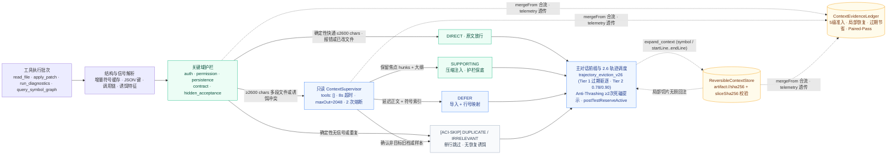
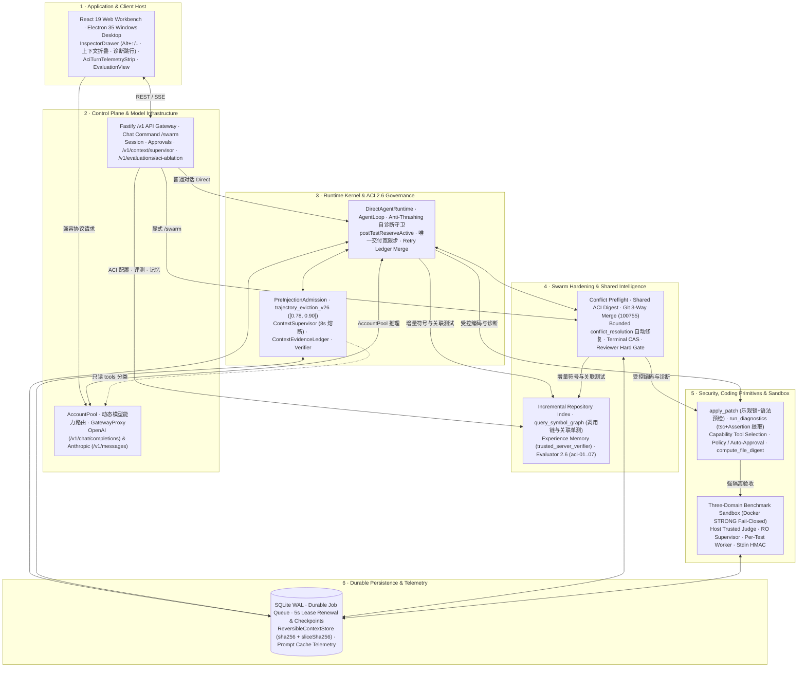
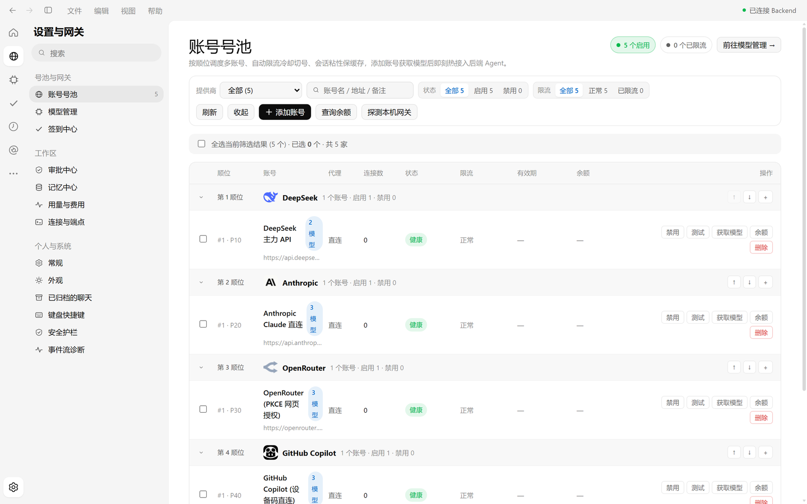
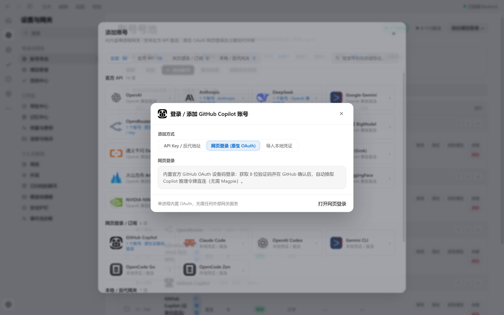

<div align="center">


# Agent_US

**Local-First Autonomous Engineering Platform · Adaptive Context Intelligence · Fail-Closed Docker Sandbox**

面向复杂软件工程任务的本地优先自主智能体框架

[](https://github.com/Eternite-0/Agent_US/releases/latest)
[](https://github.com/Eternite-0/Agent_US/actions/workflows/ci.yml)
[](https://nodejs.org/)
[](https://www.electronjs.org/)
[](https://react.dev/)
[](backend/sandbox/Dockerfile.benchmark)

[核心创新](#核心创新与能力体系) · [ACI 治理流程](#adaptive-context-intelligence-流程) · [系统架构](#系统架构) · [实证 Benchmark](#实证-benchmark-结果) · [界面预览](#界面预览) · [Swarm 与网关](#swarm-命令与外部网关) · [本地开发](#本地开发与验证) · [文档与报告](#文档与实证报告索引)

</div>

---

## 关键实证指标总览

| 维度 | 核心能力与阶段 | 实测基线 vs 演进结果 | 验证环境 |
| --- | --- | --- | --- |
| **ACI 2.6 · 轨迹驱逐与原生体验** | **Agent_US 2.6**（`trajectory_eviction_v26` · 过期输出置换 · 局部哈希恢复 · 防死磕 · `query_symbol_graph` · Swarm 自动解冲突 · Codex 原生交互） | Arm D 通关率 **`57.1%`（`8/14`**, CI `[32.6%, 78.6%]`）领先 Arm A/C（`50.0%`, `7/14`），唯一攻克 `aci-06`<br/>成功归一化成本 **`304,125`** tok/pass（较 Arm C `370,548` 降 **`17.9%`**）· 同题配对节省 **`+11.3%`（`n=5`）** vs Arm C `+2.5%`<br/>Arm A `Sup Tok = 0` · Arm D **`21` Epochs / `45` 次过期驱逐（省 `20,972` tok，总 DTOC 省 `39,189` tok）** · **`15/15` (`100%`)** 哈希恢复（`13` 次局部）<br/>全仓 **`558/558`** 后端单测（`106` 文件）· **`69/69`** 前端单测 · `visual.spec.mjs` **`26/26`** 零失败 | `deepseek-v4.1-flash`<br/>Docker `strong`（`42` 试次 `aci26`） |
| **ACI 2.5 · 工程闭环** | **Agent_US 2.5**（`phase_watermark_v25` · 完工宽限 · `8s` 熔断 · `apply_patch` · Swarm 三方合并） | Arm C / D 通关率 **`25.0% → 58.3%`（`+33.3 pp`** · CI `[31.9%, 80.7%]`）<br/>成功归一化成本 **`670,619 → 288,998–298,849` tok/pass（`−55.4% ~ −56.9%`）**<br/>同题双通配对节省 **`+5.22%`** · Arm D KV Hit **`81.57%`** · **`0/10`** 诱饵恢复 · 全仓 **`533/533`** 单测 | `deepseek-v4.1-flash`<br/>Docker `strong`（`36` 试次 `aci25`） |
| **注入前上下文治理** | **Agent_US 2.4 Stage 4**（Pre-Injection Admission · Supervisor · SHA-256 恢复） | Arm C 通关率 **`33.3% → 75.0%`（`+41.7 pp`）**<br/>关键上下文召回 **`100%`** · FNR **`0`** · 注入前减负 **`54.8%–64.8%`**<br/>Arm D KV Hit **`84.78%`** · 短任务 KV 差 **`-0.64 pp`** · **`0/6`** 诱饵恢复 | `deepseek-v4.1-flash`<br/>Docker `strong`（`48 + 6` 试次） |
| **能力感知工具选择** | **Agent_US 2.3.7**（Tool Intelligence · 动态目录与提示对齐） | Bash 拒绝次数 **`96 → 27`（`−71.9%`**, `p = 0.000122`）<br/>工具选型匹配 **`86.2% → 95.4%`** · 总 Token **`−23.6%`** | 真实 Provider<br/>`14` 题 × `5` 轮（`140` 轮） |
| **三域强隔离沙箱** | **Agent_US 2.3.1**（Trusted Judge · RO Supervisor · Worker + Stdin HMAC） | 阻断 **`7/7`** 隐藏验收绕过向量（`exit(0)` / `SIGTERM` / 伪造信封等）<br/>`STRONG` / `DOCKER` 无 Docker 时严格 **Fail-Closed** | Windows 11 + Docker Desktop<br/>`agent-us/benchmark:node24` |
| **自主推理与经验闭环** | **Agent_US 2.3–2.4 S3**（契约感知 · 根因台账 · 只读校验 · 可信经验） | `compute_file_digest` 使 `ar-09` **`0/3 → 2/3`**（`65.1s` Pass）<br/>可信经验闭环（`ar-03,05,09`）Pass **`+33.3 pp`** · 耗时 **`−45.9%`**<br/>OSS 外部基准 **`4/4`** · `tj/commander.js` **`1393/0/2`** | `deepseek-v4.1-flash`<br/>Docker `strong` 实测 |

---

## 项目定位：Why Agent_US

Agent_US 将 **Durable Agent Kernel**、**Pre-Injection ACI Governance**、**Contract-Aware Reasoning**、**Shared Repository Intelligence**、**Explicit `/swarm` Orchestration** 与 **Three-Domain OS Sandbox** 融合为端到端可审计的自主软件工程运行时，同时通过内置 `AccountPool` 与 `GatewayProxy` 向外部 OpenAI / Anthropic 兼容客户端暴露统一基础设施。

| 维度 | 普通 AI 编程助手 | Agent_US |
| --- | --- | --- |
| **上下文供给** | 盲目全量读取文件、诱饵/旧档污染前缀 | 五级注入前准入（`DIRECT`/`SUPPORTING`/`DEFER`/`DUPLICATE`/`IRRELEVANT`）、五大关键域硬护栏、`[ACI-SKIP]` 噪点拦截与 SHA-256 `expand_context` 无损按需恢复 |
| **推理与修改** | 凭直觉改代码、手算哈希/盲猜需求 | `extractTaskContract` 提取硬约束与排序规则、前置失败复现、根因消退验证与零 Shell 安全校验原语 `compute_file_digest` |
| **多智能体协同** | 固定角色模板、手动复制上下文 | 显式 `/swarm` 驱动动态编排、共享渐进式代码索引、独立 Git Worktree 并行执行与只读 Independent Reviewer |
| **安全性与验收** | 同进程跑测试、易被 `process.exit(0)` 欺骗 | Trusted Judge + 只读容器 Supervisor + 每用例独立 Worker、Stdin HMAC 验签、Docker `network=none` + Hard Veto |
| **容错与持续学习** | 进程崩溃丢状态、经验混入未验证噪声 | SQLite WAL + Checkpoint 崩溃恢复、`ContextEvidenceLedger` 全链审计、`trusted_server_verifier` 可信经验冷暖闭环 |

---

## 核心创新与能力体系

### 1. ACI 2.5–2.6 上下文准入、轨迹驱逐与局部恢复（2.4 S4 – 2.6）

> 从 2.4 Stage 4“注入前精筛 + 无损恢复”、2.5“双门控水位 + `8s` 熔断 + 完工保留金”演进为 **2.6 的轨迹预测双层驱逐（`trajectory_eviction_v26`）、按 Symbol/行号局部哈希恢复与防死磕自诊断闭环**，在保持 KV 前缀稳定下解决 `<28k` 场景 DTOC 零触发难题并持续压降冗余上下文。

- **五级注入前准入（`PreInjectionAdmissionController`）**：[`aci-admission.js`](backend/src/context/aci-admission.js) 在工具批写入历史前结合 JS/TS 符号、`.json` 顶层键（`json_key@L...`）、调用链与诱饵特征输出 **`DIRECT`**、**`SUPPORTING`**、**`DEFER`**、**`DUPLICATE`** 与 **`IRRELEVANT`**；五大关键域（`auth`、`permission`、`persistence`、`contract`、`hidden_acceptance`）与目标/报错文件受硬护栏锁定**绝不降级至 `SUPPORTING` 以下**（FNR `= 0`）；`grep:`/`glob:` 要求全部非空采样行命中诱饵才压制。
- **预算轨迹预测与过期输出主动置换（`trajectory_eviction_v26`）**：[`aci-engine.js`](backend/src/context/aci-engine.js)、[`agent-loop.js`](backend/src/kernel/agent-loop.js) 与 [`direct-agent.js`](backend/src/direct-agent.js) 将 `full_aci` 升级为 **`trajectory_eviction_v26`**（完整兼容 `aci_25 -> phase_watermark_v25` 与 2.4 `adaptive_single_step`）：**Tier 1**（`supersededTriggered`，`step >= 4`、净省 `>= 450` tok）在低于 `28k` 时即可确定性置换被后续修改/重读覆盖的旧读取、多行 `SUPPORTING` 片段以及已被后续验证解决的旧失败日志；**Tier 2**（`trajectoryTriggered`，`[0.78, 0.90]` 预测轨迹水位）在存在真实改动或 `>= 72%` 累计用量时触发，同时严格保护头部 KV Cache 前缀（`<3` 消息）、契约文档（`SPEC.md`/`CONTRACT.json`/`CONSTRAINTS.md`/`AGENTS.md`）、近 2 步活跃读写及最新未解决报错 `latestUnresolvedErrorIndex`。
- **只读 `ContextSupervisor`（`tools: []`）与 `8s` 连续超时熔断**：[`supervisor.js`](backend/src/context/supervisor.js) 将单次超时收敛至 **`8000` ms**（`maxOutputTokens = 2048` 避免长 JSON 截断，连续 `>= 2` 次超时开启 `60s` 熔断短路至确定性回退），并对纯确定性 `onlySuperseded` Tier 1 驱逐免于额外 Supervisor LLM 调用；可在 [AdaptiveContextPanel](frontend/src/components/AdaptiveContextPanel.tsx) 与会话流 `aciTelemetry` 实时观测五级准入分布、水位与熔断状态。
- **局部 SHA-256 校验恢复、防死磕守卫与完工保留金**：[`aci-store.js`](backend/src/context/aci-store.js) 与 [`meta-tools.js`](backend/src/tools/builtin/meta-tools.js) 扩展 `expand_context` 支持 `symbol` / `symbols` / `startLine..endLine` 按块精准恢复（`extractBoundedSymbolSpans`），同步校验父 `sha256` 与切片 `sliceSha256` 并统计 `partialRecoveries` / `recoveryTokensSaved`；[`execution-reasoning.js`](backend/src/kernel/execution-reasoning.js) 对同一文件连续失败修改 `>= 2` 次触发 **Anti-Thrashing** 尾部根因与调用链引导；[`budget-estimator.js`](backend/src/planning/budget-estimator.js) 为过测交付预留 **`postTestReserveActive`** 与唯一纯文本宽限步（`tools: []`），[`lease-guard.js`](backend/src/durable/lease-guard.js) 每 `5000ms` 续租。

### 2. 核心编码原语、符号图谱与增量诊断（2.5–2.6）

- **双格式乐观锁精确补丁（`apply_patch`）**：[`patch-and-diagnostics.js`](backend/src/patch-and-diagnostics.js) 与 [`fs-tools.js`](backend/src/tools/builtin/fs-tools.js) 扩展 `apply_patch` 透明解析 Codex 补丁与标准 unified diff（`--- a/` / `+++ b/` / `@@`），写盘前执行 SHA-256 **原子乐观并发锁**与 `.js/.mjs/.cjs/.json` **原子语法预校验**，并将结构化 `hunks`、`+add`/`-del` 与 `sha256After` 透传至前端 [FileChangeCard](frontend/src/components/FileChangeCard.tsx) 与 [InspectorDrawer](frontend/src/components/InspectorDrawer.tsx)（支持 **`Alt+↑/↓`** hunk 快捷键跳转与 **`>6` 行无变更上下文按需折叠展开**）。
- **增量 TypeScript 类型检查与结构化测试诊断（`run_diagnostics`）**：`run_diagnostics`（`syntax`/`typecheck`/`test`/`lint`/`auto`）自动定位最近 `tsconfig.json` 执行 `tsc --noEmit --pretty false` 提取 `source: 'tsc'` 报错，精准解析 `node --test` `AssertionError` 的 `expected` vs `actual` / `operator` / `file:line:column` 并压平千行噪声；前端 [DirectActivity](frontend/src/components/DirectActivity.tsx) 支持点击诊断条直达 `InspectorDrawer` 目标行高亮。
- **增量符号缓存与直调符号图谱（`query_symbol_graph`）**：[`repo-intelligence.js`](backend/src/repo-intelligence.js) 与 [`repo-symbols.js`](backend/src/repo-symbols.js) 基于 `(size, mtimeMs, sha256)` 缓存未变文件符号解析；[`workspace-tools.js`](backend/src/workspace-tools.js) 新增只读工具 **`query_symbol_graph`**，单次调用即可联合返回符号定义、`findCrossFileReferences` 跨文件调用/导入方与 `findRelatedTests` 关联单测，并在 [`tools/selection.js`](backend/src/tools/selection.js) 联动优先推荐。

### 3. 自主推理、根因台账与可信经验记忆（2.4 Stage 1–3）

- **契约感知推理（`Contract-Aware Reasoning`）**：[`contract-reasoning.js`](backend/src/kernel/contract-reasoning.js) 抽取 `SPEC.md` / `CONTRACT.json` / `CONSTRAINTS.md` 中的交付清单、禁用修改列表、`C1..Rn` 约束与优先级规则（过滤反引号语法示例避免误报），保持系统提示词逐字节静态以维护 KV Prompt Cache。
- **根因验证与免 Shell 校验**：[`execution-reasoning.js`](backend/src/kernel/execution-reasoning.js) 核对修复前报错指纹消退、Anti-Thrashing 连续失败拦截与 `doc` 免重验；[`meta-tools.js`](backend/src/tools/builtin/meta-tools.js) 提供零 Shell 的 `compute_file_digest` 与局部 `expand_context`；[`ExperienceMemoryService`](backend/src/memory/service.js) 仅吸纳经 `trusted_server_verifier` 验证的经验。

### 4. Swarm 协同硬化、自动冲突消解与三域强隔离沙箱（2.3.1 – 2.6）

- **Swarm 协同硬化与自动冲突修复闭环（2.5–2.6）**：[`planner.js`](backend/src/swarm/planner.js) 实施同级写路径冲突预检；[`mailbox.js`](backend/src/swarm/mailbox.js) 跨 Worker 传递 `<=1600` 字符 `[Shared Swarm ACI Digest]`；[`artifacts.js`](backend/src/swarm/artifacts.js) 通过 `mergeFileThreeWay`（`git merge-file` 三方合并，保留 `100755` 权限）识别同行冲突并提取结构化 `conflictBlocks`，由 [`orchestrator.js`](backend/src/swarm/orchestrator.js) 自动派发至多 1 次受控 `conflict_resolution` 修复步（仅携带冲突 hunk 与双方节点目标）并经 [`reviewer.js`](backend/src/swarm/reviewer.js) `evaluateConflictResolutionGate` / `evaluateReviewerHardGate`（零冲突标记 + 真实 `git diff` + 测试 `exitCode === 0`）验真放行；[`node-state-machine.js`](backend/src/swarm/node-state-machine.js) 与 [`run-deadline.js`](backend/src/swarm/run-deadline.js) 落实 SQLite 终态 CAS 与超时优雅降级（[AutonomousRunPanel](frontend/src/components/AutonomousRunPanel.tsx) 展示 `reviewerVerification` 硬门禁状态）。
- **OS 级强隔离与三域隐藏验收（2.3.1）**：[`benchmark-sandbox.js`](backend/src/tools/benchmark-sandbox.js) 与 [`Dockerfile.benchmark`](backend/sandbox/Dockerfile.benchmark) 提供 `--network=none`、非 root `65534:65534`、`--ipc=none` 的 Docker `STRONG` Fail-Closed 隔离（无 Docker 时显式走受限 `NODE_PERMISSION`）；[`hidden-acceptance.js`](backend/src/evaluation/hidden-acceptance.js) 与 [`hidden-acceptance-supervisor.mjs`](backend/src/tools/hidden-acceptance-supervisor.mjs) 配合 Stdin 单次 `hmacKey` 与 [`judge.js`](backend/src/evaluation/judge.js) Hard Veto 彻底阻断 `7/7` 绕过向量。

### 5. 能力感知工具治理、评估器 2.6 与 Codex 原生工作台（2.3.7 – 2.6）

- **工具治理与权限模式**：[`tools/selection.js`](backend/src/tools/selection.js)、[`tools/policy.js`](backend/src/tools/policy.js)、[`tools/auto-approval.js`](backend/src/tools/auto-approval.js) 与 [`dispatcher.js`](backend/src/tools/dispatcher.js) 约束工具目录对齐与 Composer 分级审批；[`prompt-cache.js`](backend/src/observability/prompt-cache.js) 监测缓存稳定性。
- **论文评估器 2.6 与原生消融界面**：[`aci-governance-benchmark.js`](backend/src/evaluation/aci-governance-benchmark.js) 与 [`benchmark-aci-governance.mjs`](backend/scripts/benchmark-aci-governance.mjs) 修复 `isAciSupervisorWireRequest` 使 Arm A/B `Sup Tok` 严格归零，将 `aci-06` 校准为 `240k` 并新增 21 文件高压力跨模块演进题 `aci-07-cross-module-evolution`（`--suite aci26`），支持 `--resume`、请求隔离 `--concurrency 1..16` 与 `--archive-dir` 自动归档；[`intelligence-routes.js`](backend/src/routes/intelligence-routes.js) 提供只读 `GET /v1/evaluations/aci-ablation`，前端 [EvaluationView](frontend/src/components/EvaluationView.tsx) 原生展示 A/C/D 通过率置信区间、同题配对省 Token 率与一键复制 LaTeX 论文表（严守 [`NATIVE-VISUAL.md`](frontend/NATIVE-VISUAL.md) 扁平无阴影与 `reduced-motion` 规范）。
- **多账号网关**：[`AccountPool`](backend/src/pool.js) 与 [`GatewayProxy`](backend/src/gateway-proxy.js) 维护多账号路由与 OAuth 原生登录，提供 OpenAI (`/v1/chat/completions`) 与 Anthropic (`/v1/messages`) 兼容端点。

---

## Adaptive Context Intelligence 流程

> 注入前拦截噪声与诱饵、保护关键域不漏召，在 2.6 通过 `trajectory_eviction_v26` 确定性驱逐过期读取与已解决报错、按 symbol/行号进行 `sliceSha256` 局部无损恢复，并用 Anti-Thrashing 与完工宽限步保护长短任务 KV Cache 与最终交付。



---

## 系统架构

> 清晰分层的六层 Local-First 架构：以 `/v1/*` 为唯一主控制面，`Direct` 会话与显式 `/swarm` 共享同一内核、工具安全边界与持久化底座（legacy `/api/v1/*` 仅作历史兼容挂载）。



---

## 实证 Benchmark 结果

> 所有真实模型测试均完整保留失败与超时样本（**零剔除、零樱桃采摘**），并在每次修改后于独立隔离沙箱与真实 Provider 上实测产出。

### 1. Agent_US 2.6 — `trajectory_eviction_v26` 与跨模块演进三臂实证（`aci26` 七题 · `42` 试次）

- **测试条件**：冻结集成分支 `feat/2.6`（`f60b7065` 前同代码快照），`deepseek-v4.1-flash`（本地 AccountPool/Gateway），Docker **`strong`**（`agent-us/benchmark:node24`），`--suite aci26`（`aci-01`..`06` 含 `aci-06=240k` + 新增 21 文件高压力跨模块演进 `aci-07=220k`）× **Arm A / C / D × 2 轮重复 = 42 试次**（`--concurrency 12` + `--resume`）。完整逐试次数据、根因校准与 LaTeX/Markdown 导表见 [2.6 — ACI 2.6、工程诊断与 UI 实证报告](backend/docs/2.6-aci-agent-ui-report.md) 及 [论文归档表格](backend/docs/evidence/aci-26-ablation-paper-tables.md)（[LaTeX 源码](backend/docs/evidence/aci-26-ablation-paper-tables.tex)）。

| 指标 | Arm A (`raw_full`) | Arm C (`retrieval_supervisor`, `phase_watermark_v25`) | Arm D (`full_aci`, `trajectory_eviction_v26`) | 核心发现 |
| --- | ---: | ---: | ---: | --- |
| **Pass Rate (`passed / 14`)** | `50.0%` (`7/14`) | `50.0%` (`7/14`) | **`57.1%` (`8/14`)** | **Arm D 领先 Arm A/C `+7.1 pp`**，且唯一攻克 **`aci-06`（`1/2`）** |
| **Pass Rate Wilson 95% CI** | `[26.8%, 73.2%]` | `[26.8%, 73.2%]` | **`[32.6%, 78.6%]`** | — |
| **Critical Recall / Precision** | `100.0%` / `85.1%` | `100.0%` / `97.4%` | **`100.0%` / `97.6%`** | **关键上下文零漏召**，精确率全场最高 |
| **Useful Token Ratio** | `61.8%` | `92.7%` | **`97.3%`** | 较基线 A 抬升 **`+35.5 pp`** |
| **Tokens per Completed Pass** | `327,339` | `370,548` | **`304,125`** | **全场最低成功交付成本（较 C 降 `−17.9%`）** |
| **Mean Tokens (Passed Trials)** | `161,944` | `184,804` | **`154,568`** | 成功样本平均总消耗最优 |
| **Paired-Pass Token Reduction** | `0.0%` (`n=7`) | `+2.5%` (`n=3`) | **`+11.3%` (`n=5`, 最优)** | 同题同轮双通配对净省 **`+11.3%`**（C 为 `+2.5%`） |
| **Supervisor Tokens (`Sup Tok`)** | **`0`** | `87,415` | `86,943` | 修复 `isAciSupervisorWireRequest` 后 **Arm A 严格归零** |
| **DTOC Epochs / Superseded Evictions** | `0` / `0` | `0` / `0` | **`21` Epochs / `45` 次（省 `20,972` tok）** | 打破 2.5 `ep=0`，**总 DTOC 节省 `39,189` tok** |
| **Partial Recoveries / Assisted Pass** | `0` / `0.0%` | `13`（省 `8,782` tok）/ `28.6%` | **`13`（省 `2,232` tok）/ `62.5%`** | `15/15` (`100.0%`) 哈希验签恢复，恢复辅助通关率 **`62.5%`** |

### 2. Agent_US 2.5 — ACI 2.5 三臂平行对照实证（`aci25` 六题 · `36` 试次）

- **测试条件**：冻结代码提交 `9459b5b`，`deepseek-v4.1-flash`（`http://127.0.0.1:3065/v1`），Docker **`strong`**（`agent-us/benchmark:node24`），`--suite aci25`（原 4 题 + 新增多模块补丁 `aci-05` 与 Swarm 契约 `aci-06`）× **Arm A / C / D × 2 轮重复 = 36 试次**（`--concurrency 12` + `--resume`）。完整逐细胞矩阵、LaTeX/Markdown 导出表及机制轨迹见 [2.5 — ACI 2.5 与工程能力实证报告](backend/docs/2.5-aci-and-engineering-report.md)。

| 指标 | Arm A (`raw_full`) | Arm C (`retrieval_supervisor`) | Arm D (`full_aci`, `phase_watermark_v25`) | 核心发现 |
| --- | ---: | ---: | ---: | --- |
| **`finalTaskSuccessRate` (`passed / 12`)** | `25.0%` (`3/12`) | **`58.3%` (`7/12`, `+33.3pp`)** | **`58.3%` (`7/12`, `+33.3pp`)** | **Arm D 追平 Arm C 并压倒基线 A**（攻克 `aci-04` 与 `aci-05`） |
| **Pass Rate Wilson 95% CI** | `[0.0889, 0.5323]` | **`[0.3195, 0.8067]`** | **`[0.3195, 0.8067]`** | — |
| **Critical Recall / FNR** | `1.0000` / `0` | `1.0000` / `0` | **`1.0000` / `0`** | 全 36 试次关键上下文零漏召、零误杀 |
| **Context Precision / UsefulTok** | `0.8318` / `0.5951` | **`0.9785`** / `0.9139` | `0.9487` / **`0.9267`** | Arm D **有效 Token 比重全场最高 (`92.67%`)** |
| **Pre-Injection `admissionTokenReduction`** | `0` | `57.44%` | **`59.03%`** | 注入主上下文前稳定省下约 6 成冗余载体 |
| **Success-Normalized `tokensPerCompletedPass`** | `670,619` | **`288,998` (`−56.9%` vs A)** | **`298,849` (`−55.4%` vs A)** | 每次成功交付的平均 Token 成本砍半以上 |
| **同题双通配对节省率 (`pairedPassTokenReduction`)** | `0` (`n=3`) | `+3.32%` (`n=2`) | **`+5.22%` (`n=2`, 最优)** | 同题同轮双方均通过时 Arm D **净省 +5.22%** |
| **`cacheHitRate`** (`cacheRead / in`) | `64.84%` (`11/12`) | `74.26%` (`12/12`) | **`81.57%` (`12/12`, `+16.73pp`)** | `phase_watermark_v25` 零震荡，`ep = 0` |
| **Hash 校验恢复 (`assistedPass` / 诱饵误恢复)** | `0` | `14/14` (`1.0`, `55.6%`) | **`10/10` (`1.0`, `42.9%`, `0/10` 诱饵)** | **Arm D `10/10` 全数命中真文件** |

- **关键 2.5 机制真实轨迹实证**：`aci-01 D rep=0` 触发 `postTestReserveActive` + Stage-1 裁剪 + **唯一 1 次 `tools: []` 宽限步**，在 `usedTokens = 162,490 > 160,000` 时免于 `TOKEN_BUDGET` 并成功 `PASS`；`aci-03 C rep=1` 两次在 `8s`（`8,001 / 8,112 ms`）精确超时后熔断器开启（`supervisorCircuitOpen: true`），后续准入 **`durationMs = 0` 瞬时旁路** 并借助 `expand_context` + `apply_patch` 顺利通关；`aci-05 D rep=1` 由 Supervisor 拦截 3 份旧档后经 `run_diagnostics(kind: "syntax")` 检查并一次 `PASS`。

### 3. Agent_US 2.4 Stage 4 — ACI 注入前治理四臂消融对比（冻结实测 · `48 + 6` 试次）

- **测试条件**：冻结代码提交 `2bce1db6`，`deepseek-v4.1-flash`（主模型与 Supervisor 一致，本地代理 `127.0.0.1:3065/v1`），Docker **`strong`**（`agent-us/benchmark:node24`），4 项高噪声复杂多文件工程任务（每项含 17–18 个文件、7–8 个高干扰诱饵、Docker 隐藏验收与防篡改 Veto）× **4 臂 × 3 轮重复 = 48 试次**。详表与逐试次原始轨日志见 [2.4 Stage 4 实证评估报告](backend/docs/2.4-stage4-aci-governance-report.md)。

| 评估指标 | Arm A (`raw_full`) | Arm B (`deterministic_progressive`) | Arm C (`retrieval_supervisor`) | Arm D (`full_aci`) | 核心发现 |
| --- | ---: | ---: | ---: | ---: | --- |
| **Final Task Success Rate** (`pass / 12`) | `33.3%` (`4/12`) | `58.3%` (`7/12`, `+25.0pp`) | **`75.0%` (`9/12`, `+41.7pp`)** | `50.0%` (`6/12`, `+16.7pp`) | B / C / D 全部显著优于原文基线 A；**C 较 A 相对提升 +125%** |
| **Critical Context Recall** | `1.0000` | `1.0000` | `1.0000` | **`1.0000`** | 全 48 试次关键上下文**零漏召** |
| **Context Precision** (`filePrecision`) | `0.8301` | **`0.9765`** | `0.9319` | `0.9534` | 较基线 A 提升 **`+10.2 pp` ~ `+14.6 pp`** |
| **False Negative Rate** (`误标 IRREL`) | `0` (`0`) | `0` (`0`) | `0` (`0`) | **`0` (`0`)`** | 关键域保护护栏实现**零误杀** |
| **Useful Token Ratio** (`tokenPrecision`) | `0.5385` | **`0.9211`** | `0.7600` | `0.8987` | 将有效载体 Token 占比从 `53.9%` 抬升至 **`76.0%–92.1%`** |
| **Admission Token Reduction** (注入前) | `0` | `54.78%` (`52,963` tok) | **`64.83%` (`82,310` tok)** | `64.23%` (`77,360` tok) | 注入主上下文前直接省下 **`54.8%–64.8%`** 工具冗余载体 |
| **Cache Hit Rate** (`cacheRead / in`) | `67.84%` | `51.57%` | `79.00%` (`12/12` SSE) | **`84.78%` (`12/12` SSE)** | **Arm D 取得全场最高 KV Cache 命中率**（较 A **`+16.9 pp`**） |
| **Supervisor Cost** (`调用 / tok / 占比`) | `0` | `0` | `33` 次 / `107,398` (`5.24%`) | `35` 次 / `51,021` (`2.62%`) | 全程 `tools: []`，Ledger 与 Summary 账本 100% 吻合 |
| **Recovery Success / Assisted Pass** | `0` | `5/5` (`1.0` · `60.0%`) | `11/11` (`1.0` · `50.0%`) | **`6/6` (`1.0` · `66.7%`, `0/6` 诱饵)** | `22/22` 恢复 **100% SHA-256 校验通过**；Arm D 彻底消除诱饵恢复 |
| **端到端 `aci-04` 长程审计通关** | `0/3` (`TOKEN_BUDGET`) | `0/3` (`2` 超预算) | **`2/3` PASS** | `0/3`（**`3/3` 完整跑完未撞预算**） | 仅 Arm C 两次贯通最难 5 文件审计与 digest 导出任务 |

- **短任务 KV Cache 无损回归（Run 4B-2，`ar-06/08/09` × `A, D` = 6 试次，`dtocMinPromptTokens=24000`）**：Arm A `2/3`（KV 命中率 **`89.53%`**）vs Arm D `2/3`（全程 **`epochTransitions = 0`**，KV 命中率 **`88.89%`**，仅差 `-0.64 pp`），验证短任务零撕裂。
- **Supervisor 与无损恢复真实链路实证**：在 `aci-04 C rep=2` 中，只读 Supervisor 将 3,860 字符的核心鉴权策略 `policy-engine.js` 压缩为聚焦关键导出符号的 `SUPPORTING` 视图（`1,002 → 614 tok`），精准把 `COMPLIANCE-APPENDIX.md` 等 4 份高混淆诱饵压至 `[ACI-SKIP]`（单轮净省 `7,149 tok`），随后主 Agent 通过 `expand_context` 经 SHA-256 验签精准恢复 `policy-engine.js` 片段（`195 tok`, `verified=true`）一次通关；在 `aci-03 D rep=0/1` 与 `aci-01 D rep=0/1` 中，主模型亦精准从 `SUPPORTING` 视图无损恢复 `CONTRACT.json` 与 `runtime-options.js` 并全部 `PASS`。

### 4. 多阶段里程碑验收快照 (2.3 – 2.4 S3)

| 版本 / 阶段 | 评测对象与规模 | 核心实测结果 | 详细报告 |
| --- | --- | --- | --- |
| **2.4 Stage 3** | 10 题自主开发基准（3 轮 A/B × `10` 题）+ `ar-03,05,09` 经验探针（`deepseek-v4.1-flash`） | 确定性双模（Docker `strong` `31/31` + 模拟无 Docker `31/31`）；Verified Experience 探针通关率 **`+33.3 pp`**（`0.3333 → 0.6667`）、`ar-03` 耗时 **`−45.9%`**；`compute_file_digest` 使 `ar-09` 由 `0/3` 升至 `2/3` | [Stage 3 实证报告](backend/docs/2.4-stage3-autonomous-intelligence-report.md) |
| **2.3.7 Tool Intelligence** | 14 项工程任务 × 5 轮配对实验（140 轮，1,316 次调用，真实 Provider） | Bash 被拒 **`96 → 27`（`−71.9%`**, 精确符号翻转 `p = 0.000122`），工具用途匹配 `605/702 (86.2%) → 586/614 (95.4%)`，首调合规 **`17/70 → 57/70`**，总实测 Token `2,225,106 → 1,700,360`（**`−23.6%`**），严格通过保持 `68/70` | [2.3.7 实测报告](backend/docs/2.3.7-capability-aware-tool-selection-report.md) |
| **2.3.1 Sandbox Security** | Windows 11 + Docker Desktop 4.81.0 + 双平台 CI | 隐藏验收 **`7/7` 绕过向量拦截通过**，Hard Veto + Stdin HMAC + `STRONG` Fail-Closed 验证全部通过（`agent-us/benchmark:node24`） | [2.3.1 安全验收报告](backend/docs/2.3.1-windows-docker-security-acceptance.md) |
| **2.3 Benchmark & E2E** | 4 个 MIT 开源仓库 (`nanoid`, `trough`, `fast-content-type-parse`, `nanoevents`) + `tj/commander.js` | OSS Run 4 **`4/4 PASS`**（并发 1 / 480s）；`tj/commander.js` 动态生成 5 规划节点与 2 并行分支，经历真实 `SIGKILL` 恢复后独立重跑 **`1393 PASS / 0 FAIL / 2 SKIP`** | [2.3 验收报告](backend/docs/2.3-general-autonomous-agent-report.md) |

<details>
<summary><b>📌 评测局限与诚实边界说明（点击展开）</b></summary>

1. **端到端均值 `tokenReduction` 与成功归一化指标对比**：Stage 4 与 2.5 中，原始基线 Arm A 分别有 `8/12` 与 `9/12` 试次过早因 `TOKEN_BUDGET` 或长尾超时截断从而压低了简单算术均分母；为此 2.5 引入 **`tokensPerCompletedPass`** 与 **`pairedPassTokenReduction`**。在 2.6 `aci26` 42 试次下，Arm D 取得 **`+11.3%`** 配对节省与 **`304,125`** tok/pass（双项优于 Arm C 的 `+2.5%` / `370,548`）。
2. **`ep=0`、`aci-06` 与 `wireSup` 痛点在 2.6 的消解与剩余长程边界**：2.5 遗留的三项关键痛点均在 2.6 实证闭环解决——Arm D `epochTransitions` 从 `0 → 21`（`45` 次过期驱逐省 `20,972` tok，总 DTOC 省 `39,189` tok），Arm D 首次唯一攻克 `aci-06`（`0/2 → 1/2`），Arm A `wireSup` 经 `isAciSupervisorWireRequest` 精确归零（`27,507 → 0`）。与此同时，高压长程任务 `aci-04`（D `0/2` vs C `1/2`）与新增 21 文件 `aci-07`（D `0/2` vs A/C `1/2`，Arm D 两轮均已触发 2 次过期驱逐但仍在 220k 限额下超时/超预算）及部分样本 `cacheHitRate` 波动仍是有待继续优化的前沿空间。
3. **上游缓存波动与 `Supervisor` 超时回退**：真实网关观测到 Stage 4（`8/48`）、2.5（`5/36`）与 2.6 个别请求存在上游 `cacheReadTokens ≈ 0` 波动，Arm D 平均耗时与长程 `220k` 限额受模型多轮推理波动影响；所有 Supervisor `8s` 超时均触发熔断并安全回退至确定性策略。
4. **2.3 外部开源 Benchmark 样本说明**：早期 2.3 OSS 四仓库（`nanoid` 等）样本规模较小，Capability Profile 仍按 `provisional_low_sample` 标注；缺少目标仓库外置依赖时，`tsc`/`tsd` 等需在具备依赖的隔离环境中补验。

</details>

---

## 界面预览

<div align="center">
  
  <br />
  <sub><b>主工作台</b>（会话流、AdaptiveContextPanel、权限模式控制、工作区审阅、审批与交付状态）</sub>
</div>

<br />

<table>
  <tr>
    <td width="50%" align="center">
      
      <br /><sub><b>多账号号池</b>（账号目录、模型能力标签与健康度路由）</sub>
    </td>
    <td width="50%" align="center">
      
      <br /><sub><b>供应商接入</b>（多协议接入、网关配置与凭据管理）</sub>
    </td>
  </tr>
  <tr>
    <td width="50%" align="center">
      
      <br /><sub><b>原生网页登录与 OAuth</b>（内置安全登录流与状态同步）</sub>
    </td>
    <td width="50%" align="center">
      
      <br /><sub><b>模型管理与统一网关</b>（OpenAI / Anthropic 兼容协议与模型映射）</sub>
    </td>
  </tr>
</table>

---

## Swarm 命令与外部网关

### 在聊天框使用 `/swarm`

在 **Web 或桌面端聊天输入框**发送（非终端命令）；普通消息默认进入 Direct 多轮自主流，显式发送 `/swarm` 才创建独立 Swarm Run：

| 命令 | 行为 |
| --- | --- |
| `/swarm <多行任务描述>` | 在当前会话工作区与权限边界下提交 Swarm Run：后台执行仓库渐进分析、规划与校验后动态组队调度子 Agent |
| `/swarm status` | 查询当前会话正在运行或最近一次完成的 Swarm Run 状态与子任务进展 |
| `/swarm stop` | 安全停止当前会话未结束的 Swarm Run（不会取消普通 Direct turn） |
| `/swarm` | 显示内置 `/swarm` 命令用法说明 |

### 本地 REST / SSE 与模型兼容端点

后端默认监听 `http://127.0.0.1:8787`，鉴权使用 `BACKEND_TOKEN`（`Authorization: Bearer ...` 或 `x-api-key`）：

| 接口面 | 代表路由 | 用途 |
| --- | --- | --- |
| **模型兼容网关** | `POST /v1/chat/completions` · `GET /v1/models` · `POST /v1/messages` | OpenAI 与 Anthropic 兼容端点（经 `GatewayProxy` 与 `AccountPool` 转发） |
| **ACI 与自主运行时** | `/v1/sessions/*` · `/v1/stream` · `/v1/context/supervisor` · `/v1/approvals` | Direct 会话、SSE 事件流（含 `aciTelemetry`/`budgetWatermarks`）、ContextSupervisor 与 ACI 开关、工具审批 |
| **Swarm 与自治 API** | `/v1/swarm/*` · `/v1/autonomous/*` · `/v1/evaluations/aci-ablation` · `/v1/accounts` · `/v1/auth/*` | 自主任务与冲突自动修复、多智能体状态、归档消融查询、多账号健康路由 *(旧 `/api/v1/*` 仅保留兼容)* |

---

## 本地开发与验证

### 环境要求

- **OS**：Windows 11 / macOS / Linux
- **Runtime**：Node.js `>= 24.9.0`（ESM）· npm · Git
- **可选（强隔离实测）**：Docker Desktop / Docker Engine（用于 `agent-us/benchmark:node24` `STRONG` 沙箱评测）

### 快速启动

```powershell
# 1. 启动后端 (默认 http://127.0.0.1:8787，数据目录可用 BACKEND_DATA 覆盖)
Set-Location backend
npm ci
$env:BACKEND_TOKEN = node -e "console.log(require('crypto').randomBytes(32).toString('hex'))"
npm start

# 2. 启动前端 (另开终端，访问 http://127.0.0.1:5173，自动代理 /v1)
Set-Location frontend
npm ci
$env:BACKEND_URL = "http://127.0.0.1:8787"
$env:BACKEND_TOKEN = "<与 backend 相同的 BACKEND_TOKEN>"
npm run dev

# 3. 启动 / 打包 Electron 桌面端 (从仓库根目录执行)
npm --prefix frontend run build
npm --prefix desktop ci
npm --prefix desktop start        # 本地开发预览
npm --prefix desktop run build    # 生成 Windows 安装包 / 便携版
```

### 验证命令

```powershell
# 后端语法与类型检查 + 2.6 核心回归与 E2E 套件
Set-Location backend
npm run check
node --test --test-concurrency=1 test/context/aci-26.test.js test/tools/coding-diagnostics-26.test.js test/swarm/conflict-resolution-26.test.js test/evaluation/eval-26.test.js test/integration-26-e2e.test.js

# 评测沙箱（本地具备 Docker 时用 strong；Docker-less CI 自动/显式走 node-permission）
$env:AGENT_US_BENCHMARK_SANDBOX_MODE = 'strong'
node --test --test-concurrency=1 --test-timeout=180000 test/evaluation/aci-governance-benchmark.test.js test/evaluation/docker-sandbox-acceptance.test.js

# 前端与桌面端校验（含 2.6 UI 单测与 Playwright 视觉门禁）
Set-Location ..\frontend
npx tsc --noEmit
node --test test/*.test.js
npm run build
npm run test:e2e:visual
Set-Location ..
Get-ChildItem desktop\*.mjs | ForEach-Object { node --check $_.FullName }
```

> CI 完整双平台矩阵见 [`.github/workflows/ci.yml`](.github/workflows/ci.yml)（Ubuntu 24 + Windows 24）；Windows 桌面发行流程见 [`.github/workflows/release-windows.yml`](.github/workflows/release-windows.yml)。

---

## 目录结构

<details>
<summary><b>展开查看完整仓库模块分布 (`backend/` · `frontend/` · `desktop/`)</b></summary>

```text
Agent_US/
├─ backend/
│  ├─ src/
│  │  ├─ context/                # aci-admission / aci-engine (trajectory_eviction_v26) / aci-store / supervisor / memory
│  │  ├─ kernel/                 # agent-loop / contract-reasoning / execution-reasoning (Anti-Thrashing) / runtime
│  │  ├─ tools/                  # selection / policy / auto-approval / dispatcher / benchmark-sandbox / builtin/
│  │  ├─ durable/                # DurableJobQueue / CheckpointStore / Recovery / lease-guard (renewTurnLease)
│  │  ├─ evaluation/             # aci-governance-benchmark (aci26 / aci-07) / external-benchmark / judge / service
│  │  ├─ governance/             # EvidenceVerifier / Audit / Policy Control Plane
│  │  ├─ planning/               # AdaptivePlanner / AdaptiveReplanner / budget-estimator / Validator
│  │  ├─ swarm/                  # Orchestrator (conflict_resolution) / Artifacts (mergeFileThreeWay) / Reviewer Hard Gate
│  │  ├─ communication/          # Inter-Agent Communication Bus & Store Adapters
│  │  ├─ memory/                 # Verified-only ExperienceMemoryService
│  │  ├─ observability/          # Prompt Cache Telemetry / Metrics / Traces / Structured Logs
│  │  ├─ routes/                 # chat-command (/swarm) / intelligence-routes (/v1/evaluations/aci-ablation) / workspace-git
│  │  ├─ patch-and-diagnostics.js # 双格式 apply_patch & run_diagnostics (增量 tsc + node --test expected/actual)
│  │  ├─ direct-agent.js         # DirectAgentRuntime 主编排引擎 (Static Prompt + ACI 2.6 + Durable)
│  │  ├─ workspace-tools.js      # query_symbol_graph 直调符号图谱 / inspect_repository
│  │  ├─ repo-intelligence.js    # 增量符号缓存、跨文件引用与关联测试定位
│  │  ├─ pool.js & gateway-proxy.js # AccountPool 多账号路由与 OpenAI/Anthropic 协议适配
│  │  └─ v1-routes.js            # 主 REST / SSE API (/v1/*；legacy /api/v1/* 仅兼容)
│  ├─ sandbox/                   # Dockerfile.benchmark (agent-us/benchmark:node24)
│  ├─ scripts/                   # check.js · benchmark-aci-governance.mjs (--suite aci26 / --archive-dir / wireSup fix)
│  ├─ test/                      # 106+ 串行单测、2.6 端到端集成、Docker 安全隔离与消融套件
│  └─ docs/                      # 2.3–2.6 全阶段技术与实证报告 + evidence/ 归档实验数据
├─ frontend/
│  ├─ src/
│  │  ├─ components/             # AdaptiveContextPanel · FileChangeCard · InspectorDrawer · EvaluationView · ThreadView
│  │  ├─ utils/                  # aciTelemetry.ts · diagnostics.ts · diff.ts (折叠上下文/hunk)
│  │  ├─ api/                    # REST / SSE Client (getAciAblationSummary) · Simulator
│  │  └─ App.tsx
│  ├─ NATIVE-VISUAL.md           # 前端视觉设计与交互规范
│  └─ test/                      # UI 单测 (ux-26 / eval-25-ui 等) 与 Playwright visual.spec.mjs / browser-runtime
├─ desktop/
│  ├─ main.mjs                   # Electron Desktop Host
│  ├─ extension-hub.mjs          # 桌面插件扩展宿主
│  ├─ office-skills.mjs          # Office Skills 支持
│  ├─ pack-win.mjs               # Windows x64 安装包与便携版构建入口
│  └─ preload.cjs
├─ docs/images/                  # 真实工作台截图资源
├─ AGENTS.md
└─ README.md
```

</details>

---

## 文档与实证报告索引

| 类别 | 文档 | 说明 |
| --- | --- | --- |
| **最新 2.6 实证** | [2.6 — ACI 2.6、工程诊断与 UI 实证报告](backend/docs/2.6-aci-agent-ui-report.md) · [论文导出表](backend/docs/evidence/aci-26-ablation-paper-tables.md) | `trajectory_eviction_v26`、`sliceSha256` 局部恢复、Anti-Thrashing、`query_symbol_graph`、Swarm 自动解冲突、`wireSup` 归零与 `42` 试次 `aci26` 实证 |
| **2.5 实证归档** | [2.5 — ACI 2.5 与工程能力实证报告](backend/docs/2.5-aci-and-engineering-report.md) | 双门控 `phase_watermark_v25`、`8s` 熔断、完工宽限步、`apply_patch`/`run_diagnostics`、Swarm 三方合并/Hard Gate 与 `36` 试次 3-Arm 实证 |
| **2.4 Stage 4 实证** | [2.4 Stage 4 — ACI 上下文准入治理报告](backend/docs/2.4-stage4-aci-governance-report.md) | 注入前五级准入、`ContextSupervisor`、`expand_context` SHA-256 恢复、KV 保真与 4 臂 48 试次完整记录 |
| **2.4 Stage 1–3 演进** | [2.4 Stage 3 实证报告](backend/docs/2.4-stage3-autonomous-intelligence-report.md) · [Stage 2 报告](backend/docs/2.4-stage2-real-provider-benchmark-report.md) · [Stage 1 报告](backend/docs/2.4-stage1-autonomous-reasoning-report.md) | 契约推理、根因台账、零 Shell 摘要、Verified Experience 与双 CI 验证 |
| **2.3.7 工具智能** | [2.3.7 Capability-Aware Tool Selection 报告](backend/docs/2.3.7-capability-aware-tool-selection-report.md) | 14 题配对真实 Provider 实验、`−71.9%` Bash 拒绝与 `−23.6%` Token 消耗 |
| **2.3.1 安全隔离** | [2.3.1 Windows Docker 安全验收报告](backend/docs/2.3.1-windows-docker-security-acceptance.md) · [2.3.1 隔离报告](backend/docs/2.3.1-benchmark-isolation-report.md) | 三域信任边界、7 种逃逸/绕过拦截实测与 Docker `STRONG` Fail-Closed |
| **基础架构与运行** | [后端架构说明](backend/docs/architecture.md) · [2.3 综合验收报告](backend/docs/2.3-general-autonomous-agent-report.md) · [后端指南](backend/README.md) · [前端指南](frontend/README.md) · [视觉规范](frontend/NATIVE-VISUAL.md) | 系统设计、API 说明、启动调试与 UI 视觉规范 |
