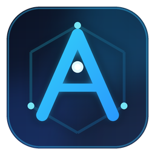
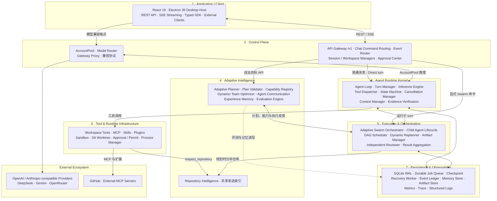
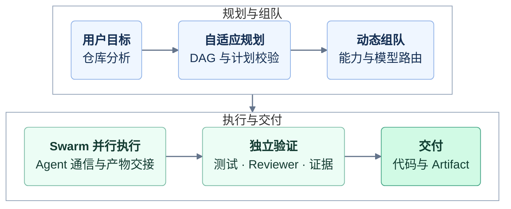
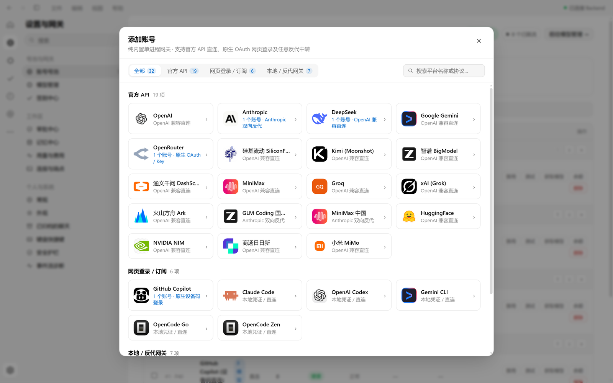

<div align="center">



# Agent_US — General-Purpose Autonomous Agent Framework

**面向复杂软件工程任务的本地优先自主智能体平台**

[](https://github.com/Eternite-0/Agent_US/releases/latest)
[](https://github.com/Eternite-0/Agent_US/actions/workflows/ci.yml)
[](https://nodejs.org/)
[](https://www.electronjs.org/)
[](https://react.dev/)
[](https://fastify.dev/)

[下载 Latest Release](https://github.com/Eternite-0/Agent_US/releases/latest) · [Swarm 命令](#swarm-命令) · [系统架构](#系统架构) · [自主开发流程](#autonomous-software-engineering-workflow) · [核心能力](#核心能力) · [界面预览](#界面预览) · [本地开发](#本地开发与构建) · [配套文档](#配套文档)

</div>

---

## 项目定位

Agent_US 是一套 **Local-First Autonomous Agent Framework**。它将 **Agent Runtime Kernel**、**Adaptive Planner**、**Dynamic Swarm**、**Repository Intelligence**、**Agent Communication**、**Experience Memory** 和 **Evaluation Engine** 组合为一条可验证的工程执行链路，使系统能够理解陌生代码库、规划复杂任务、按任务需求组建 Agent 团队、并行开发、恢复中断、验证证据并完成交付。

模型网关、多供应商 `AccountPool`、MCP 和 Skills 为 Agent Runtime 与外部客户端提供模型接入和工具扩展。

### Why Agent_US

| 普通 AI 应用 | Agent_US |
| --- | --- |
| 用户手动拆分任务 | 从仓库事实出发自主规划，并支持有限重规划 |
| 单 Agent 串行执行 | 根据能力和工作流动态组建团队，支持并行子 Agent |
| 只返回文字答案 | 交付真实代码、测试结果和可追溯 Artifact |
| 进程退出后任务丢失 | Durable Execution、Checkpoint、Recovery 和 outcome reconciliation |

用户目标不需要预先提供固定 DAG。任务规模、仓库结构、依赖关系和能力画像共同影响规划与团队形成。

---

## Swarm 命令

在 **Web 或桌面端的聊天输入框**发送以下命令，不是在终端运行。普通消息默认走 Direct 对话；只有显式发送 `/swarm <任务>` 才会从聊天启动 Swarm。

| 命令 | 行为 |
| --- | --- |
| `/swarm 检查前后端的测试覆盖并汇总缺口` | 在当前根会话提交一个新的 Swarm Run，后台分析仓库、生成并校验计划，再调度子 Agent。任务可以写成多行。 |
| `/swarm status` | 查询当前会话的 Swarm Run；优先显示未结束的运行，否则显示最近一次运行。 |
| `/swarm stop` | 停止当前会话未结束的 Swarm Run，不会取消普通 Direct turn。 |
| `/swarm` | 查看命令帮助，不启动任务。 |

命令不支持附件。启动时沿用会话工作区，不能通过命令放宽会话权限或预算。同一会话有未结束的 Direct turn 或 Swarm Run 时，不能再启动一个 Swarm；结束或取消 Direct turn 后，可在原会话中发送 `/swarm <任务>`。运行进度、计划、子任务与交付可在「自主任务」面板查看。

---

## 系统架构

七层按职责划分。实线表示请求、调用或持久化，虚线表示评测与记忆的读写关系。



- [`DirectAgentRuntime`](backend/src/direct-agent.js) 装配 `AgentRuntimeKernel`、上下文、工具、Durable、Swarm 和治理组件。普通消息在父会话里运行 Direct turn；聊天入口的 [`handleChatCommand`](backend/src/routes/chat-command.js) 在创建 Direct turn 前识别 `/swarm`，提交独立的 Swarm Run。Swarm 由持久化队列驱动，子 Agent 在子会话里沿用同一套推理与工具运行时。
- `GatewayProxy` 负责协议兼容和模型请求转发。Agent Loop 的推理使用 AccountPool，外部模型客户端的协议转换由 GatewayProxy 处理。
- `Evaluation`、`Memory` 和 `Planner` 通过服务、事件和持久化状态互相反馈。评测由独立入口调度，经验检索按上下文和任务需要执行。
- `Control Plane` 的 `/v1` 路由是当前主 API 面。旧 `/api/v1/*` DAG 路由仍挂载于 [`routes.js`](backend/src/routes.js) 和 [`engine.js`](backend/src/engine.js)，仅用于 legacy / compatibility。

---

## Autonomous Software Engineering Workflow



| 反馈 | 下一步 |
| --- | --- |
| 工具调用需要审批 | 放行后继续执行 |
| 进程中断或副作用结果未知 | 从 Checkpoint 恢复，必要时先人工核对 |
| 测试、审查或证据检查未通过 | 在预算内重规划，再执行与验证 |
| 交付后的评测与验证经验 | 为后续任务提供能力画像与经验参考 |

- 聊天中用 `/swarm <任务>` 启动此流程：聊天入口返回 `runId`，后台再规划和执行。程序化调用可通过 `POST /v1/autonomous/runs` 提交目标和工作区信息；普通聊天不自动进入该流程。
- Agent 数量由任务复杂度、独立工作流、能力画像、成本和验证要求共同决定。
- 可并行的子 Agent 使用独立 worktree 或受控共享路径执行。
- 失败可以触发有预算上限的 `repair_and_reverify` 或其他有限重规划。
- 已完成节点产生的 Artifact 会进入后续 Overlay、Review、Verify 和 Delivery。
- 文件写入、命令执行、Hook、MCP 和外部副作用受工具策略、Permit、Sandbox 或人工审批控制。
- 带独立验证要求的计划在交付前执行测试、只读 Reviewer 审查和 Evidence Verification。检查项随计划与证据契约变化。

---

## 核心能力

仓库分析、动态团队、子 turn、恢复和交付已接入自治运行。计划创建与提案修订、团队优化、通信、经验反馈和评测也有独立 API，可通过后端文档按需调用。

### 1. Autonomous Repository Intelligence

[`analyzeRepository()`](backend/src/repo-intelligence.js) 为 `inspect_repository` 只读工具和 Swarm 规划提供代码、测试、入口、符号、调用关系、依赖与 Git 信息。两者对同一实际工作区路径共用进程内渐进索引，默认每次最多扫描 120 个新文件；后续调用可继续推进，已扫描内容变化时会重建快照。Git 分支、HEAD、近期提交以及**已索引路径**的脏状态每次都会重新读取，提交或切分支不需要手动刷新文件索引。

### 2. Adaptive Planning

[`AdaptivePlanner`](backend/src/planning/planner.js)、[`AdaptiveReplanner`](backend/src/planning/replanner.js) 和 [`validatePlan`](backend/src/planning/validator.js) 提供计划创建、验证和提案修订 API。线上自治路径由 [`swarm/planner.js`](backend/src/swarm/planner.js) 结合仓库摘要生成执行节点，再执行结构化计划校验。运行期修复由 [`swarm/replan.js`](backend/src/swarm/replan.js) 处理。

### 3. Dynamic Multi-Agent Swarm

[`AdaptiveSwarmOrchestrator`](backend/src/swarm/orchestrator.js) 负责运行树、子 Agent、依赖调度、并行 worktree、Artifact Overlay、Reviewer 和交付状态。`TeamOptimizer` 根据工作流和模型能力选择单 Agent 或团队规模，运行时不固定为五种角色。

### 4. Durable Agent Runtime

[`AgentRuntimeKernel`](backend/src/kernel/runtime.js) 和 [`AgentLoop`](backend/src/kernel/agent-loop.js) 统一推理、工具调用、状态转换、取消、预算与证据收口。Durable 层提供 [`DurableJobQueue`](backend/src/durable/job-queue.js)、[`CheckpointStore`](backend/src/durable/checkpoint.js)、Recovery Worker 和未知结果核对。

### 5. Inter-Agent Communication

[`CommunicationBus`](backend/src/communication/bus.js) 提供持久化消息通道，Swarm 内部的 [`InterAgentMailbox`](backend/src/swarm/mailbox.js) 负责子 Agent 间的消息收取与投递。消息会在节点边界进入后续上下文，并受运行状态和权限约束。

### 6. Experience Memory

[`ExperienceMemoryService`](backend/src/memory/service.js) 记录可复用的执行经验和反馈。[`ProjectMemoryService`](backend/src/context/memory.js) 服务于项目上下文。经验记录支持候选、验证与反馈，项目记忆用于组装会话上下文。

### 7. Evaluation & Benchmark

[`EvaluationService`](backend/src/evaluation/service.js)、[`external-benchmark.js`](backend/src/evaluation/external-benchmark.js) 和 [`EvidenceVerifier`](backend/src/governance/verifier.js) 将实现、测试、历史、Artifact 和证据分开检查。Benchmark 数据见 [2.3 验收报告](backend/docs/2.3-general-autonomous-agent-report.md)。

### 8. Secure Tool Runtime

[`ToolDispatcher`](backend/src/tools/dispatcher.js)、[`ToolPermissionPolicy`](backend/src/tools/policy.js)、[`sandbox.js`](backend/src/tools/sandbox.js)、[`permits.js`](backend/src/permits.js) 和 Hook Trust 组件共同控制文件、终端、网络、MCP、工作树和外部副作用。工具收据、审批决定和审计事件进入持久化账本。

### 9. Multi-Provider Gateway

[`AccountPool`](backend/src/pool.js) 维护供应商账号、模型目录、能力元数据、健康度和路由信息。[`GatewayProxy`](backend/src/gateway-proxy.js) 通过 `POST /v1/chat/completions` 和 `POST /v1/messages` 提供 OpenAI / Anthropic 兼容协议。外部兼容请求经过 GatewayProxy，Agent Runtime 则通过 AccountPool 的推理适配器使用同一模型基础设施。

---

## 2.3 验收与 Benchmark

以下是固定任务、模型与运行配置下的结果。详见 [2.3 General-Purpose Autonomous Agent 验收报告](backend/docs/2.3-general-autonomous-agent-report.md)。

### 外部开源 Benchmark

- Benchmark 契约为 `agent-us-oss-benchmark@1.0.0`。
- 数据集覆盖 4 个 MIT 开源仓库，分别为 `ai/nanoid`、`wooorm/trough`、`fastify/fast-content-type-parse` 和 `ai/nanoevents`。
- 真实 Provider 运行通过 OpenAI-compatible 端点调用 `deepseek-v4.1-flash`。

| 轮次 | 结果 | 主要发现 |
| --- | --- | --- |
| Run 1 | 3/4 PASS | 临时校验脚本已清理，证据检查误判文件缺失。 |
| Run 2 | 2/4 PASS | 固定输出上限造成两项任务的模型输出截断。 |
| Run 3 | 3/4 PASS | 两路请求竞争本地代理，一项任务超时。 |
| Run 4 | **4/4 PASS** | 并发设为 1，超时设为 480 秒。无失败、超时或重试。 |

该模型的外部 Benchmark 能力画像只有四个样本，状态为 `provisional_low_sample`。

### 陌生代码库端到端任务

- 仓库为 [`tj/commander.js`](https://github.com/tj/commander.js)，固定 Commit 为 `a5a7dc084d4d2b7932e85ca049c5204e50a2c721`。
- 运行时自主生成 5 个规划节点和 2 个并行开发分支，节点数量由任务规划产生，不是系统固定角色数。
- 验收过程覆盖真实进程 `SIGKILL`、已完成节点去重、`outcome_unknown` 人工核对恢复、Artifact 交付与只读独立 Reviewer。Reviewer 检查产物后给出 `pass`。
- 应用交付后独立重跑目标仓库测试，结果为 `1393 PASS / 0 FAIL / 2 SKIP`。
- 该结果只代表这一次特定仓库和特定任务的实测。

### 离线控制与验证边界

- 确定性测试使用 `ScriptedAdapter`、故障注入或参考解验证状态机、预算、迁移、产物冲突与证据门禁。报告中的离线负对照为 `0/1`，如预期被拒绝，单独计入离线结果。
- 外部 Benchmark 的四个样本不足以推断通用成功率。大型仓库需按子目录进一步扫描。缺少目标仓库依赖时，`tsc`、`tsd` 等外置工具链需在具备依赖的环境中补验。
- Benchmark Sandbox 和依赖策略已提供独立实现，当前 `EvaluationService` 与自治入口尚未接入该路径。见 [后端架构](backend/docs/architecture.md#工具与审批边界)。
- [前端 simulator](frontend/src/api/simulator.ts) 提供演示数据。实际执行、审批与交付结果由 `/v1` 后端返回。

---

## 界面预览

<table>
  <tr>
    <td width="50%" align="center">
      
      <br /><sub><b>主工作台</b>（会话流、工作区、审批和交付状态）</sub>
    </td>
    <td width="50%" align="center">
      
      <br /><sub><b>账号号池</b>（供应商账号、模型和健康度）</sub>
    </td>
  </tr>
  <tr>
    <td width="50%" align="center">
      
      <br /><sub><b>供应商接入</b>（协议和凭证配置）</sub>
    </td>
    <td width="50%" align="center">
      
      <br /><sub><b>网页登录与 OAuth</b></sub>
    </td>
  </tr>
  <tr>
    <td colspan="2" align="center">
      
      <br /><sub><b>模型管理与统一网关</b>（模型目录、映射和兼容端点）</sub>
    </td>
  </tr>
</table>

---

## 外部客户端与模型网关

后端在本地服务启动后提供兼容端点。常用入口如下。

- OpenAI 兼容客户端的 Base URL 为 `http://127.0.0.1:8787/v1`（采用源码后端默认端口），调用 `POST /v1/chat/completions` 和 `GET /v1/models`。
- Anthropic 兼容客户端使用服务根地址并调用 `POST /v1/messages`。客户端鉴权使用本地服务的 `BACKEND_TOKEN`，可通过 Bearer 或 `x-api-key` 请求头传递。
- 多供应商账号和模型配置使用 `/v1/accounts`、`/v1/models/*` 与 `/v1/auth/*`。
- 运行时会话、SSE、审批、自治运行和交付使用 `/v1/sessions/*`、`/v1/stream`、`/v1/approvals`、`/v1/autonomous/*` 和 `/v1/swarm/*`。
- 旧 `/api/v1/*` DAG 路由仍用于兼容旧客户端，新的功能说明和集成应以 `/v1/*` 为准。

---

## 本地开发与构建

### 环境要求

- Windows、macOS 或 Linux
- Node.js `>=24.9.0`
- npm
- Git
- 外部 Provider 或本地 OpenAI-compatible Provider

### 启动后端

```powershell
Set-Location D:\Agent_US\backend
npm ci
$env:BACKEND_TOKEN = node -e "console.log(require('crypto').randomBytes(32).toString('hex'))"
npm start
```

默认地址为 `http://127.0.0.1:8787`。数据目录默认是 `backend/var`，可以通过 `BACKEND_DATA` 覆盖。工作区可以通过 `AGENT_WORKSPACE` 或 `PUT /v1/workspace` 设置。

### 启动前端

```powershell
Set-Location D:\Agent_US\frontend
npm ci
$env:BACKEND_URL = "http://127.0.0.1:8787"
$env:BACKEND_TOKEN = "<与 backend 相同的 BACKEND_TOKEN>"
npm run dev
```

浏览器访问 `http://127.0.0.1:5173`。Vite 开发服务器代理 `/v1` 和 `/api/v1`。

### 桌面端预览与打包

```powershell
# 从仓库根目录执行，先按上文安装后端和前端依赖
npm --prefix frontend run build
npm --prefix desktop ci
npm --prefix desktop start
```

Electron Host 管理本地后端与同源通信。Windows x64 安装版和便携版可从 [Latest Release](https://github.com/Eternite-0/Agent_US/releases/latest) 下载，具体资产以发布页为准。本地执行 `npm --prefix desktop run build` 会生成 Windows 包。见 [桌面端入口](desktop/main.mjs)和[发布工作流](.github/workflows/release-windows.yml)。

### 验证命令

```powershell
Set-Location D:\Agent_US\backend
npm run check
node --test test/explicit-swarm-command.test.js test/repo-progressive-index.test.js test/repo-intelligence.test.js test/swarm/autonomous-generalization.test.js

Set-Location D:\Agent_US\frontend
npx tsc --noEmit
npm run build

Set-Location D:\Agent_US
node --check desktop/main.mjs
```

CI 的实际矩阵见 [`.github/workflows/ci.yml`](.github/workflows/ci.yml)。它在 Ubuntu 和 Windows 上使用 Node 24，后端核心回归步骤按工作流排除三个环境依赖套件。

---

## 目录结构

```text
Agent_US/
├─ backend/
│  ├─ src/
│  │  ├─ kernel/                 # Agent Loop、推理、状态机、取消和事件
│  │  ├─ runtime/                # 会话仓库、审批管理、关闭协调
│  │  ├─ durable/                # Job Queue、Checkpoint、恢复和租约
│  │  ├─ governance/             # Control Plane、调度、审计和证据验证
│  │  ├─ tools/                  # 工具注册、分发、策略、Sandbox 和 MCP 生命周期
│  │  ├─ context/                # 上下文组装、预算、压缩和项目记忆
│  │  ├─ planning/               # Adaptive Planner、验证和重规划
│  │  ├─ swarm/                  # 团队优化、编排、子 Agent、消息和 Artifact
│  │  ├─ communication/          # Agent Communication Bus 和持久化适配器
│  │  ├─ memory/                 # Experience Memory
│  │  ├─ evaluation/             # Benchmark、评测、记录和评分
│  │  ├─ observability/          # Metrics、Trace 和 Structured Logs
│  │  ├─ direct-agent.js         # DirectAgentRuntime 主编排入口
│  │  ├─ intelligence-services.js # Planner、Evaluation、Memory、Communication 装配
│  │  ├─ repo-intelligence.js    # 仓库结构和调用关系分析
│  │  ├─ pool.js                 # AccountPool 与模型能力路由
│  │  ├─ gateway-proxy.js        # OpenAI / Anthropic 协议适配
│  │  ├─ service.js              # Store、Pool、Runtime、Control Plane 装配
│  │  ├─ v1-routes.js            # 主 REST / SSE API 注册
│  │  └─ main.js                 # 后端进程入口
│  ├─ test/                      # 后端单元、集成、恢复、安全和评测测试
│  └─ docs/
├─ frontend/
│  ├─ src/
│  │  ├─ api/                    # REST、SSE 和运行时客户端
│  │  ├─ components/             # 会话、Swarm、交付、审批和设置界面
│  │  └─ App.tsx                 # React 应用入口
│  ├─ test/
│  └─ README.md
├─ desktop/
│  ├─ main.mjs                   # Electron Desktop Host
│  ├─ preload.cjs
│  └─ pack-win.mjs               # Windows 打包入口
├─ docs/images/                  # README 使用的真实 UI 截图
├─ README.md
└─ AGENTS.md
```

---

## 配套文档

- [后端启动、API 和测试](backend/README.md)
- [2.3 真实验收报告](backend/docs/2.3-general-autonomous-agent-report.md)
- [后端 2.3 架构说明](backend/docs/architecture.md)
- [前端启动与界面能力](frontend/README.md)
- [CI 工作流](.github/workflows/ci.yml)
- [GitHub Latest Release](https://github.com/Eternite-0/Agent_US/releases/latest)
