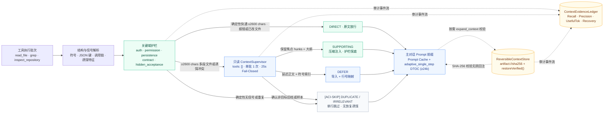

<div align="center">


# Agent_US

**Local-First Autonomous Engineering Platform · Adaptive Context Intelligence · Fail-Closed Docker Sandbox**

面向复杂软件工程任务的本地优先自主智能体框架

[](https://github.com/Eternite-0/Agent_US/releases/latest)
[](https://github.com/Eternite-0/Agent_US/actions/workflows/ci.yml)
[](https://nodejs.org/)
[](https://www.electronjs.org/)
[](https://react.dev/)
[](backend/sandbox/Dockerfile.benchmark)

[核心创新](#核心创新与能力体系) · [ACI 治理流程](#adaptive-context-intelligence-流程) · [系统架构](#系统架构) · [实证 Benchmark](#实证-benchmark-结果) · [界面预览](#界面预览) · [Swarm 与网关](#swarm-命令与外部网关) · [本地开发](#本地开发与验证) · [文档与报告](#文档与实证报告索引)

</div>

---

## 关键实证指标总览

| 维度 | 核心能力与阶段 | 实测基线 vs 演进结果 | 验证环境 |
| --- | --- | --- | --- |
| **注入前上下文治理** | **Agent_US 2.4 Stage 4**（Pre-Injection Admission · Supervisor · SHA-256 恢复） | Arm C 通关率 **`33.3% → 75.0%`（`+41.7 pp`）**<br/>关键上下文召回 **`100%`** · FNR **`0`** · 注入前减负 **`54.8%–64.8%`**<br/>Arm D KV Hit **`84.78%`** · 短任务 KV 差 **`-0.64 pp`** · **`0/6`** 诱饵恢复 | `deepseek-v4.1-flash`<br/>Docker `strong`（`48 + 6` 试次） |
| **能力感知工具选择** | **Agent_US 2.3.7**（Tool Intelligence · 动态目录与提示对齐） | Bash 拒绝次数 **`96 → 27`（`−71.9%`**, `p = 0.000122`）<br/>工具选型匹配 **`86.2% → 95.4%`** · 总 Token **`−23.6%`** | 真实 Provider<br/>`14` 题 × `5` 轮（`140` 轮） |
| **三域强隔离沙箱** | **Agent_US 2.3.1**（Trusted Judge · RO Supervisor · Worker + Stdin HMAC） | 阻断 **`7/7`** 隐藏验收绕过向量（`exit(0)` / `SIGTERM` / 伪造信封等）<br/>`STRONG` / `DOCKER` 无 Docker 时严格 **Fail-Closed** | Windows 11 + Docker Desktop<br/>`agent-us/benchmark:node24` |
| **自主推理与经验闭环** | **Agent_US 2.3–2.4 S3**（契约感知 · 根因台账 · 只读校验 · 可信经验） | `compute_file_digest` 使 `ar-09` **`0/3 → 2/3`**（`65.1s` Pass）<br/>可信经验闭环（`ar-03,05,09`）Pass **`+33.3 pp`** · 耗时 **`−45.9%`**<br/>OSS 外部基准 **`4/4`** · `tj/commander.js` **`1393/0/2`** | `deepseek-v4.1-flash`<br/>Docker `strong` 实测 |

---

## 项目定位：Why Agent_US

Agent_US 将 **Durable Agent Kernel**、**Pre-Injection ACI Governance**、**Contract-Aware Reasoning**、**Shared Repository Intelligence**、**Explicit `/swarm` Orchestration** 与 **Three-Domain OS Sandbox** 融合为端到端可审计的自主软件工程运行时，同时通过内置 `AccountPool` 与 `GatewayProxy` 向外部 OpenAI / Anthropic 兼容客户端暴露统一基础设施。

| 维度 | 普通 AI 编程助手 | Agent_US |
| --- | --- | --- |
| **上下文供给** | 盲目全量读取文件、诱饵/旧档污染前缀 | 五级注入前准入（`DIRECT`/`SUPPORTING`/`DEFER`/`DUPLICATE`/`IRRELEVANT`）、五大关键域硬护栏、`[ACI-SKIP]` 噪点拦截与 SHA-256 `expand_context` 无损按需恢复 |
| **推理与修改** | 凭直觉改代码、手算哈希/盲猜需求 | `extractTaskContract` 提取硬约束与排序规则、前置失败复现、根因消退验证与零 Shell 安全校验原语 `compute_file_digest` |
| **多智能体协同** | 固定角色模板、手动复制上下文 | 显式 `/swarm` 驱动动态编排、共享渐进式代码索引、独立 Git Worktree 并行执行与只读 Independent Reviewer |
| **安全性与验收** | 同进程跑测试、易被 `process.exit(0)` 欺骗 | Trusted Judge + 只读容器 Supervisor + 每用例独立 Worker、Stdin HMAC 验签、Docker `network=none` + Hard Veto |
| **容错与持续学习** | 进程崩溃丢状态、经验混入未验证噪声 | SQLite WAL + Checkpoint 崩溃恢复、`ContextEvidenceLedger` 全链审计、`trusted_server_verifier` 可信经验冷暖闭环 |

---

## 核心创新与能力体系

### 1. 自适应上下文准入治理（ACI Governance · 2.4 Stage 4）

> 将原先仅在历史增长后触发压缩的 DTOC，升级为**在信息进入主模型上下文之前**实施精筛、护栏保护、可逆省略与在线学习的完整上下文控制系统。

- **五级注入前准入（`PreInjectionAdmissionController`）**：工具批次执行后、写入消息历史前先经 [`aci-admission.js`](backend/src/context/aci-admission.js) 结合 JS/TS 符号、`.json` 顶层键（`json_key@L...`）、调用链、报错堆栈与文件路径进行确定性初筛，输出 **`DIRECT`**、**`SUPPORTING`**（大纲 + 焦点 hunks + 恢复提示）、**`DEFER`**（导入 + 符号行号表 + 恢复提示）、**`DUPLICATE`** 与 **`IRRELEVANT`**；针对 `>2600` 字符或存在诱饵冲突的候选文件交由单批次选择性决策；对 `grep:`/`glob:` 搜索结果要求**全部采样非空行**命中诱饵特征方判定 `isDecoy`，防止混合搜索结果被整批压制。
- **五大关键域硬护栏（Critical Protection Guardrail）**：覆盖 **`auth`**、**`permission`**、**`persistence`**、**`contract`**、**`hidden_acceptance`**。非诱饵关键域文件以及 Prompt 明确指定、报错堆栈关联、近期编辑修改的文件在运行时受保护护栏强制锁定——**绝不允许被模型降级至 `SUPPORTING` 以下**（零漏召回，FNR `= 0`）。
- **只读零特权 `ContextSupervisor`**：[`supervisor.js`](backend/src/context/supervisor.js) 支持 `auto` / `custom` / `off`（默认开启，可由前端 [AdaptiveContextPanel](frontend/src/components/AdaptiveContextPanel.tsx) 与 `/v1/context/supervisor` 动态切换），经 `AccountPool` 目录解析模型（**生产代码零硬编码模型名**），严格强制 **`tools: []`**（零命令执行/写文件/审批权）、`25s` 超时 Fail-Closed 回退与单请求 `mergeUsageSnapshot` 用量去重。
- **去诱饵 `[ACI-SKIP]` 桩与 SHA-256 无损恢复**：[`aci-store.js`](backend/src/context/aci-store.js) 与 [`meta-tools.js`](backend/src/tools/builtin/meta-tools.js) 将 `IRRELEVANT` / `DUPLICATE` 映射为不带恢复调用诱饵的 `[ACI-SKIP ...]` 桩，保留 `DEFER` / `SUPPORTING` 的 `artifact://<sha256>` 引用；主 Agent 调用 `expand_context`（支持 `outline` / `hunk` / `verbatim`）经 `restoreVerified()` 现场重算校验 SHA-256（篡改即抛 `ARTIFACT_HASH_MISMATCH`），全链行为记入 `ContextEvidenceLedger`。
- **短任务 KV Cache 无损保护（`adaptive_single_step` DTOC）**：[`aci-engine.js`](backend/src/context/aci-engine.js) 将 `[0.60, 0.82]` DTOC 水位线门控于 `dtocMinPromptTokens = 24000`，`emergency_budget` 采用单次 `emergencyUsed` 门控且 [`agent-loop.js`](backend/src/kernel/agent-loop.js) 仅在 `compressedCount > 0` 时更新上下文前缀，避免短任务误压缩撕裂 KV Cache。

### 2. 自主推理与可信执行闭环（2.4 Stage 1–3）

- **契约感知推理（`Contract-Aware Reasoning`）**：[`contract-reasoning.js`](backend/src/kernel/contract-reasoning.js) 确定性抽取用户需求及工作区 `SPEC.md` / `CONTRACT.json` / `CONSTRAINTS.md` 中的交付产物、禁止改动列表、约束编号（`C1..Rn`）、优先级规则（如 `ordering_precedence`）及预期命令，在交付停机前完成就绪核验，同时保持系统提示词逐字节静态以维护 KV Prompt Cache。
- **根因验证与完工防误杀**：[`execution-reasoning.js`](backend/src/kernel/execution-reasoning.js) 维护结构化根因消退台账，仅在修复前失败指纹消失且测试通过后标记 `rootCauseVerified`；新增 **`doc` 变更免重验**与 **`self_test` 校准容忍**（`STUCK_PATTERNS.SELF_TEST_CALIBRATION`），避免纯文档收尾或调优自写测试触发虚假死循环熔断。
- **免 Shell 只读工具原语 & 可信经验记忆**：`compute_file_digest` 在禁止 Shell 时直接在工作区边界内计算确定性 SHA-256 与规范化 JSON 摘要；[`ExperienceMemoryService`](backend/src/memory/service.js) 严格过滤仅来自 `trusted_server_verifier` 的已验证经验参与跨任务上下文注入。

### 3. 三域信任边界隔离沙箱与防绕过验收（2.3.1）

- **OS 级强隔离执行环境**：[`benchmark-sandbox.js`](backend/src/tools/benchmark-sandbox.js) 依托 [`Dockerfile.benchmark`](backend/sandbox/Dockerfile.benchmark) 构建的隔离镜像（Node 24 + Git + Python 3、`--network=none`、非 root `65534:65534`、`--ipc=none`、`--cap-drop=ALL`、Pids/内存/CPU/输出限额），在 `STRONG` / `DOCKER` 模式下容器不可用时严格 **Fail-Closed**（抛 `SandboxUnavailableError`），绝不静默降级至宿主机；同时在 Docker-less CI（如 `windows-latest`）保留显式 `NODE_PERMISSION` 受限验证通道。
- **三域隐藏验收协议**：[`hidden-acceptance.js`](backend/src/evaluation/hidden-acceptance.js)（Host Trusted Judge）与 [`hidden-acceptance-supervisor.mjs`](backend/src/tools/hidden-acceptance-supervisor.mjs)（Read-Only Container Supervisor）按测试项派生独立短期 Worker 子进程，单次 `hmacKey` 仅通过短寿命容器 `stdin` 投递；常时间 `timingSafeEqual` 验签并联动 [`judge.js`](backend/src/evaluation/judge.js) 与 [`EvaluationService`](backend/src/evaluation/service.js) **Hard Veto**，彻底封堵 `process.exit(0)`、`SIGTERM`、跳用例与伪造信封绕过。

### 4. 能力感知工具选择、分级审批与统一网关（2.3.7 & Core）

- **能力感知工具治理与 Composer 权限模式**：[`tools/selection.js`](backend/src/tools/selection.js)、[`tools/policy.js`](backend/src/tools/policy.js)、[`tools/auto-approval.js`](backend/src/tools/auto-approval.js) 与 [`dispatcher.js`](backend/src/tools/dispatcher.js) 共同约束工具目录选择与分级自动审批（Direct Composer 权限菜单直连工具策略），[`prompt-cache.js`](backend/src/observability/prompt-cache.js) 持续监测工具与前缀缓存稳定性。
- **显式 `/swarm` 编排与渐进仓库智能**：聊天框发送 `/swarm <任务>` 即经 [`chat-command.js`](backend/src/routes/chat-command.js) 与 [`orchestrator.js`](backend/src/swarm/orchestrator.js) 动态组建多智能体团队，复用进程内渐进式索引 [`repo-intelligence.js`](backend/src/repo-intelligence.js)、[`DurableJobQueue`](backend/src/durable/job-queue.js) 与只读 [`EvidenceVerifier`](backend/src/governance/verifier.js)。
- **多账号路由与兼容协议网关**：[`AccountPool`](backend/src/pool.js) 与 [`GatewayProxy`](backend/src/gateway-proxy.js) 提供健康探测、能力路由与原生网页 OAuth 登录，并在本地同时暴露 OpenAI (`/v1/chat/completions`) 与 Anthropic (`/v1/messages`) 兼容端点。

---

## Adaptive Context Intelligence 流程

> 注入前拦截噪声与诱饵、保护关键域不漏召、压缩后基于 SHA-256 无损按需恢复，同时保证短任务 KV Prefix 零损伤。



---

## 系统架构

> 清晰分层的六层 Local-First 架构：以 `/v1/*` 为唯一主控制面，`Direct` 会话与显式 `/swarm` 共享同一内核、工具安全边界与持久化底座（legacy `/api/v1/*` 仅作历史兼容挂载）。


---

## 实证 Benchmark 结果

> 所有真实模型测试均完整保留失败与超时样本（**零剔除、零樱桃采摘**），并在每次修改后于独立隔离沙箱与真实 Provider 上实测产出。

### 1. Agent_US 2.4 Stage 4 — ACI 注入前治理四臂消融对比（冻结实测 · `48 + 6` 试次）

- **测试条件**：冻结代码提交 `2bce1db6`，`deepseek-v4.1-flash`（主模型与 Supervisor 一致，本地代理 `127.0.0.1:3065/v1`），Docker **`strong`**（`agent-us/benchmark:node24`），4 项高噪声复杂多文件工程任务（每项含 17–18 个文件、7–8 个高干扰诱饵、Docker 隐藏验收与防篡改 Veto）× **4 臂 × 3 轮重复 = 48 试次**。详表与逐试次原始轨日志见 [2.4 Stage 4 实证评估报告](backend/docs/2.4-stage4-aci-governance-report.md)。

| 评估指标 | Arm A (`raw_full`) | Arm B (`deterministic_progressive`) | Arm C (`retrieval_supervisor`) | Arm D (`full_aci`) | 核心发现 |
| --- | ---: | ---: | ---: | ---: | --- |
| **Final Task Success Rate** (`pass / 12`) | `33.3%` (`4/12`) | `58.3%` (`7/12`, `+25.0pp`) | **`75.0%` (`9/12`, `+41.7pp`)** | `50.0%` (`6/12`, `+16.7pp`) | B / C / D 全部显著优于原文基线 A；**C 较 A 相对提升 +125%** |
| **Critical Context Recall** | `1.0000` | `1.0000` | `1.0000` | **`1.0000`** | 全 48 试次关键上下文**零漏召** |
| **Context Precision** (`filePrecision`) | `0.8301` | **`0.9765`** | `0.9319` | `0.9534` | 较基线 A 提升 **`+10.2 pp` ~ `+14.6 pp`** |
| **False Negative Rate** (`误标 IRREL`) | `0` (`0`) | `0` (`0`) | `0` (`0`) | **`0` (`0`)`** | 关键域保护护栏实现**零误杀** |
| **Useful Token Ratio** (`tokenPrecision`) | `0.5385` | **`0.9211`** | `0.7600` | `0.8987` | 将有效载体 Token 占比从 `53.9%` 抬升至 **`76.0%–92.1%`** |
| **Admission Token Reduction** (注入前) | `0` | `54.78%` (`52,963` tok) | **`64.83%` (`82,310` tok)** | `64.23%` (`77,360` tok) | 注入主上下文前直接省下 **`54.8%–64.8%`** 工具冗余载体 |
| **Cache Hit Rate** (`cacheRead / in`) | `67.84%` | `51.57%` | `79.00%` (`12/12` SSE) | **`84.78%` (`12/12` SSE)** | **Arm D 取得全场最高 KV Cache 命中率**（较 A **`+16.9 pp`**） |
| **Supervisor Cost** (`调用 / tok / 占比`) | `0` | `0` | `33` 次 / `107,398` (`5.24%`) | `35` 次 / `51,021` (`2.62%`) | 全程 `tools: []`，Ledger 与 Summary 账本 100% 吻合 |
| **Recovery Success / Assisted Pass** | `0` | `5/5` (`1.0` · `60.0%`) | `11/11` (`1.0` · `50.0%`) | **`6/6` (`1.0` · `66.7%`, `0/6` 诱饵)** | `22/22` 恢复 **100% SHA-256 校验通过**；Arm D 彻底消除诱饵恢复 |
| **端到端 `aci-04` 长程审计通关** | `0/3` (`TOKEN_BUDGET`) | `0/3` (`2` 超预算) | **`2/3` PASS** | `0/3`（**`3/3` 完整跑完未撞预算**） | 仅 Arm C 两次贯通最难 5 文件审计与 digest 导出任务 |

- **短任务 KV Cache 无损回归（Run 4B-2，`ar-06/08/09` × `A, D` = 6 试次，`dtocMinPromptTokens=24000`）**：Arm A `2/3`（KV 命中率 **`89.53%`**）vs Arm D `2/3`（全程 **`epochTransitions = 0`**，KV 命中率 **`88.89%`**，仅差 `-0.64 pp`），验证短任务零撕裂。
- **Supervisor 与无损恢复真实链路实证**：在 `aci-04 C rep=2` 中，只读 Supervisor 将 3,860 字符的核心鉴权策略 `policy-engine.js` 压缩为聚焦关键导出符号的 `SUPPORTING` 视图（`1,002 → 614 tok`），精准把 `COMPLIANCE-APPENDIX.md` 等 4 份高混淆诱饵压至 `[ACI-SKIP]`（单轮净省 `7,149 tok`），随后主 Agent 通过 `expand_context` 经 SHA-256 验签精准恢复 `policy-engine.js` 片段（`195 tok`, `verified=true`）一次通关；在 `aci-03 D rep=0/1` 与 `aci-01 D rep=0/1` 中，主模型亦精准从 `SUPPORTING` 视图无损恢复 `CONTRACT.json` 与 `runtime-options.js` 并全部 `PASS`。

### 2. 多阶段里程碑验收快照 (2.3 – 2.4 S3)

| 版本 / 阶段 | 评测对象与规模 | 核心实测结果 | 详细报告 |
| --- | --- | --- | --- |
| **2.4 Stage 3** | 10 题自主开发基准（3 轮 A/B × `10` 题）+ `ar-03,05,09` 经验探针（`deepseek-v4.1-flash`） | 确定性双模（Docker `strong` `31/31` + 模拟无 Docker `31/31`）；Verified Experience 探针通关率 **`+33.3 pp`**（`0.3333 → 0.6667`）、`ar-03` 耗时 **`−45.9%`**；`compute_file_digest` 使 `ar-09` 由 `0/3` 升至 `2/3` | [Stage 3 实证报告](backend/docs/2.4-stage3-autonomous-intelligence-report.md) |
| **2.3.7 Tool Intelligence** | 14 项工程任务 × 5 轮配对实验（140 轮，1,316 次调用，真实 Provider） | Bash 被拒 **`96 → 27`（`−71.9%`**, 精确符号翻转 `p = 0.000122`），工具用途匹配 `605/702 (86.2%) → 586/614 (95.4%)`，首调合规 **`17/70 → 57/70`**，总实测 Token `2,225,106 → 1,700,360`（**`−23.6%`**），严格通过保持 `68/70` | [2.3.7 实测报告](backend/docs/2.3.7-capability-aware-tool-selection-report.md) |
| **2.3.1 Sandbox Security** | Windows 11 + Docker Desktop 4.81.0 + 双平台 CI | 隐藏验收 **`7/7` 绕过向量拦截通过**，Hard Veto + Stdin HMAC + `STRONG` Fail-Closed 验证全部通过（`agent-us/benchmark:node24`） | [2.3.1 安全验收报告](backend/docs/2.3.1-windows-docker-security-acceptance.md) |
| **2.3 Benchmark & E2E** | 4 个 MIT 开源仓库 (`nanoid`, `trough`, `fast-content-type-parse`, `nanoevents`) + `tj/commander.js` | OSS Run 4 **`4/4 PASS`**（并发 1 / 480s）；`tj/commander.js` 动态生成 5 规划节点与 2 并行分支，经历真实 `SIGKILL` 恢复后独立重跑 **`1393 PASS / 0 FAIL / 2 SKIP`** | [2.3 验收报告](backend/docs/2.3-general-autonomous-agent-report.md) |

<details>
<summary><b>📌 评测局限与诚实边界说明（点击展开）</b></summary>

1. **端到端总 `tokenReduction` 统计口径说明**：Stage 4 Phase 4B 中 Arm B/C/D 相对 Arm A 的端到端总 Token 表现为 `-5.83%` / `-13.81%` / `-8.18%`，并非准入压缩失效（注入前 `admissionTokenReduction` 实际省下 `54.78%` / `64.83%` / `64.23%` 工具载体），而是因为基线 **Arm A 有 `8/12` 试次过早因 `TOKEN_BUDGET` 或长尾超时截断**压低了分母均值，使 Arm C/D 得以深入完成多轮修复与导出。
2. **Arm C (`75.0%`) 与 Arm D (`50.0%`) 差异原因**：在最难的 `aci-04` 上，Arm D 实际 **`3/3` 全部完整运行至 `completed`**（未发生任何 `TOKEN_BUDGET` 截断），仅各差 1 条隐藏安全断言归属 `model_capability`；另在 `aci-01..03` 中触发的 `4` 次单步 DTOC 使多轮后逼近 `160k` 上限。
3. **网关长尾与异常观测**：Phase 4B 共观测到 `8/48` 试次上游 SSE 返回 `cacheReadTokens = 0`（Arm C/D `12/12` 稳定获得 `79.00%` / `84.78%`）、`3` 次 Arm C Supervisor 请求出现网关侧 `~20k prompt_tokens` 上报峰值、`12/68` 次 Supervisor 调用因 `25s` 超时安全回退至确定性规则，以及 Arm C 仍有 `5/12` 次模型主动忽略 `[ACI-SKIP]` 重读诱饵（Arm D 严格保持 **`0/6`**）。
4. **2.3 外部开源 Benchmark 样本说明**：早期 2.3 OSS 四仓库（`nanoid` 等）样本规模较小，Capability Profile 仍按 `provisional_low_sample` 标注；缺少目标仓库外置依赖时，`tsc`/`tsd` 等需在具备依赖的隔离环境中补验。

</details>

---

## 界面预览

<div align="center">
  
  <br />
  <sub><b>主工作台</b>（会话流、AdaptiveContextPanel、权限模式控制、工作区审阅、审批与交付状态）</sub>
</div>

<br />

<table>
  <tr>
    <td width="50%" align="center">
      
      <br /><sub><b>多账号号池</b>（账号目录、模型能力标签与健康度路由）</sub>
    </td>
    <td width="50%" align="center">
      
      <br /><sub><b>供应商接入</b>（多协议接入、网关配置与凭据管理）</sub>
    </td>
  </tr>
  <tr>
    <td width="50%" align="center">
      
      <br /><sub><b>原生网页登录与 OAuth</b>（内置安全登录流与状态同步）</sub>
    </td>
    <td width="50%" align="center">
      
      <br /><sub><b>模型管理与统一网关</b>（OpenAI / Anthropic 兼容协议与模型映射）</sub>
    </td>
  </tr>
</table>

---

## Swarm 命令与外部网关

### 在聊天框使用 `/swarm`

在 **Web 或桌面端聊天输入框**发送（非终端命令）；普通消息默认进入 Direct 多轮自主流，显式发送 `/swarm` 才创建独立 Swarm Run：

| 命令 | 行为 |
| --- | --- |
| `/swarm <多行任务描述>` | 在当前会话工作区与权限边界下提交 Swarm Run：后台执行仓库渐进分析、规划与校验后动态组队调度子 Agent |
| `/swarm status` | 查询当前会话正在运行或最近一次完成的 Swarm Run 状态与子任务进展 |
| `/swarm stop` | 安全停止当前会话未结束的 Swarm Run（不会取消普通 Direct turn） |
| `/swarm` | 显示内置 `/swarm` 命令用法说明 |

### 本地 REST / SSE 与模型兼容端点

后端默认监听 `http://127.0.0.1:8787`，鉴权使用 `BACKEND_TOKEN`（`Authorization: Bearer ...` 或 `x-api-key`）：

| 接口面 | 代表路由 | 用途 |
| --- | --- | --- |
| **模型兼容网关** | `POST /v1/chat/completions` · `GET /v1/models` · `POST /v1/messages` | OpenAI 与 Anthropic 兼容端点（经 `GatewayProxy` 与 `AccountPool` 转发） |
| **ACI 与自主运行时** | `/v1/sessions/*` · `/v1/stream` · `/v1/context/supervisor` · `/v1/approvals` | Direct 会话、SSE 事件流、ContextSupervisor 与 ACI 开关 (`admissionEnabled` / `dtocMinPromptTokens`)、工具审批 |
| **Swarm 与自治 API** | `/v1/swarm/*` · `/v1/autonomous/*` · `/v1/accounts` · `/v1/auth/*` | 自主任务提交、多智能体状态、多账号健康路由与登录状态 *(旧 `/api/v1/*` 仅保留兼容)* |

---

## 本地开发与验证

### 环境要求

- **OS**：Windows 11 / macOS / Linux
- **Runtime**：Node.js `>= 24.9.0`（ESM）· npm · Git
- **可选（强隔离实测）**：Docker Desktop / Docker Engine（用于 `agent-us/benchmark:node24` `STRONG` 沙箱评测）

### 快速启动

```powershell
# 1. 启动后端 (默认 http://127.0.0.1:8787，数据目录可用 BACKEND_DATA 覆盖)
Set-Location backend
npm ci
$env:BACKEND_TOKEN = node -e "console.log(require('crypto').randomBytes(32).toString('hex'))"
npm start

# 2. 启动前端 (另开终端，访问 http://127.0.0.1:5173，自动代理 /v1)
Set-Location frontend
npm ci
$env:BACKEND_URL = "http://127.0.0.1:8787"
$env:BACKEND_TOKEN = "<与 backend 相同的 BACKEND_TOKEN>"
npm run dev

# 3. 启动 / 打包 Electron 桌面端 (从仓库根目录执行)
npm --prefix frontend run build
npm --prefix desktop ci
npm --prefix desktop start        # 本地开发预览
npm --prefix desktop run build    # 生成 Windows 安装包 / 便携版
```

### 验证命令

```powershell
# 后端语法与类型检查 + Stage 3/4 与核心集成回归
Set-Location backend
npm run check
node --test --test-concurrency=1 test/context/aci.test.js test/intelligence-routes.test.js test/integration-24-glue.test.js test/direct-auto-approval.test.js test/workspace-git.test.js

# 评测沙箱（本地具备 Docker 时用 strong；Docker-less CI 自动/显式走 node-permission）
$env:AGENT_US_BENCHMARK_SANDBOX_MODE = 'strong'
node --test --test-concurrency=1 --test-timeout=180000 test/evaluation/aci-governance-benchmark.test.js test/evaluation/docker-sandbox-acceptance.test.js

# 前端与桌面端校验
Set-Location ..\frontend
npx tsc --noEmit
npm run build
Set-Location ..
Get-ChildItem desktop\*.mjs | ForEach-Object { node --check $_.FullName }
```

> CI 完整双平台矩阵见 [`.github/workflows/ci.yml`](.github/workflows/ci.yml)（Ubuntu 24 + Windows 24）；Windows 桌面发行流程见 [`.github/workflows/release-windows.yml`](.github/workflows/release-windows.yml)。

---

## 目录结构

<details>
<summary><b>展开查看完整仓库模块分布 (`backend/` · `frontend/` · `desktop/`)</b></summary>

```text
Agent_US/
├─ backend/
│  ├─ src/
│  │  ├─ context/                # aci-admission / aci-engine / aci-store / supervisor / compaction / memory
│  │  ├─ kernel/                 # agent-loop / contract-reasoning / execution-reasoning / runtime / events
│  │  ├─ tools/                  # selection / policy / auto-approval / dispatcher / benchmark-sandbox / builtin/
│  │  ├─ durable/                # DurableJobQueue / CheckpointStore / Recovery Worker / Leases
│  │  ├─ evaluation/             # aci-governance-benchmark / external-benchmark / hidden-acceptance / judge / service
│  │  ├─ governance/             # EvidenceVerifier / Audit / Policy Control Plane
│  │  ├─ planning/               # AdaptivePlanner / AdaptiveReplanner / Validator
│  │  ├─ swarm/                  # Orchestrator / Mailbox / TeamOptimizer / Replan / Overlay
│  │  ├─ communication/          # Inter-Agent Communication Bus & Store Adapters
│  │  ├─ memory/                 # Verified-only ExperienceMemoryService
│  │  ├─ observability/          # Prompt Cache Telemetry / Metrics / Traces / Structured Logs
│  │  ├─ routes/                 # chat-command (/swarm) / intelligence-routes / workspace-git
│  │  ├─ direct-agent.js         # DirectAgentRuntime 主编排引擎 (Static Prompt + ACI + Durable)
│  │  ├─ repo-intelligence.js    # 进程内共享渐进仓库符号与调用分析
│  │  ├─ pool.js & gateway-proxy.js # AccountPool 多账号路由与 OpenAI/Anthropic 协议适配
│  │  └─ v1-routes.js            # 主 REST / SSE API (/v1/*；legacy /api/v1/* 仅兼容)
│  ├─ sandbox/                   # Dockerfile.benchmark (agent-us/benchmark:node24)
│  ├─ scripts/                   # check.js · benchmark-aci-governance.mjs 等实测脚手架
│  ├─ test/                      # 93+ 串行单测、集成、Docker 安全隔离与消融套件
│  └─ docs/                      # 2.3–2.4 全阶段技术与实证报告
├─ frontend/
│  ├─ src/
│  │  ├─ components/             # AdaptiveContextPanel · Composer · ThreadView · InspectorDrawer 等
│  │  ├─ api/                    # REST / SSE Client · Simulator
│  │  └─ App.tsx
│  ├─ NATIVE-VISUAL.md           # 前端视觉设计与交互规范
│  └─ test/                      # UI 视觉与 Playwright 浏览器运行时测试
├─ desktop/
│  ├─ main.mjs                   # Electron Desktop Host
│  ├─ extension-hub.mjs          # 桌面插件扩展宿主
│  ├─ office-skills.mjs          # Office Skills 支持
│  ├─ pack-win.mjs               # Windows x64 安装包与便携版构建入口
│  └─ preload.cjs
├─ docs/images/                  # 真实工作台截图资源
├─ AGENTS.md
└─ README.md
```

</details>

---

## 文档与实证报告索引

| 类别 | 文档 | 说明 |
| --- | --- | --- |
| **最新 Stage 4 实证** | [2.4 Stage 4 — ACI 上下文准入治理报告](backend/docs/2.4-stage4-aci-governance-report.md) | 注入前五级准入、`ContextSupervisor`、`expand_context` SHA-256 恢复、KV 保真与 4 臂 48 试次完整记录 |
| **2.4 Stage 1–3 演进** | [2.4 Stage 3 实证报告](backend/docs/2.4-stage3-autonomous-intelligence-report.md) · [Stage 2 报告](backend/docs/2.4-stage2-real-provider-benchmark-report.md) · [Stage 1 报告](backend/docs/2.4-stage1-autonomous-reasoning-report.md) | 契约推理、根因台账、零 Shell 摘要、Verified Experience 与双 CI 验证 |
| **2.3.7 工具智能** | [2.3.7 Capability-Aware Tool Selection 报告](backend/docs/2.3.7-capability-aware-tool-selection-report.md) | 14 题配对真实 Provider 实验、`−71.9%` Bash 拒绝与 `−23.6%` Token 消耗 |
| **2.3.1 安全隔离** | [2.3.1 Windows Docker 安全验收报告](backend/docs/2.3.1-windows-docker-security-acceptance.md) · [2.3.1 隔离报告](backend/docs/2.3.1-benchmark-isolation-report.md) | 三域信任边界、7 种逃逸/绕过拦截实测与 Docker `STRONG` Fail-Closed |
| **基础架构与运行** | [后端架构说明](backend/docs/architecture.md) · [2.3 综合验收报告](backend/docs/2.3-general-autonomous-agent-report.md) · [后端指南](backend/README.md) · [前端指南](frontend/README.md) · [视觉规范](frontend/NATIVE-VISUAL.md) | 系统设计、API 说明、启动调试与 UI 视觉规范 |
