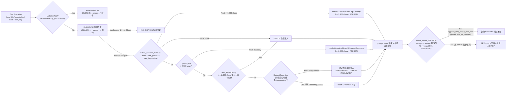

# Agent_US 3.1–3.2 Prefix KV Cache、ACI Anti-Bloat 与 SWE-bench 50 题实证报告

- **基线版本**: `origin/main` @ `b7b525e`
- **主测模型与协议**: `deepseek-v4.1-flash`（OpenAI 兼容链路，`maxSteps = 60`，`turnTimeoutMs = 900,000`）
- **实证数据集**: HuggingFace `MariusHobbhahn/swe-bench-verified-mini`（`subset = paper-50`，`seed = 42`，共 `50` 题：`django/django` `25` 题 + `sphinx-doc/sphinx` `25` 题）
- **对比双臂（100 轮隔离 Docker 容器）**: `raw_full`（`aciProfile = raw_full`，关闭准入与 DTOC）vs `full_aci`（`aciProfile = full_aci`，启用 `cache_aware_v31` 与 3.2.1 确定性准入防膨胀）
- **核心证据目录**: [evidence/swebench-mini50/summary.md](evidence/swebench-mini50/summary.md)、[evidence/swebench-mini50/swebench-paper-table.tex](evidence/swebench-mini50/swebench-paper-table.tex)

---

## 摘要（Executive Summary）

Agent_US 3.1–3.2 围绕长程代码修复场景中的两大工程瓶颈展开协同演进：**长轨迹下的 Prefix KV Cache 稳定性**，以及**超长工具输出与重复探针引发的上下文膨胀（Context Bloat）**。在 3.1 夯实同轮 `reasoning_content` 回传、`promptOutput` 一致性落库、单调追加前缀保证与 `cache_aware_v31` 缓存破坏摊销门控的基础上，3.2 引入 `42,000` 字符主动 `read_file` 工作集保护、`DUPLICATE` 前置哈希去重（含 `__probe__:*` 变更失效）、`EXEC_ERROR_TOOLS` 错误正则隔离、超长执行日志与搜索结果的保真/聚类摘要、同模型/思考模型零延迟确定性准入分流（`Supervisor Cost = 0`），以及原生挂载 `/testbed` 的 SWE-bench Docker 隔离评测与 GitHub Actions 分片并行基础设施。

在 **SWE-bench Verified Mini 全量 50 题（双臂共 100 轮真机 Docker 容器执行与自动判分）** 上，相比 `raw_full` 基线，`full_aci` 实现了性能与效率的双重显著提升：

1. **解决率净升 +6.00 个百分点（相对提升 +16.7%）**：`36.00% (18/50)` $\rightarrow$ **`42.00% (21/50)`**；Non-Empty Patch Rate 达到 **`100.00% (50/50)`**（`raw_full` 为 `98.00% (49/50)`）。
2. **已解决效率大幅优化**：Tokens/Resolved 由 `3,314,561` 降至 **`2,963,502`**（**`-10.59%`**）；在双方均通过的配对题集（`n = 13`）上，配对 Token 总量由 `16,275,639` 降至 `11,387,344`，**Paired Resolved Token Reduction 达到 `+30.03%`**；总耗时由 `14,471,307 ms` 降至 **`13,552,121 ms`**（**`-6.35%`**）。
3. **高缓存命中率与零监督开销并存**：Real Provider Cache Hit Rate 稳定维持在 **`96.69%`**（`59,051,904 / 61,070,627, n = 50`，对比 `raw_full` `97.09%, n = 49` 仅差 `-0.40 pp`），`ACI Admission Token Reduction Rate` 达 **`20.31%`**（`235,519 / 1,159,547`），`Supervisor Cost` 严格为 **`0 calls / 0 tok / 0 ms`**。
4. **分仓库表现呈现显著结构性收益**：在 `django/django`（`n = 25`）上以相同解决率（`56.0%`, `14/25`）削减 **`20.37%`** 总 Token 与 **`28.07%`** 耗时（配对减耗 `+26.63%`, `n = 10`）；在更复杂、上下文易膨胀的 `sphinx-doc/sphinx`（`n = 25`）上将解决率由 `16.0% (4/25)` 推升至 **`28.0% (7/25)`**（**`+12.0 pp`**，相对提升 **`+75.0%`**，配对减耗 `+33.51%`, `n = 3`）。

---

## 1. 3.1–3.2 核心架构演进



### 1.1 3.1 Coding & Prefix KV Cache Foundation

在代码 Agent 的多轮工具调用场景中，每一次对历史前缀（Prefix）的修改都会导致上游 Provider 的 Prefix KV Cache 失效并触发重算。3.1 版本重构了核心运行时的前缀不变量与 DTOC 触发门控：

1. **同轮 `reasoning_content` 完整回传与跨轮剥离**:
   - 在单轮多步推理循环中，[AgentLoop](../src/kernel/agent-loop.js) 将每步模型输出的 `stepResult.reasoning` 保留在内存消息 `assistantMsg.reasoning` 中，并通过 `onAssistantMessage` 回调持久化写入 `direct_messages.reasoning`（[direct-agent.js](../src/direct-agent.js)）。
   - 在通过 OpenAI 兼容协议向上游请求下一步工具调用时，[pool.js](../src/pool.js) 中的 `toOpenAiMessages()` 检测 `m.role === 'assistant' && typeof m.reasoning === 'string' && m.reasoning.length > 0`，自动序列化回传 `reasoning_content: m.reasoning` 字段，满足 DeepSeek 等思考模型同轮工具链的连续推理协议要求（而 Anthropic 链路则严格禁止构造未签名 thinking 块）。
   - 当进入下一用户轮次时，[ContextAssembler.assemble()](../src/context/assembler.js) 对已完结历史轮次消息执行 `delete cleanMsg.reasoning`，防止陈旧思考链跨轮累积挤占上下文预算。

2. **`promptOutput` 落库一致性与单调追加前缀保证**:
   - [AgentLoop](../src/kernel/agent-loop.js) 在批处理准入后计算 `promptOutput = excerpt(String(admittedOutputs[batchIdx] ?? output ?? ''), 32000)` 并压入当前请求 `messages`，同时把相同的 `promptOutput` 传给 `onToolResult`。
   - [DirectAgentRuntime](../src/direct-agent.js) 在 `onToolResult` 中将 `excerpt(String(promptOutput ?? output ?? ''), 32000)` 写入 `direct_messages.content`，消除了“内存提示词使用折叠摘要、数据库持久化却保存原始大文本”导致重启恢复或跨轮重建时 KV 前缀字节漂移的问题。
   - 配合 session 级静态 `nonce`（`buildStaticSystemPrompt(nonce)`）与历史 `liveContextTail` 边界回放（[assembler.js](../src/context/assembler.js)），系统提示词与 Turn $1 \dots k-1$ 历史字节序列保持严格单调追加（append-only）。

3. **`cache_aware_v31` DTOC 门控（`48,000` Token Floor + `0.35 * invalidatedSuffixTokens` 摊销）**:
   - [DirectAgentRuntime](../src/direct-agent.js) 将 `full_aci` / `aci_31` Profile 默认解析为 `CACHE_AWARE_V31_DTOC_POLICY`（`'cache_aware_v31'`），水位线配置为 `CACHE_AWARE_V31_EPOCH_WATERMARKS = [0.78, 0.9]`（[aci-engine.js](../src/context/aci-engine.js)）。
   - **Prompt Floor 保护**：在非紧急预算压力下，当 `tokensBefore < DEFAULT_V31_MIN_PROMPT_TOKENS`（**`48,000` tokens**）时，直接以 `reason: 'append_only_cache_floor_v31'` 短路返回 `triggered: false`，杜绝过早重写前缀。
   - **缓存破坏摊销门控**：当上下文超过 `48,000` tokens 且通过冷却步数检查（`DEFAULT_V31_EVICTION_COOLDOWN_STEPS = 6`）时，引擎定位最早的待驱逐消息下标 `firstCandidateIndex`，调用 `measureRequestComposition` 测算其后方将被失效的 KV 后缀体积 `invalidatedSuffixTokens`。在非临界压力（`singleStepRatio < 0.80 && !emergencyTriggered`）下，强制要求压缩带来的净节省满足：
     $$\text{combinedNetSavings} \ge \max\Big(3500,\ \lceil 0.35 \times \text{invalidatedSuffixTokens} \rceil\Big)$$
     （其中 `DEFAULT_V31_MIN_NET_SAVINGS_TOKENS = 3500`）。只有当预期回收体量至少能摊销被破坏缓存后缀的 **35%** 时才允许执行 Epoch 驱逐，否则以 `insufficient_net_savings` 跳过压缩，守住 Provider 端的高命中率。

### 1.2 3.2.1 ACI Anti-Bloat & Cache Protection

相比 2.5 与 2.6（见 [2.6-aci-agent-ui-report.md](2.6-aci-agent-ui-report.md) 与 [archive/2.5-aci-and-engineering-report.md](archive/2.5-aci-and-engineering-report.md)），Agent_US 3.2.1 针对真实大型 Python 仓库（Django、Sphinx）中的高频噪声与误折问题，在 [aci-admission.js](../src/context/aci-admission.js)、[supervisor.js](../src/context/supervisor.js) 与 [verifier.js](../src/governance/verifier.js) 中落地了七项关键机制：

| 机制模块 | 源码位置与关键符号 | 核心阈值与设计细节 |
| --- | --- | --- |
| **主动工作集保护与窄切片豁免** | `PreInjectionAdmissionController.admitBatch()` ([aci-admission.js](../src/context/aci-admission.js)) | `DEFAULT_WORKING_SET_READ_MAX_CHARS = 42000`：非错误、非诱饵（`!isDecoy`）且 `<= 42,000` chars 的 `read_file` 输出直接 `DIRECT`（`explicit_read_working_set`）；指定 `startLine`/`endLine` 且行数 `<= 400` 的非诱饵局部阅读判定为 `isNarrowSlice`（`narrow_line_slice`）直接放行，避免二次 `expand_context` 往返。 |
| **`DUPLICATE` 前置去重与 `__probe__:*` 失效** | `activeHashesByPath`, `invalidatePath()` ([aci-admission.js](../src/context/aci-admission.js)) | `DUPLICATE` 检查前置至 `isErr`、`isNarrowSlice`、`explicit_read_working_set` 与超长压缩之前；`grep`/`glob`/`inspect_repository`/`query_symbol_graph` 以 `__probe__:${lowerTool}:${stableArgsStringify(args)}` 存储 SHA-256 摘要；任一 `MUTATION_TOOLS` 写操作触发 `invalidatePath()` 时自动清空对应路径与全部 `__probe__:*` 键。 |
| **错误正则作用域收敛** | `EXEC_ERROR_TOOLS`, `ERROR_OUTPUT_RE` ([aci-admission.js](../src/context/aci-admission.js)) | `isErr` 仅对 `EXEC_ERROR_TOOLS`（`bash`、`start_process`、`run_diagnostics`）匹配 `ERROR_OUTPUT_RE`，避免被读取的源码文件内包含 `AssertionError`/`Error:`/`FAIL` 文本时误触发全量强制注入。 |
| **超长执行日志保真摘要** | `DEFAULT_OVERSIZED_EXEC_MIN_CHARS = 6000`, `renderOversizedExecLogSummary()` | 当 `bash`/`start_process`/`run_diagnostics` 输出 `> 6,000` chars 时压缩为 `SUPPORTING` 摘要（上限 `DEFAULT_OVERSIZED_EXEC_MAX_RENDERED_CHARS = 3200` chars）：保留 Head（前 20 行，25% 预算）、基于 `EXEC_FAILURE_CUE_RE` 提取的最多 12 个 Traceback/Failures 窗口（42% 预算）、Tail（末 30 行）及 `[ACI-REF artifact://...]` `expand_context` 恢复命令。 |
| **超长检索按文件/目录聚类** | `DEFAULT_OVERSIZED_SEARCH_MIN_CHARS = 4500`, `renderOversizedSearchClusteredSummary()` | 当非错误、非诱饵 `grep`/`glob` 输出 `> 4,500` chars 时渲染为上限 `DEFAULT_OVERSIZED_SEARCH_MAX_RENDERED_CHARS = 2800` chars 的聚类摘要：`grep` 按文件命中数降序聚合 Top 24 文件计数与 Top 10 文件示例行；`glob` 按两级目录聚合 Top 24 目录计数，均附带 `artifact://` 恢复引用。 |
| **同模型/思考模型零延迟分流** | `ContextSupervisor.resolveModel()` ([supervisor.js](../src/context/supervisor.js)), `resolveSupervisorExecutionConfig()` ([swebench-pool.js](../src/evaluation/swebench-pool.js)) | 在 `auto` 模式下检测到同主模型（`matchesMainModel`）、推理模型（`AUTO_SKIP_REASONING_RE` 或 `capabilities.reasoning === true`）或 `AUTO_SKIP_V4_RE`（`/deepseek-v4/i`）时自动禁用 LLM Supervisor 并零延迟回退至确定性准入（`DEFAULT_MIN_SUPERVISOR_BATCH_CHARS = 16000`），实现 **`Supervisor Cost = 0`**。 |
| **Verifier `/testbed/` 前缀与清理豁免** | `stripContainerOrWorkspacePrefix()`, `isExplicitFileDeleteCommand()` ([verifier.js](../src/governance/verifier.js)) | 对回执路径先 POSIX 规范化再剥离 `/testbed` 与 `/work` 前缀；放行针对临时复现文件/测试产物的显式清理命令，包括 `parseGitCleanSegment` / `matchesGitCleanSegment`（支持 `git -C <dir> clean -f`）与 `PROGRAMMATIC_DELETE_RE`（Python `os.remove`/`os.unlink`/`os.rmdir`、`Path(...).unlink()`、`shutil.rmtree()` 及 JS `fs.unlink`/`rm`）。 |

### 1.3 3.2 SWE-bench `/testbed` 容器隔离评测与云端并行基础设施

为在真实历史开源仓库环境中验证长程修补与缓存效果，3.2 构建了完整的容器隔离执行与云端并行评测体系：

- **`SweBenchDockerAdapter` 原生 `/testbed` 容器隔离**（[swebench-docker.js](../src/evaluation/swebench-docker.js)）：支持 `SWEBENCH_DOCKER_PRESETS`（`epoch` 镜像 `ghcr.io/epoch-research/swe-bench.eval.x86_64.{instance_id}:latest` 与 `official` 镜像），以 `--network=none`、内存/CPU 配额将宿主机工作区挂载为 `/testbed:rw`（工作目录 `/testbed`），注入 `DEFAULT_TESTBED_PATH`（`/opt/miniconda3/envs/testbed/bin:...`）与 `CONDA_DEFAULT_ENV=testbed`、`CONDA_PREFIX=/opt/miniconda3/envs/testbed`，并在容器内执行命令白名单与 `git` 反作弊历史窥探拦截。容器销毁前在非 Windows 平台以 `exec -u 0` 执行 `repairHostWorkspacePermissions()` 修复宿主机文件属主/权限，随后由 `safeRmRf()` 完成跨平台安全清理（遇权限错误自动递归 `chmod 0777` 或 `sudo -n rm -rf --` 回退，永不因清理抛错中断流程）。
- **单题环境故障隔离与自动化判分**（[benchmark-swebench.mjs](../scripts/benchmark-swebench.mjs)、[swebench-dataset-eval.js](../src/evaluation/swebench-dataset-eval.js)）：`isEnvironmentOrDockerError()` 捕获镜像拉取、解压、`/testbed` 挂载与 `ENOSPC` 错误并隔离记为 `status: 'env_error'`，配合 `--resume` 自动重试；`fetchSweBenchVerifiedDataset()` 从 HuggingFace Datasets Server 拉取 `MariusHobbhahn/swe-bench-verified-mini`（50 题）；`evaluateSweBenchPredictions()` 在干净 `/testbed` 容器内先 `git apply` 应用 `model_patch`，重置 `test_patch` 涉及的既有/新增文件后应用官方 `test_patch`，再由 `buildSweBenchEvalCommands()` 与 `parseEvalTestResults()` 自动调度并解析 `django/django`（`./tests/runtests.py --verbosity 2 --parallel 1`）、`sympy/sympy`（`bin/test -C --verbose`）与通用仓库（`pytest -rA --tb=short`）的 `FAIL_TO_PASS` 与 `PASS_TO_PASS` 结果。
- **URL 归一化、交错分片与 GitHub Actions 云端流水线**（[swebench-pool.js](../src/evaluation/swebench-pool.js)、[benchmark-swebench.mjs](../scripts/benchmark-swebench.mjs)、[swebench-benchmark.yml](../../.github/workflows/swebench-benchmark.yml)）：
  - `normalizeSweBenchEndpoint()` 按协议规范化上游地址（Anthropic 剥离 `/v1/messages` 或 `/messages`，OpenAI 保留自定义路径同时剥离 `/chat/completions`/`/completions`/`/responses`/`/models` 并为无路径根域补全 `/v1`，排除 `api.githubcopilot.com`）。
  - `--shard <index>/<total>` 调用 `sliceInstancesForShard()` 按 `idx % total === index - 1` 对子集做均衡交错分片；`--merge-shards` 执行 `getShardCandidateRank()` **6 级质量元组去重合并**（`[nonEnvError, teleAndPred, evaluatedGood, completed, cacheAvailable, nonEmptyPatch]`），生成全量 `summary.md` 与 `swebench-paper-table.tex`。
  - `.github/workflows/swebench-benchmark.yml` 仅通过 `workflow_dispatch` 触发，采用三段式作业编排：`prepare-matrix`（校验 `SWEBENCH_API_KEY` 与输入参数生成分片矩阵）$\rightarrow$ `run-shard`（清理 runner 磁盘、续跑/按需注入 `smoke-5` 种子、以 `--no-use-app-pool --docker-preset epoch --turn-timeout-ms 900000 --container-memory 3g --cleanup-images --evaluate` 并行跑分）$\rightarrow$ `merge-and-publish`（汇总分片、输出 `$GITHUB_STEP_SUMMARY`、上传产物并自动提交结果）。

---

## 2. SWE-bench Verified Mini 全量 50 题（100 轮真机 Docker 容器）实证结果

### 2.1 总体双臂对比（`raw_full` vs `full_aci`）

下表数据直接来自 [evidence/swebench-mini50/summary.md](evidence/swebench-mini50/summary.md)、[evidence/swebench-mini50/swebench-paper-table.tex](evidence/swebench-mini50/swebench-paper-table.tex) 及原始 `telemetry.*.jsonl` / `eval.*.jsonl` 聚合校验（`subset = paper-50`，`model = deepseek-v4.1-flash`，`maxSteps = 60`）：

| 指标（Metric） | `raw_full`（基线） | `full_aci`（3.2 ACI + `cache_aware_v31`） | 绝对/相对变化（Delta） |
| --- | ---: | ---: | ---: |
| **Resolved Rate** | `36.00% (18/50)` | **`42.00% (21/50)`** | **`+6.00 pp`**（相对 **`+16.7%`**） |
| **Completed Status** | `35/50`（11 failed, 3 cancelled, 1 reconciling） | `35/50`（14 failed, 1 cancelled, 0 reconciling） | 零 `reconciling` 挂起 |
| **Non-Empty Patch Rate** | `98.00% (49/50)` | **`100.00% (50/50)`** | **`+2.00 pp`** |
| **Tokens / Resolved** | `3,314,561` | **`2,963,502`** | **`-10.59%`** |
| **Paired Resolved Token Reduction (`n=13`)** | `0.00%` (`16,275,639` tok) | **`+30.03%`** (`11,387,344` tok) | **`-4,888,295` tok**（ratio of sums） |
| **Total Input Tokens** | `58,497,753` | `61,124,185` | `+4.49%`（因长难 Sphinx 题跑满步数） |
| **Total Output Tokens** | `1,164,337` | **`1,109,362`** | **`-4.72%`** |
| **Total Tokens (Mean / Instance)** | `59,662,090` (`1,193,242`) | `62,233,547` (`1,244,671`) | `+4.31%` |
| **Real Provider Cache Hit Rate** | `97.09%` (`54,571,392 / 56,207,643`, `n=49`) | **`96.69%`** (`59,051,904 / 61,070,627`, `n=50`) | `-0.40 pp`（高位持平） |
| **Steps (Mean)** | `1,630` (`32.60`) | `1,792` (`35.84`) | `+3.24` steps/instance |
| **Wall-Clock Time (Mean)** | `14,471,307 ms` (`289,426 ms`) | **`13,552,121 ms`** (`271,042 ms`) | **`-6.35%`**（`-919,186 ms`） |
| **ACI Admission Token Reduction** | `0.00% (0 / 0)` | **`20.31% (235,519 / 1,159,547)`** | 准入净拦截 `235.5K` tokens |
| **DTOC Epoch Transitions** | `0` | `4` | 仅超长轨迹触发 4 次 |
| **Supervisor Cost** | `0 calls / 0 tok / 0 ms` | **`0 calls / 0 tok / 0 ms`** | 零额外延迟与成本 |

在全量 `full_aci` 的 `2,267` 次工具准入决策中，分布为：`DIRECT = 2,067`（`91.18%`）、`SUPPORTING = 158`（`6.97%`）、`DEFER = 41`（`1.81%`）、`DUPLICATE = 1`（`0.04%`）、`IRRELEVANT = 0`。主动工作集保护使 `91%` 以上的核心源码切片得以原样保留，同时将 `199` 次超长执行日志、大范围搜索及冗余读取温和折叠，在不损害模型理解的前提下直接削减 `20.31%` 的工具注入 Token。

### 2.2 按仓库分层对比（`django/django` vs `sphinx-doc/sphinx`）

`paper-50` 子集包含 `django/django`（`25` 题）与 `sphinx-doc/sphinx`（`25` 题），两者在代码耦合度与测试输出体积上存在显著差异，分层统计结果揭示了 ACI 3.2 的双重收益模式：

| 仓库子集 | 指标 | `raw_full` | `full_aci` | 对比变化 |
| --- | --- | ---: | ---: | --- |
| **`django/django`** (`n = 25`) | **Resolved Rate** | `56.0% (14/25)` | `56.0% (14/25)` | 打平（`0.0 pp`） |
| | **Total Tokens (In + Out)** | `21,979,110` (`21,516,582 + 462,528`) | **`17,500,956`** (`17,085,150 + 415,806`) | **`-20.37%`** |
| | **Steps (Mean)** | `760` (`30.40`) | **`670`** (`26.80`) | **`-11.84%`** |
| | **Wall-Clock Time** | `6,720,081 ms` | **`4,833,611 ms`** | **`-28.07%`** |
| | **Real Cache Hit Rate** | `96.82%` (`18,621,184 / 19,231,855`, `n=24`) | `96.33%` (`16,451,584 / 17,079,213`, `n=25`) | `-0.49 pp` |
| | **Admission Reduction** | `0.00%` | `11.32% (41,872 / 369,881)` | — |
| | **Paired Token Red (`n=10`)** | `8,230,484` | **`6,038,419`** | **`+26.63%`** |
| **`sphinx-doc/sphinx`** (`n = 25`) | **Resolved Rate** | `16.0% (4/25)` | **`28.0% (7/25)`** | **`+12.0 pp`**（相对 **`+75.0%`**） |
| | **Total Tokens (In + Out)** | `37,682,980` (`36,981,171 + 701,809`) | `44,732,591` (`44,039,035 + 693,556`) | `+18.71%`（深水区步数扩展） |
| | **Steps (Mean)** | `870` (`34.80`) | `1,122` (`44.88`) | `+28.97%` |
| | **Wall-Clock Time** | `7,751,226 ms` | `8,718,510 ms` | `+12.48%` |
| | **Real Cache Hit Rate** | `97.23%` (`35,950,208 / 36,975,788`) | `96.84%` (`42,600,320 / 43,991,414`) | `-0.39 pp` |
| | **Admission Reduction** | `0.00%` | **`24.52% (193,647 / 789,666)`** | 显著拦截 Sphinx 搜索/日志噪声 |
| | **Paired Token Red (`n=3`)** | `8,045,155` | **`5,348,925`** | **`+33.51%`** |

- **Django 上的纯效率加速**：在中等复杂度的 `django/django` 上，两臂同样解出 `14` 题，但 `full_aci` 减少了 `90` 步探索（`760 -> 670`），总 Token 下降 **`20.37%`**，端到端耗时下降 **`28.07%`**，在保持几乎一致缓存命中率的同时大幅压缩推理与等待成本。
- **Sphinx 上的解决率跃迁**：`sphinx-doc/sphinx` 存在大量重型 AST/Docutils 交叉引用与冗长检索结果。`full_aci` 准入控制器在 Sphinx 上触发了 **`24.52%`** 的 Token 缩减（`193,647` tokens，是 Django 缩减率的 2.17 倍），避免了早期上下文被 `grep` 与 `pytest` 日志撑爆，支撑模型完成更深度的定位与验证，使解决率从 `16.0% (4/25)` 跃升至 **`28.0% (7/25)`**（相对提升 **`+75.0%`**）。

### 2.3 胜负分布与失败模式深度剖析（Win/Loss & Failure-Mode Deep-Dive）

交叉核对 `eval.raw_full.jsonl`、`eval.full_aci.jsonl` 与 `predictions.*.jsonl`，50 题双臂结果分布如下：

- **双赢（Both Resolved）**：`13` 题（`django` `10` 题 + `sphinx` `3` 题）。配对总 Token 由 `16,275,639` 降至 `11,387,344`（**`+30.03%`**），其中经典案例如 `sphinx-doc__sphinx-8035` 在 `raw_full` 中消耗 60 步 / `6,897,008` 总 Token（`failed` 状态勉强通过），而在 `full_aci` 中仅用 42 步 / `1,240,403` 总 Token 即 `completed` 通过，单题节省 **`82.0%`** Token。
- **`full_aci` 独赢（`8` 题）**：
  1. **6 题规避 `raw_full` 的 `test_patch_apply_failed` 并全量通过**：在 `raw_full` 中，以下 **6** 道题全部在 `evaluateSweBenchPredictions()` 阶段因 `test_patch_apply_failed` 判负，而 `full_aci` 保持了干净的上下文聚焦与精准修改范围，全部一次性通过（`FAIL_TO_PASS` 与 `PASS_TO_PASS` 100% 通过）：
     - `django__django-12039`：`full_aci` 15 步（`281,825` tok）仅改 `django/db/backends/ddl_references.py` 通过（`1/1` F2P, `11/11` P2P）；`raw_full` 19 步（`454,100` tok）额外改了 `tests/backends/test_ddl_references.py` 与 `tests/indexes/tests.py` 并触发 `test_patch_apply_failed`。
     - `django__django-12308`：`full_aci` 20 步（`279,854` tok）通过（`2/2` F2P, `20/20` P2P）；`raw_full` 21 步（`319,157` tok）触发 `test_patch_apply_failed`。
     - `django__django-11999`：`full_aci` 36 步（`854,988` tok）通过（`1/1` F2P, `30/30` P2P）；`raw_full` 22 步（`308,198` tok）触发 `test_patch_apply_failed`。
     - `django__django-12325`：`full_aci` 21 步（`295,573` tok）完成并全过（`2/2` F2P, `201/201` P2P）；`raw_full` 在 60 步卡死进入 `reconciling`（`2,324,443` tok）且 `test_patch_apply_failed`，`full_aci` 单题节省 **`87.28%`** 总 Token。
     - `sphinx-doc__sphinx-9281`：`full_aci` 45 步（`1,189,524` tok）仅改 `CHANGES` 与 `sphinx/util/inspect.py` 通过（`1/1` F2P, `38/38` P2P）；`raw_full` 29 步（`607,245` tok）触发 `test_patch_apply_failed`。
     - `sphinx-doc__sphinx-9230`：`full_aci` 31 步（`625,410` tok）通过（`1/1` F2P, `44/44` P2P）；`raw_full` 32 步（`793,495` tok）触发 `test_patch_apply_failed`。
  2. **2 题攻克 `raw_full` 的 `failed_tests` 高难 Sphinx 任务**：
     - `sphinx-doc__sphinx-10673`：`raw_full` 消耗 60 步 / `4,776,172` tok 仍未通过测试；`full_aci` 在第 57 步以 `3,250,365` tok 干净通过（节省 `31.9%` Token）。
     - `sphinx-doc__sphinx-8638`：`raw_full`（44 步）在 `tests/test_domain_py.py::test_info_field_list_var` 失败（F2P `0/1`, P2P `34/34`）；`full_aci`（60 步）精准定位字段列表变量解析边界并完成修复（F2P `1/1`, P2P `34/34`）。
- **`raw_full` 独赢（`5` 题）——诚实剖析**：
  - `django__django-12273`：`full_aci`（40 步 `failed`）触发 `failed_tests`（F2P `0/2`, P2P `27/27`）。
  - `django__django-11848`：`full_aci`（18 步 `completed`）修改了 `tests/utils_tests/test_http.py` 并触发 `test_patch_apply_failed`，而 `raw_full`（31 步）仅修改 `django/utils/http.py` 成功通过。
  - `django__django-12143`：`full_aci` 在长程探索中触发了 `1` 次 DTOC epoch（39 步 `failed`），最终 `failed_tests`（F2P `0/1`）。
  - `django__django-12406`：`full_aci`（48 步）事实上通过了全部目标修复（F2P `3/3`），但同时修改了文档与表单逻辑导致 `PASS_TO_PASS` 回归 4 项（`161/165`, `passToPassFailed = 4`）。
  - `sphinx-doc__sphinx-10466`：`full_aci`（60 步 `failed`）未通过 F2P（`0/1`, P2P `6/6`），`raw_full` 在 20 步即直接修出通过。
- **整体失败原因分布**：

| 失败/结束原因（`eval.*.jsonl` `reason`） | `raw_full` (`n=50`) | `full_aci` (`n=50`) | 说明 |
| --- | ---: | ---: | --- |
| `resolved` | `18` | **`21`** | `full_aci` 净胜 `+3` 题（`+8` vs `-5`） |
| `test_patch_apply_failed` | `18` | **`15`** | 仍为两臂共同的首要未解瓶颈（两臂触发该原因的补丁均 100% 触及 `tests/` 文件） |
| `failed_tests` | `13` | `14` | `full_aci` 多出的 1 例来自 `sphinx-doc__sphinx-7748` 从 `empty_patch` 转为产出了实际修复补丁并进入测试判定 |
| `empty_patch` | `1` | **`0`** | `raw_full` 在 `sphinx-doc__sphinx-7748` 上 900s 超时取消且未生成补丁；`full_aci` 实现 `100%` 非空补丁 |

> [!NOTE]
> 关于 `cache_aware_v31` 的 DTOC Epoch 触发频率：`full_aci` 在全量 50 题共 `1,792` 步中仅在 `4` 道超长题目（`django__django-12143`、`sphinx-doc__sphinx-8548`、`sphinx-doc__sphinx-9229`、`sphinx-doc__sphinx-9461`）各触发 `1` 次 Epoch 压缩（合计 `4` 次）。这符合 `48,000` token floor 与 `0.35 * invalidatedSuffixTokens` 摊销门控的设计预期：绝大多数题目在 `PreInjectionAdmissionController` 过滤掉 `20.31%` 的工具输出冗余后，已无需通过破坏历史 KV Prefix 来换取空间。

---

## 3. 诚实边界与复现命令

### 3.1 诚实边界与数据口径说明

1. **数据集子集范围**：本次 50 题实证使用 `MariusHobbhahn/swe-bench-verified-mini`（`django/django` 25 题 + `sphinx-doc/sphinx` 25 题），并非完整 500 题 `princeton-nlp/SWE-bench_Verified`。面向 `sympy/sympy`、`scikit-learn/scikit-learn`、`pytest-dev/pytest` 等其他仓库的泛化表现仍需全量测试集进一步验证。
2. **Smoke-5 历史归档与种子复用**：早期 5 题烟雾测试产物已归档至 [evidence/archive/swebench-smoke5/summary.md](evidence/archive/swebench-smoke5/summary.md)（包含 `django__django-12050`、`django__django-12155`、`django__django-12209`、`sphinx-doc__sphinx-8035`、`sphinx-doc__sphinx-8721`）。在 GitHub Actions 流水线中可通过 `seed_smoke5`（仅当 `model=deepseek-v4.1-flash` 且非 `env_error` 时）跳过重复运行；本报告第 2 节全部统计数据均直接基于 [evidence/swebench-mini50/](evidence/swebench-mini50/summary.md) 中全量 50 题双臂 JSONL 产物逐行聚合计算。
3. **Cache Hit Rate 统计样本说明**：`raw_full` 中 `django__django-12325` 终止状态为 `reconciling`，未记入 `cacheEligibleInputTokens`（故 `raw_full` 真实缓存命中率分母统计 `n = 49`，`full_aci` 为 `n = 50`）。
4. **Supervisor 零开销边界**：由于 `deepseek-v4.1-flash` 在 `ContextSupervisor.resolveModel()` 与 `resolveSupervisorExecutionConfig()` 中自动回退为确定性准入（`Supervisor Cost = 0 calls / 0 tok / 0 ms`），本组实验验证的是 **ACI 3.1/3.2 确定性准入 + `cache_aware_v31`** 的效果，尚未评估叠加独立非推理轻量模型（如 `deepseek-chat`）作为 LLM Supervisor 时的额外收益与成本权衡。
5. **`test_patch_apply_failed` 残余瓶颈**：尽管 `full_aci` 将 `test_patch_apply_failed` 从 `18` 题降至 `15` 题，但该类失败仍占 `full_aci` 全部未通过题目的 `51.7% (15/29)`。即便 [swebench-dataset-eval.js](../src/evaluation/swebench-dataset-eval.js) 在应用 `test_patch` 前会对 `test_patch` 涉及文件执行 `git checkout --` / `rm -f --`，模型在预测补丁中对 `tests/` 目录或共享夹具的改写仍可能引入间接冲突，是后续 Prompt 约束与评测前补丁隔离的重点改进方向。

### 3.2 复现与门禁验证命令

```powershell
# 1. 离线确定性 KV-Cache 仿真（无需 Docker 或外部 API Key）
node backend/scripts/benchmark-swebench.mjs --dry-run

# 2. 下载并缓存 HuggingFace SWE-bench Verified Mini (50 题)
node backend/scripts/benchmark-swebench.mjs --fetch-dataset

# 3. 本地完整 50 题双臂隔离容器评测 + LaTeX 表导出
node backend/scripts/benchmark-swebench.mjs `
  --dataset hf:verified-mini `
  --subset paper-50 `
  --arms raw_full,full_aci `
  --model deepseek-v4.1-flash `
  --docker-preset epoch `
  --use-app-pool `
  --max-steps 60 `
  --turn-timeout-ms 900000 `
  --container-memory 3g `
  --cleanup-images `
  --evaluate `
  --export-latex `
  --output-dir backend/docs/evidence/swebench-mini50

# 4. 单分片运行与多分片 6 级质量去重合并（对应 GitHub Actions 并行模式）
node backend/scripts/benchmark-swebench.mjs --dataset hf:verified-mini --subset paper-50 --shard 1/5 --arms raw_full,full_aci --model deepseek-v4.1-flash --no-use-app-pool --docker-preset epoch --evaluate --output-dir /tmp/swebench-out/shard-1
node backend/scripts/benchmark-swebench.mjs --dataset hf:verified-mini --merge-shards /tmp/swebench-out/shard-1,/tmp/swebench-out/shard-2 --arms raw_full,full_aci --model deepseek-v4.1-flash --subset paper-50 --output-dir backend/docs/evidence/swebench-mini50 --export-latex

# 5. 标准代码静态检查与构建门禁
cd backend && npm run check
cd ../frontend && npx tsc --noEmit && npm run build
cd .. && node --check desktop/main.mjs
```

> 云端触发：在 GitHub 仓库配置 `SWEBENCH_API_KEY`（及可选 `SWEBENCH_ENDPOINT`）Secret 后，通过 Actions 页面 `workflow_dispatch` 启动 [SWE-bench Cloud Benchmark](../../.github/workflows/swebench-benchmark.yml)（默认 `subset=paper-50`、`shards=5`、`arms=raw_full,full_aci`）。

### 3.3 相关源码与证据索引

- **3.1–3.2 运行时与 ACI 核心**：[direct-agent.js](../src/direct-agent.js)、[pool.js](../src/pool.js)、[agent-loop.js](../src/kernel/agent-loop.js)、[assembler.js](../src/context/assembler.js)、[aci-admission.js](../src/context/aci-admission.js)、[aci-engine.js](../src/context/aci-engine.js)、[supervisor.js](../src/context/supervisor.js)、[verifier.js](../src/governance/verifier.js)
- **SWE-bench 评测与并行基础设施**：[swebench-docker.js](../src/evaluation/swebench-docker.js)、[swebench-dataset-eval.js](../src/evaluation/swebench-dataset-eval.js)、[swebench-pool.js](../src/evaluation/swebench-pool.js)、[benchmark-swebench.mjs](../scripts/benchmark-swebench.mjs)、[swebench-benchmark.yml](../../.github/workflows/swebench-benchmark.yml)
- **实证产物与历史报告**：
  - [evidence/swebench-mini50/summary.md](evidence/swebench-mini50/summary.md)
  - [evidence/swebench-mini50/swebench-paper-table.tex](evidence/swebench-mini50/swebench-paper-table.tex)
  - [evidence/swebench-mini50/telemetry.raw_full.jsonl](evidence/swebench-mini50/telemetry.raw_full.jsonl) & [evidence/swebench-mini50/telemetry.full_aci.jsonl](evidence/swebench-mini50/telemetry.full_aci.jsonl)
  - [evidence/swebench-mini50/eval.raw_full.jsonl](evidence/swebench-mini50/eval.raw_full.jsonl) & [evidence/swebench-mini50/eval.full_aci.jsonl](evidence/swebench-mini50/eval.full_aci.jsonl)
  - [evidence/swebench-mini50/predictions.raw_full.jsonl](evidence/swebench-mini50/predictions.raw_full.jsonl) & [evidence/swebench-mini50/predictions.full_aci.jsonl](evidence/swebench-mini50/predictions.full_aci.jsonl)
  - [evidence/swebench-mini50/subset.paper-50.instance_ids.json](evidence/swebench-mini50/subset.paper-50.instance_ids.json)
  - [evidence/archive/swebench-smoke5/summary.md](evidence/archive/swebench-smoke5/summary.md)
  - [2.6-aci-agent-ui-report.md](2.6-aci-agent-ui-report.md)
  - [archive/2.5-aci-and-engineering-report.md](archive/2.5-aci-and-engineering-report.md)
