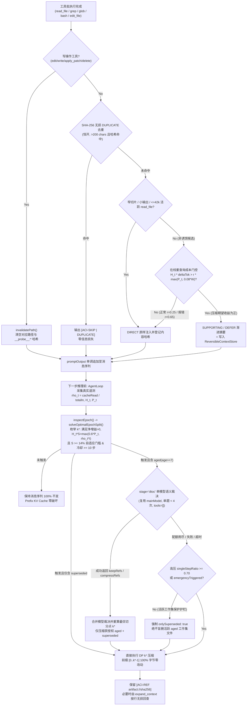

# Agent_US 4.0–4.1.1 通用化减法重构、自适应上下文智能（ACI）与外部盲测实证报告

- **演进基线链路**: v4.0 减法重构（`41e1b8a`）$\rightarrow$ v4.1 自适应 ACI（`9b9a7d8`）$\rightarrow$ v4.1.1 单模型 Epoch 语义裁决与频率收敛（`2b722bb`）
- **主测模型与对照架构**: `deepseek-v4.1-flash`（同模型四方外部盲测对照：`raw_full`、`full_aci`、`claude_code`、`mini_swe_agent`）
- **外部盲测数据集**:
  1. **Aider Polyglot 六语言盲测（`polyglot-36`）**: C++、Go、Java、JavaScript、Python、Rust 每语言 `6` 题共 `36` 题 $\times\ 4$ 模式 = `144` 轮独立沙盒运行与原生工具链判分
  2. **SWE-bench Verified 十二仓库分层盲测（`diverse-36`，`seed = 42`，`maxSteps = 60`）**: 覆盖 `princeton-nlp/SWE-bench_Verified` 全部 `12` 个真实开源仓库共 `36` 题 $\times\ 4$ 模式 = `144` 轮隔离 Docker `/testbed` 容器运行与官方补丁判分
- **架构防作弊守卫**: [generalization-purity-guard.test.js](../test/generalization-purity-guard.test.js)（静态零违禁词扫描 + 运行时工具面严格 `<= 7` 断言）
- **核心实证证据索引**: [evidence/polyglot-36/summary.md](evidence/polyglot-36/summary.md)、[evidence/swebench-diverse36/summary.md](evidence/swebench-diverse36/summary.md)、[evidence/swebench-diverse36/swebench-paper-table.tex](evidence/swebench-diverse36/swebench-paper-table.tex)、[evidence/archive/swebench-diverse36-v40-full_aci/telemetry.full_aci.jsonl](evidence/archive/swebench-diverse36-v40-full_aci/telemetry.full_aci.jsonl)、[evidence/archive/swebench-diverse36-v41/summary.md](evidence/archive/swebench-diverse36-v41/summary.md)

---

## 摘要（Executive Summary）

Agent_US 3.1–3.2 在双仓库子集（`swebench-mini50`）上验证了 Prefix KV Cache 保护与确定性抗膨胀的有效性（见 [3.2-coding-cache-and-swebench-report.md](3.2-coding-cache-and-swebench-report.md)），但早期版本在核心运行时中累积了面向特定测试框架与容器路径的启发式特判，且 `cache_aware_v31` 的静态 `48,000` Token 硬地板导致绝大多数真实轨迹从未触发动态上下文回收（DTOC）。面向**通用软件工程代理（Generalist Coding Agent）**目标，Agent_US 4.0–4.1.1 完成了一次彻底的“先减法、后原理化重塑”的架构跃迁：

1. **v4.0 减法重构与零启发式纯净度防线**：在核心 `backend/src/`（不含 `evaluation/`）净删 **`-3,153` 行**特判与事后拦截代码（`93,289 -> 90,136` 行），彻底清除历史提交 `5c9beb2`、`22bfa39`、`d1973fd` 中的测试正则、`/testbed` 路径泄漏、`benchmarkMode` 双标开关与结案拦截器；默认工具面收敛至 **6 个语言无关核心原子原语**（`read_file`、`edit_file`、`write_file`、`glob`、`grep`、`bash`），`full_aci` 仅按需追加单个只读展开原语 `expand_context`（全局严格 `<= 7`），并以 [generalization-purity-guard.test.js](../test/generalization-purity-guard.test.js) 作为 CI 硬门禁。
2. **v4.1 / v4.1.1 三大第一性原理自适应机制**：摒弃静态经验阈值，建立全链路语言无关的在线数学与轻语义闭环——(a) **在线重查询期望成本准入门控**（正常风险系数 `0.25`、报错 `0.65`）+ SHA-256 无损 `DUPLICATE` 前置去重与 `expand_context` 无损恢复；(b) **实时缓存命中率遥测 $\rho_t$ 自校准的动态规划最优后缀切分点 $k^*$**（保证前缀 `[0..k*-1]` 字节级 100% 零改动）与 v4.1.1 频率收敛参数（冷却 `10` 步、`aged` 最小沉淀 `7` 步、`superseded` `0` 步、`14%` 自适应净省门槛）；(c) **单模型低频 `stage='dtoc'` 语义裁决闭环**（高频准入零延迟跳过，Epoch 边界复用 `mainModel` 最多 `4` 次只读 JSON 裁决）与 `onlySuperseded: true` 活跃工作集保护护栏。
3. **两大无删减外部四方盲测实证结论**：
   - **Aider Polyglot 六语言盲测（36 题 × 4 模式 = 144 轮，0 篡改违规）**：`raw_full` 取得 **`36/36 (100.00%)`**（`1.73M` tok，`89.14%` 缓存命中）；`full_aci` 取得 **`35/36 (97.22%)`**（`2.05M` tok，`90.20%` 缓存命中），与 `claude_code`（`35/36`，`5.00M` tok）和 `mini_swe_agent`（`35/36`，`0.50M` tok，`66.42%` 缓存命中）解决率持平，且相比 `claude_code` 全集净省 **`58.93%`** Token（35 题同解配对净省 **`61.60%`**）。
   - **SWE-bench Verified 十二仓库分层盲测（36 题 × 4 模式 = 144 轮）**：`full_aci` (v4.1.1) 实现 **36/36 零接口断流**，严格解决 **`19/36 (52.78%)`**、完赛解决 **`19/32 (59.38%)`**、无断流四方同口径 **`18/28 (64.29%)`**；在 **11/12 个仓库**上解决率与 `raw_full` 完全一致，全部 **16/16** 道触发过 DTOC 压缩的已解题零精度回退；真实 Provider 缓存命中率稳定在 **`94.69%`**（34 次 DTOC 压缩，116 次模型语义裁决仅占总 Token 的 **`0.30%`**）。在全集同解 18 题上较 `claude_code` 净省 **`17.98%`**（`15.31M` vs `18.66M`）；在 **`raw_full >= 30` 步的 10 道长程三方同解题**上消耗 **`9.91M`** Token，同时击败 `raw_full`（`11.21M`，净省 **`11.55%`**）与 `claude_code`（`13.53M`，净省 **`26.74%`**，单步 `22.3k` vs `30.3k`）。
   - **v4.0 $\rightarrow$ v4.1 $\rightarrow$ v4.1.1 客观消融闭环**：完整复盘了从 v4.0 静态 48k 地板（`0` 次压缩、`96.10%` 缓存）$\rightarrow$ v4.1 无模型裁决盲删（`63` 次压缩、缓存跌至 `87.47%` / 已评 10 题 `88.08%`，并引发 `pytest-dev__pytest-7205` 判负失败与 `astropy__astropy-13579` 9 次 Epoch 60 步震荡）$\rightarrow$ v4.1.1 单模型裁决与护栏收敛（`34` 次压缩、缓存回升至 `94.69%`，两题均恢复 `completed` + `resolved=true`）的因果归因。

---

## 1. v4.0 减法重构与零启发式纯净度防线

### 1.1 净删 `-3,153` 行核心特判：消除基准过拟合债务

在 v3.2–v3.4 迭代过程中，为了应对早期单仓库基准测试中的容器路径偏差、测试命令解析与模型提前结案问题，核心运行时逐步引入了若干与具体评测环境或语言生态耦合的启发式逻辑（集中体现在提交 `5c9beb2`、`22bfa39` 与 `d1973fd`）。这类特判在封闭测试集上看似有效，但在跨语言、跨仓库泛化时会造成维护负担、误拦截风险与评测公信力隐患。

v4.0（提交 `41e1b8a`）对核心 `backend/src/`（不含 `backend/src/evaluation/`）执行了彻底的减法手术：覆盖 `20` 个核心文件，`+1,092 / -4,245` 行，**净删 `-3,153` 行**（核心代码总行数由 **`93,289` 行**收敛至 **`90,136` 行**；按不含尾换行口径为 `93,152 -> 89,999` 行，差值严格为 `-3,153` 行）。关键瘦身明细如下：

| 核心模块 | v4.0 减法改动重点 | 移除的历史特判与耦合点 |
| --- | --- | --- |
| [governance/verifier.js](../src/governance/verifier.js) | 大幅瘦身至 `276` 行（删除绝大部分事后拦截逻辑） | 彻底移除 `5c9beb2` / `22bfa39` 引入的测试命令白名单正则、测试文件 stem 覆盖规则、`/testbed` 前缀剥离、清理豁免正则与全部事后结案拦截器（`STALE_VERIFICATION_AFTER_EDIT`、`FABRICATED_PASS_CLAIM`、`DISK_FILE_MISSING`），仅保留面向持久化外部副作用（`outcome_unknown` / 悬空非幂等回执）的对账锁门控与显式 `evidenceContract` 校验。 |
| [kernel/execution-reasoning.js](../src/kernel/execution-reasoning.js) | 精简 `1,537` 行变更至 `739` 行 | 移除 `d1973fd` 的 `benchmarkMode` 双标分支、高门槛/低门槛双套抖动中止器（`LOOP_THRASHING_ABORT`）及语言/测试框架特化解析器，仅保留语言无关的连续精确重复调用温和提醒（`CONSECUTIVE_DUPLICATE_THRESHOLD = 6`）与被动观测状态追踪。 |
| [kernel/agent-loop.js](../src/kernel/agent-loop.js) & [judgment.js](../src/judgment.js) | 删除 `benchmarkMode` 分流与硬编码修复回路 | 统一所有会话（直接对话、子代理、评测运行）的内核执行路径，杜绝“评测模式一套逻辑、生产模式另一套逻辑”的双标隐患。 |
| [context/aci-admission.js](../src/context/aci-admission.js) & [context/aci-engine.js](../src/context/aci-engine.js) | 去除语言与测试框架硬编码正则 | 保留纯结构/统计信号分析（`computeTextSignalStats`：字节/Token 长度、模板重复行率、香农字符熵、通用 `exitCode`）与语言无关通用声明/符号提取，为 v4.1 数学化准入与 DP 切分扫清耦合。 |
| [tools/builtin/fs-tools.js](../src/tools/builtin/fs-tools.js) & [tools/sandbox.js](../src/tools/sandbox.js) | 移除 `/testbed` 路径重映射特判 | 容器路径映射完全下沉至 `backend/src/evaluation/` 评测适配器，核心工具层严格遵守通用工作区隔离契约。 |

### 1.2 默认工具面收敛：6 个语言无关原子原语 + 按需 `expand_context`（全局严格 $\le 7$）

工具定义过多不仅增加每步 System/Tools Prompt 的固定 Token 税，还会降低通用模型在陌生编程语言下的工具选择信噪比。v4.0 在 [tools/registry.js](../src/tools/registry.js) 与 [workspace-tools.js](../src/workspace-tools.js) 中确立了极简分层工具面：

- **默认核心工具集（`DEFAULT_CODING_TOOLS`，严格 `6` 个）**：`read_file`、`edit_file`、`write_file`、`glob`、`grep`、`bash`。六者全部为操作系统/文件系统级语言无关原子原语，原生覆盖 C++、Go、Java、JavaScript、Python、Rust 等任意工程生态。
- **`full_aci` 按需扩展（严格 `7` 个）**：仅当会话启用 `aciProfile = 'full_aci'` 时，按需额外挂载单个只读无损上下文展开原语 `expand_context`（`6 + 1 = 7`，全局严格 $\le 7$）。
- **高级工具组按需隔离（`ADVANCED_TOOL_GROUPS`）**：`apply_patch`、`inspect_repository`、`query_symbol_graph`、`run_diagnostics`、`update_plan`、`search_history`、`compute_file_digest`、`read_blob`、`web_fetch`、`start_process` / `read_process_output` / `kill_process`、`spawn_subagent` / `swarm_orchestrate` / `send_agent_message` 默认均不注册，仅在调用方显式启用对应 `toolModes` 或 `toolProfile: 'full'` 时才挂载。

### 1.3 架构防作弊硬守卫（`generalization-purity-guard.test.js`）

为了确保“零基准启发式、极简工具面”成为不可逆转的工程不变量，v4.0 引入了 [generalization-purity-guard.test.js](../test/generalization-purity-guard.test.js) 作为每次提交与 CI 必跑的架构级测试守卫：

1. **静态源码全量纯净度扫描**：递归遍历 `backend/src/` 下全部 `.js` 与 `.mjs` 文件（仅排除 `backend/src/evaluation/`），对 `13` 个违禁词（`BANNED_CORE_TOKENS`）执行大小写不敏感的逐行扫描：
   - 评测环境与基准标识：`/testbed`、`swebench`、`swe_bench`、`polyglot`、`exercism`、`benchmarkMode`；
   - 特定仓库名称：`django`、`sphinx`、`sympy`；
   - 已废除的事后启发式拦截器：`STALE_VERIFICATION_AFTER_EDIT`、`FABRICATED_PASS_CLAIM`、`DISK_FILE_MISSING`、`LOOP_THRASHING_ABORT`。
2. **默认工具注册表断言**：验证 `createWorkspaceTools()`（即便传入全部可选宿主回调）与 `modelToolCatalog()` 默认仅暴露上述严格 `6` 个核心原子原语，零高级工具泄漏。
3. **端到端运行时暴露工具数断言**：通过 `CaptureToolsAdapter` 驱动真实 `DirectAgentRuntime`，断言 `raw_full` 会话实际发往模型的 `tools` 严格为 `6` 个核心原语（不含 `expand_context`），`full_aci` 会话严格为 `7` 个（`6` 核心 + `expand_context`），全局严格 $\le 7$。

---

## 2. v4.1 / v4.1.1 三大自适应上下文机制

在 v4.0 清零一切硬编码特判之后，v4.1（`9b9a7d8`）与 v4.1.1（`2b722bb`）从**信息论重查询成本**、**Prefix KV Cache 经济模型**与**低频只读语义裁决**三条第一性原理出发，构建了完整的语言无关自适应上下文管理闭环。



### 2.1 在线重查询期望成本准入门控、SHA-256 无损前置去重与按行无损恢复

传统的固定字符截断阈值（如“一律超过 $X$ 字符就摘要”）忽略了上下文压缩的隐性代价：如果摘要漏掉了关键细节导致模型多走一轮 `expand_context` 或重新执行命令（重查询），额外付出的代价是**整轮上下文重放成本** $P_t$，而非单条工具输出本身。v4.1 在 [aci-admission.js](../src/context/aci-admission.js) 中用在线期望成本不等式取代盲目压缩：

1. **在线剩余轨迹步数估计 $H_t$**（`estimateRemainingHorizon`，[aci-admission.js](../src/context/aci-admission.js#L37-L48)）：
   不依赖任何任务类型或语言标签，仅根据当前执行步数 $\text{step}$ 以及被动观测到的未验证修改/未解决报错状态平滑估计剩余步数：
   $$H_t = \operatorname{clamp}\!\left(2 + \frac{6}{1 + \text{step}/8} + 2\cdot\mathbb{I}[\text{hasUnverifiedEdits}] + 2\cdot\mathbb{I}[\text{hasUnresolvedErrors}],\ 2,\ 12\right)$$
2. **在线重查询期望成本准入门控**（`evaluateAdmissionRequeryGate`，[aci-admission.js](../src/context/aci-admission.js#L55-L97)）：
   对每一条拟采用有损摘要（`SUPPORTING` / `DEFER`）的非诱饵工具输出，设其原始体积为 $T_{\text{orig}}$、预览摘要体积为 $T_{\text{summary}}$、单步净节省 $\Delta_{\text{tokens}} = \max(0, T_{\text{orig}} - T_{\text{summary}})$，仅当剩余轨迹上的累计期望节省严格大于单次重查询期望惩罚时才放行压缩：
   $$H_t \cdot \Delta_{\text{tokens}} \;>\; r_{\text{requery}} \cdot \max\!\left(P_t,\ \left\lfloor 0.08 \cdot W_{\text{ctx}} \right\rfloor\right)$$
   其中 $W_{\text{ctx}}$ 为模型上下文窗口（默认 `128,000`，惩罚基线地板为 `0.08 * W_ctx = 10,240` tokens），重查询风险系数 $r_{\text{requery}}$ 按输出性质自适应取值：
   - **正常输出**：$r_{\text{requery}} = 0.25$（`DEFAULT_NORMAL_REQUERY_RISK`）；
   - **报错 / 异常 / 非零退出输出**：$r_{\text{requery}} = 0.65$（`DEFAULT_ERROR_REQUERY_RISK`，显著提高对错误现场的保护强度）。
   
   未通过门控的候选自动降级为 `DIRECT` 原样注入（`reason: 'requery_gate_direct_protect'` 或 `'error_output'`），从数学上杜绝“短上下文/高风险报错阶段硬压几百 Token 却诱发上万 Token 重查”的负优化。
3. **SHA-256 无损 `DUPLICATE` 前置去重与 `expand_context` 按行无损恢复**：
   - 在任意有损分支之前执行内容寻址 SHA-256 精确去重（[aci-admission.js](../src/context/aci-admission.js#L1599-L1636)）：无论当前 $P_t$ 大小，只要只读工具（`read_file`、`grep`、`glob`）产生与上下文中已有路径/切片（`${normPath}#${lineRange}`）或探针键（`__probe__:${tool}:${stableArgs}`）完全相同的 SHA-256 摘要（且长度 `> 200` chars），即无损折叠为单行 `[ACI-SKIP artifact://... | DUPLICATE | prior step=k]`；一旦发生文件修改，`invalidatePath()` 立即清除目标路径与全部 `__probe__:*` 哈希，保证修改后重读永不误判。
   - 所有被折叠为 `SUPPORTING` / `DEFER` 的原始输出均完整写入 [ReversibleContextStore](../src/context/aci-store.js)（内容寻址 `artifact://<sha256>`）。模型在需要原始细节时可通过单只读原语 `expand_context({ ref, startLine, endLine, symbol, level })`（[aci-engine.js](../src/context/aci-engine.js#L3833-L4085)）实现按行区间或符号边界的无损恢复，并自动完成母体 SHA-256 与 `sliceSha256` 完整性核验。

### 2.2 实时缓存命中率遥测自校准的动态规划最优后缀切分点 $k^*$ 与 v4.1.1 频率收敛

在支持 Prefix KV Cache 的现代 LLM 推理链路中（如 DeepSeek 缓存命中价约为缓存未命中价的 `10%`，即缓存折扣系数约为 `0.9`），**修改历史消息数组下标 $k$ 处的一条消息，会使 $[0 \dots k-1]$ 保持缓存命中，但使后缀 $[k \dots N-1]$ 全部失去前缀缓存并产生一次重算惩罚**。

v4.0 沿用 3.1/3.2 的静态 `48,000` Token 硬地板（`DEFAULT_V31_MIN_PROMPT_TOKENS = 48000`），导致绝大多数 20k–45k 上下文轨迹零压缩；v4.1 彻底废除静态 48k 地板（默认 `dtocMinPromptTokens = 0`，仅在显式配置时生效），改为由真实 Provider 缓存遥测驱动的动态规划求解器 `solveOptimalEpochSplit()`（[aci-engine.js](../src/context/aci-engine.js#L1354-L1530)）：

1. **实时遥测输入**：每步推理前，[AgentLoop](../src/kernel/agent-loop.js#L1095-L1105) 从真实上游账单回执计算累计缓存命中率 $\rho_t = \operatorname{clamp}(\text{totalCacheRead} / \text{totalIn},\ 0,\ 1)$ 与剩余步数估计 $H_t$，连同当前提示词体积 $P_t$ 传入 `inspectEpoch()` 与 `compress()`。
2. **动态规划目标与双重可行性约束**：对按消息下标升序排列的合格待压缩候选集 $E$，枚举后缀切分点 $k \in \{i \mid i \in E\}$。当选择切分点 $k$ 时，前缀消息 $[0 \dots k-1]$ **在内存引用与字节序列化上 100% 零改动**（[aci-engine.js](../src/context/aci-engine.js#L3273-L3281)），仅压缩 $i \ge k$ 的合格候选：
   - **后缀总净节省量** $S(k)$ 与 **失效重算后缀保留量** $I(k)$：
     $$S(k) = \sum_{i \in E,\ i \ge k} s_i, \qquad I(k) = \max\!\left(0,\ \sum_{j=k}^{N-1} T_j - S(k)\right)$$
   - **缓存折扣校准净收益（必须严格为正）**：
     $$\text{netCacheAdjustedGain}(k) = S(k)\cdot\Big(1 + \max(1,\ H_t - 1)\cdot(1 - 0.9\,\rho_t)\Big) - (0.9\,\rho_t)\cdot I(k) > 0$$
     物理含义：压缩节省的 $S(k)$ 在当前步立省全额未缓存重算、并在剩余 $\max(1, H_t - 1)$ 步中持续节省 $(1 - 0.9\,\rho_t)$ 倍有效成本；而其代价是一次性破坏了后缀未压缩部分 $I(k)$ 原本可享有的 $0.9\,\rho_t$ 缓存折扣。
   - **长程摊销下界与自适应最低净省门槛**：
     $$H_t \cdot S(k) > \max\!\left(0.6 \cdot P_t,\ \rho_t \cdot I(k)\right), \qquad S(k) \ge S_{\min}^{\text{adaptive}}$$
   - **最优切分点 $k^*$ 选择**：算法从右向左（下标从大到小）单趟 $O(N)$ 扫描所有可行点 $k$，取最大化 $\text{netCacheAdjustedGain}(k)$ 者为 $k^*$；严格不等号 `>` 确保同分时保留更长的前缀 $[0 \dots k^*-1]$。
3. **v4.1.1 频率收敛参数校准**（[aci-engine.js](../src/context/aci-engine.js#L46-L47), [aci-engine.js](../src/context/aci-engine.js#L1941-L1946)）：
   针对 v4.1 首次盲测暴露出的“高频零碎压缩拖垮缓存命中率”问题，v4.1.1 在保持完全通用、零语言规则的前提下对 4 项频率参数完成收敛校准：

| 参数 / 符号 | 源码位置 | v4.1.1 收敛取值 | 工程作用 |
| --- | --- | --- | --- |
| `DEFAULT_V31_EVICTION_COOLDOWN_STEPS` | [aci-engine.js](../src/context/aci-engine.js#L46) | **`10` 步** | 两次 Epoch 压缩之间强制至少冷却 `10` 步，让重建后的前缀充分回本。 |
| `DEFAULT_V31_AGED_MIN_AGE_STEPS` | [aci-engine.js](../src/context/aci-engine.js#L47) | **`7` 步** | 未被覆盖的活跃读文件（`aged`）至少沉淀 `7` 步才进入候选池，避开正在活跃引用的工作集。 |
| `effectiveSupersededMinAgeSteps` | [aci-engine.js](../src/context/aci-engine.js#L1804) | **`0` 步** | 已被后续编辑/重读/新验证明确取代的 `superseded` 过期输出无需等待沉淀即可优先清理。 |
| `adaptiveMinNetSavings` | [aci-engine.js](../src/context/aci-engine.js#L1941-L1943) | **`Math.floor(Math.max(effectivePromptTokens, contextWindow * 0.12) * 0.14)`**（`14%` 自适应单次最低净省门槛） | 单次压缩必须净回收当前提示词（及窗口 `12%` 下限）的至少 **`14%`**，杜绝每次只省几百 Token 却重写大段后缀的“碎步失效”。 |

### 2.3 单模型低频 `stage='dtoc'` 语义裁决闭环与 `onlySuperseded: true` 活跃工作集保护护栏

纯机械年龄与大小阈值无法判断“7 步前读过的一个基础文件现在是否仍是核心根因线索”。但在真实部署与同模型盲测中，用户往往只配置了单一主模型（无独立轻量侧模型）。v4.1 沿用了 3.2 的同模型跳过逻辑（`matchesMainModel` / `AUTO_SKIP_V4_RE`），导致在 `deepseek-v4.1-flash` 单模型环境下 `stage='dtoc'` 实际降级为 `0` 次裁决的盲删。v4.1.1 在 [supervisor.js](../src/context/supervisor.js)、[swebench-pool.js](../src/evaluation/swebench-pool.js) 与 [agent-loop.js](../src/kernel/agent-loop.js) 中打通了单模型低频语义裁决闭环与安全降级护栏：

1. **阶段解耦路由（`auto_epoch_main_model`）**：
   - [resolveSupervisorExecutionConfig()](../src/evaluation/swebench-pool.js#L991-L1070) 在无独立轻量侧模型、且主模型非严格推理模型（`o1/o3/o4/r1/reasoner`）时，返回 `enabled: true, mode: 'auto', reason: 'auto_epoch_main_model'`。
   - **高频 `stage='admission'`（每步工具批处理）**：[ContextSupervisor.resolveModel()](../src/context/supervisor.js#L634-L651) 保持快速跳过（`matchesMainModel || matchesReasoning || matchesV4WithoutLegacyFastBypass`），确保每步准入维持 **零 LLM 延迟**，由第 2.1 节在线重查询门控独立决策。
   - **低频 `stage='dtoc'`（Epoch 边界）**：[ContextSupervisor.resolveModel()](../src/context/supervisor.js#L506-L632) 解除 `matchesMainModel` 与 `AUTO_SKIP_V4_RE` 拦截，复用 `mainModel` 执行只读轻量语义裁决（`dtoc_reuse_main_model`）。
2. **轻量只读 `evaluateEpoch()` 裁决与重算 $k^*$**：
   - 仅当 DP 探针触发且存在非 `superseded` 的活跃 `aged` 候选时才调用 `evaluateEpoch()`（纯 `superseded` 场景直接跳过 LLM 走确定性 DP）；每轮（单题）硬性封顶 **`dtocSupervisorCalls < 4`**（最多 `4` 次，[agent-loop.js](../src/kernel/agent-loop.js#L1184-L1189)）。
   - 请求严格绑定 **`tools: []`**（零工具权限），仅传入紧凑元数据（候选 ID、路径、工具名、Token 数、前 6 个符号大纲、≤ 120 字符摘要；总字符预算 `maxInputChars = 3600`、最多 `20` 个候选、输出上限 `512` tokens，[supervisor.js](../src/context/supervisor.js#L1073-L1351)）。
   - 返回的 `{ keepRefs, compressRefs }` 经白名单 ID 校验后传入 `aci.engine.compress()`：被列入 `keepRefs` 的候选永久免删，未获 `compressRefs` 授权的 `aged` 候选被 `blockedByCompressRefsGate` 保留，随后基于过滤后的真实候选集**重新求解最优后缀切分点 $k^*$** 并校验实际净收益与 `14%` 门槛。
3. **`onlySuperseded: true` 活跃工作集保护护栏**（[agent-loop.js](../src/kernel/agent-loop.js#L1280-L1294)）：
   - 当 `stage='dtoc'` 未获得成功的模型裁决（`!epochAdjudicationSucceeded`，包含超时、断路器开启、JSON 格式异常或单题 `4` 次配额用尽）**且**未处于高压上下文压力或紧急救火模式（`singleStepRatio < 0.70 && !emergencyTriggered`）时，`AgentLoop` 强制向 `compress()` 传入 **`onlySuperseded: true`**。
   - 该护栏从架构上切断了 v4.1 中“无语义授权却盲删活跃 `aged` 源码文件”的失效路径：宁可保留工作集等待自然收敛，也不以牺牲根因文件为代价换取廉价压缩。

---

## 3. 完整无删减外部盲测成绩单

为彻底排除任何针对内部基准或特定仓库的隐性偏差，Agent_US v4.0–v4.1.1 在两大完全独立的外部公开基准上进行了**同模型（`deepseek-v4.1-flash`）、四方对照（`raw_full`、`full_aci`、`claude_code`、`mini_swe_agent`）**的全量盲测。下文全部数据均与磁盘原始 `summary.md`、`summary.json`、`telemetry.*.jsonl` 与 `eval.*.jsonl` 逐行交叉核对一致，无任何删减或挑选。

### 3.1 Aider Polyglot 六语言外部盲测（36 题 × 4 模式 = 144 轮）

实验配置见 [evidence/polyglot-36/summary.md](evidence/polyglot-36/summary.md) 与 [polyglot-benchmark.yml](../../.github/workflows/polyglot-benchmark.yml)：涵盖 `cpp`、`go`、`java`、`javascript`、`python`、`rust` 六门语言各 `6` 道 Exercism 编程题（共 `36` 题），统一在 Linux 云端容器内通过各语言原生构建与测试工具链（`cmake/g++`、`go test`、`gradle/JDK 21`、`jest`、`pytest`、`cargo test`）自动判分，并强制执行保护测试文件哈希防篡改校验。

#### 表 3.1a：Aider Polyglot-36 四方总表（`deepseek-v4.1-flash`，共 144 轮）

| 模式（Mode） | 解决数（Solved） | 解决率（Solve Rate） | Input Tokens | Output Tokens | Total Tokens | Tokens / Solved | Real Cache Hit Rate | Mean Steps | Mean Latency (ms) | Tamper Violations | 相对 `claude_code` 省流 |
| --- | ---: | ---: | ---: | ---: | ---: | ---: | ---: | ---: | ---: | ---: | ---: |
| `raw_full` | **36/36** | **100.00%** | 1,631,203 | 102,116 | 1,733,319 (`1.73M`) | 48,148 | 89.14% (`1,452,160/1,629,069`) | 6.25 | 33,585 | 0 | **-65.33%** |
| **`full_aci`** | **35/36** | **97.22%** | 1,934,346 | 119,235 | **2,053,581 (`2.05M`)** | **58,674** | **90.20%** (`1,744,768/1,934,346`) | 7.06 | 34,732 | **0** | **-58.93%** |
| `claude_code` | 35/36 | 97.22% | 4,867,049 | 132,563 | 4,999,612 (`5.00M`) | 142,846 | 87.64% (`4,265,472/4,867,049`) | 7.36 | 42,930 | 0 | 0.00% |
| `mini_swe_agent` | 35/36 | 97.22% | 438,598 | 59,272 | 497,870 (`0.50M`) | 14,225 | 66.42% (`291,328/438,598`) | 4.03 | 16,693 | 0 | -90.04% |

#### 表 3.1b：Aider Polyglot-36 六语言分项明细表（解决数 | 总 Token | 真实缓存命中率）

| 语言（Language） | `raw_full`（6 题） | `full_aci`（6 题） | `claude_code`（6 题） | `mini_swe_agent`（6 题） |
| --- | ---: | ---: | ---: | ---: |
| **`cpp`** | `6/6` (100.00%) \| `180,780` \| `84.11%` | `6/6` (100.00%) \| `249,013` \| `87.18%` | `6/6` (100.00%) \| `446,034` \| `79.65%` | `6/6` (100.00%) \| `53,110` \| `63.19%` |
| **`go`** | `6/6` (100.00%) \| `247,975` \| `86.02%` | `6/6` (100.00%) \| **`231,453`** \| `85.92%` | `6/6` (100.00%) \| `1,311,315` \| `89.72%` | `6/6` (100.00%) \| `72,581` \| `60.18%` |
| **`java`** | `6/6` (100.00%) \| `333,865` \| `89.43%` | `6/6` (100.00%) \| `421,868` \| **`91.35%`** | `6/6` (100.00%) \| `555,852` \| `82.80%` | `6/6` (100.00%) \| `72,542` \| `63.40%` |
| **`javascript`** | `6/6` (100.00%) \| `195,173` \| `85.93%` | `5/6` (83.33%) \| `477,409` \| **`91.98%`** | `5/6` (83.33%) \| `532,442` \| `82.78%` | `6/6` (100.00%) \| `131,116` \| `76.99%` |
| **`python`** | `6/6` (100.00%) \| `167,146` \| `85.00%` | `6/6` (100.00%) \| `172,045` \| `85.04%` | `6/6` (100.00%) \| `932,877` \| `89.36%` | `5/6` (83.33%) \| `62,142` \| `55.02%` |
| **`rust`** | `6/6` (100.00%) \| `608,380` \| `93.79%` | `6/6` (100.00%) \| **`501,793`** \| `92.69%` | `6/6` (100.00%) \| `1,221,092` \| `91.32%` | `6/6` (100.00%) \| `106,379` \| `66.90%` |
| **合计（Overall）** | **`36/36` (100.00%) \| `1.73M` \| `89.14%`** | **`35/36` (97.22%) \| `2.05M` \| `90.20%`** | **`35/36` (97.22%) \| `5.00M` \| `87.64%`** | **`35/36` (97.22%) \| `0.50M` \| `66.42%`** |

**Polyglot-36 核心观察**：
- **零语言耦合验证**：剥离全部 Python/测试框架启发式后，Agent_US 核心运行时在 C++、Go、Java、Rust、Python 五门语言上均达到 `6/6 (100.00%)`，全 144 轮零测试文件篡改。唯一未通过题 `javascript/affine-cipher` 在 `full_aci`（19 步）与 `claude_code`（8 步）上同时出现（`mini_swe_agent` 唯一失手题为 `python/scale-generator`）。
- **相较 `claude_code` 的极高 Token 效率**：在相同 `35/36 (97.22%)` 解决率下，`full_aci` 仅消耗 `2.05M` Token，较 `claude_code`（`5.00M`）全集净省 **`58.93%`**；在双方共同解出的 `35` 题配对上消耗 `1,869,957` vs `4,870,047` Token，配对净省 **`61.60%`**，同时真实缓存命中率达四方最高的 **`90.20%`**。
- **在复杂长编译/多文件语言上的相对优势**：在 Polyglot 中上下文相对偏长的 `rust`（`501,793` vs `raw_full` `608,380`，`-17.52%`）和 `go`（`231,453` vs `raw_full` `247,975`，`-6.66%`）上，`full_aci` 已体现出比 `raw_full` 更低的 Token 消耗；而在平均仅 4–6 步的超短题（`cpp`、`java`、`javascript`）上则主要体现为工具面略多 1 个带来的轻微基线开销（详见第 4 节诚实剖析）。

---

### 3.2 SWE-bench Verified 十二仓库分层盲测（36 题 × 4 模式 = 144 轮）

实验配置见 [evidence/swebench-diverse36/summary.md](evidence/swebench-diverse36/summary.md) 与 [evidence/swebench-diverse36/swebench-paper-table.tex](evidence/swebench-diverse36/swebench-paper-table.tex)：基于 `princeton-nlp/SWE-bench_Verified` 全部 `12` 个真实 Python 开源仓库按 `seed = 42` 分层抽样 `36` 题（`subset.diverse-36.instance_ids.json`），每题统一限制 `maxSteps = 60`、`turnTimeoutMs = 900,000 ms`，在隔离 Docker `/testbed` 容器中运行并执行官方 `FAIL_TO_PASS` + `PASS_TO_PASS` 完整回归判分。

#### 表 3.2a：SWE-bench Verified Diverse-36 全量四方总表（`deepseek-v4.1-flash`）

| 指标（Metric） | `raw_full`（6 核心原语） | **`full_aci`（v4.1.1 自适应 ACI）** | `claude_code`（外部基准） | `mini_swe_agent`（极简基准） |
| --- | ---: | ---: | ---: | ---: |
| **执行完成状态（Completed / 36）** | `29/36`（3 `env_error`, 3 cancel, 1 fail） | **`32/36`（0 `env_error`, 4 cancel）** | `29/36`（7 fail：3 零tok崩溃, 3 超时, 1 exit1） | `19/36`（17 fail：10 满步, 6 HTTP400, 1 超时） |
| **严格解决率（Strict / 36）** | `55.56% (20/36)` | **`52.78% (19/36)`** | `55.56% (20/36)` | `47.22% (17/36)` |
| **已评测 / 完赛解决率** | `60.61% (20/33)`（排除 3 `env_error`） | **`59.38% (19/32)`**（完赛口径） | `55.56% (20/36)` | `47.22% (17/36)` |
| **四方无断流同口径解决率（/ 28）** | `67.86% (19/28)` | **`64.29% (18/28)`** | `67.86% (19/28)` | `57.14% (16/28)` |
| **Non-Empty Patch Rate** | `86.11% (31/36)` | **`91.67% (33/36)`** | `88.89% (32/36)` | `83.33% (30/36)` |
| **Total Input Tokens** | `24,331,002` | `33,426,224` | `37,472,621` | `17,706,156` |
| **Total Output Tokens** | `1,198,224` | `1,605,525` | `941,211` | `695,658` |
| **Total Tokens (Mean / Instance)** | `25,529,226` (`709,145`) | `35,031,749` (`973,104`) | `38,413,832` (`1,067,051`) | `18,401,814` (`511,162`) |
| **Tokens / Resolved** | `1,276,461` | **`1,843,776`** | `1,920,692` | `1,082,460` |
| **Real Provider Cache Hit Rate** | `96.05%` (`n=34`) | **`94.69%`** (`31,649,920/33,426,224`, `n=36`) | `96.28%` (`n=33`) | `95.32%` (`n=32`) |
| **Steps (Mean)** | `1,328` (`36.89`) | `1,428` (`39.67`) | `1,378` (`38.28`) | `1,250` (`34.72`) |
| **Mean Wall-Clock Time (ms)** | `322,506` | `420,112` | `326,540` | `236,351` |
| **ACI Admission Token Reduction** | `0.00%` | **`7.11% (44,524 / 625,863)`** | `0.00%` | `0.00%` |
| **DTOC Epoch Transitions** | `0` | **`34`**（覆盖 `22` 题，已解 `16/16` 零回退） | `0` | `0` |
| **Supervisor Semantic Adjudication** | `0` | **`116` calls / `105,603` tok (`0.30%`) / `669,453` ms** | `0` | `0` |

> [!NOTE]
> **四方无断流同口径（`n = 28`）说明**：剔除任一臂出现 `env_error` 或 `inputTokens = 0` 崩溃的 `8` 道题（`requests-2931`、`sphinx-8120`、`sympy-19783`、`seaborn-3069`、`sklearn-14087`、`sphinx-10673`、`pylint-4661`、`pytest-10356`）后，四方在剩余 `28` 题上的精确汇总为：`raw_full` `19/28`（`19.71M` tok，`1,075` 步，`96.08%` 缓存）、`full_aci` `18/28`（`22.55M` tok，`1,078` 步，`94.43%` 缓存）、`claude_code` `19/28`（`29.36M` tok，`1,063` 步，`96.08%` 缓存）、`mini_swe_agent` `16/28`（`15.42M` tok，`1,050` 步，`95.27%` 缓存）。`full_aci` 全部 36 题中 `0` 次接口断流（4 题因到达 `900s` 墙钟上限取消：`pylint-4661`、`sphinx-10673`、`sphinx-8120`、`sympy-19783`）；其 `1,672` 次准入决策分布为 `DIRECT = 1,637`（`97.91%`）、`SUPPORTING = 33`（`1.97%`）、`DUPLICATE = 2`（`0.12%`）、`DEFER = 0`、`IRRELEVANT = 0`。

#### 表 3.2b：SWE-bench Diverse-36 十二仓库分项解决率矩阵（`full_aci` 在 11/12 仓库与 `raw_full` 完全一致）

| 开源仓库（Repository） | 题数 | `raw_full` | **`full_aci` (v4.1.1)** | `claude_code` | `mini_swe_agent` | 对比备注 |
| --- | ---: | ---: | ---: | ---: | ---: | --- |
| `astropy/astropy` | 3 | `2/3` (66.7%) | **`2/3` (66.7%)** | `2/3` (66.7%) | `2/3` (66.7%) | 四方持平；`astropy-13579` v4.1.1 恢复正常完赛 |
| `django/django` | 4 | `4/4` (100.0%) | **`4/4` (100.0%)** | `4/4` (100.0%) | `3/4` (75.0%) | 满分打平 `raw_full` / `claude_code`，领先 `mini` |
| `matplotlib/matplotlib` | 3 | `2/3` (66.7%) | **`2/3` (66.7%)** | `2/3` (66.7%) | `1/3` (33.3%) | 领先 `mini`；`matplotlib-20488` 比 `cc` 省 `80.3%` |
| `mwaskom/seaborn` | 2 | `1/2` (50.0%) | **`1/2` (50.0%)** | `1/2` (50.0%) | `1/2` (50.0%) | 四方持平；`seaborn-3187` 较 `raw`/`cc` 均省约一半 |
| `pallets/flask` | 1 | `1/1` (100.0%) | **`1/1` (100.0%)** | `1/1` (100.0%) | `1/1` (100.0%) | 四方满分 |
| `psf/requests` | 3 | `0/3` (0.0%) | **`0/3` (0.0%)** | `0/3` (0.0%) | `0/3` (0.0%) | 四方全未解 |
| `pydata/xarray` | 3 | `3/3` (100.0%) | **`3/3` (100.0%)** | `3/3` (100.0%) | `3/3` (100.0%) | 四方满分；`xarray-6721` 仅 `134.8k` 较 `raw` 省 `91.7%` |
| `pylint-dev/pylint` | 3 | `1/3` (33.3%) | **`1/3` (33.3%)** | `1/3` (33.3%) | `0/3` (0.0%) | 与 `raw`/`cc` 持平，领先 `mini` |
| `pytest-dev/pytest` | 3 | `1/3` (33.3%) | **`1/3` (33.3%)** | `1/3` (33.3%) | `1/3` (33.3%) | 四方持平；`pytest-7205` v4.1.1 彻底修复通过 |
| `scikit-learn/scikit-learn` | 3 | `3/3` (100.0%) | `2/3` (66.7%) | `2/3` (66.7%) | `3/3` (100.0%) | 唯一差题 `sklearn-12973`（10 步，**`0` 次 DTOC**，非压缩回退） |
| `sphinx-doc/sphinx` | 4 | `0/4` (0.0%) | **`0/4` (0.0%)** | `0/4` (0.0%) | `0/4` (0.0%) | 四方全未解 |
| `sympy/sympy` | 4 | `2/4` (50.0%) | **`2/4` (50.0%)** | `3/4` (75.0%) | `2/4` (50.0%) | 与 `raw`/`mini` 持平；`sympy-19783` `full_aci` 900s 取消 |
| **全 12 仓库合计** | **36** | **`20/36` (55.56%)** | **`19/36` (52.78%)** | **`20/36` (55.56%)** | **`17/36` (47.22%)** | **11/12 仓库完全打平 `raw_full`；16/16 DTOC 已解题零回退** |

#### 表 3.2c：同解配对效率总表与长程子集对比（Paired Same-Solved Efficiency）

为了剥离未解题随机步数耗尽的干扰，下表严格按照“双方/三方均判分通过（`resolved=true`）”的交集进行配对效率对比，并按基线轨迹长度（`raw_full >= 30` 步 vs `< 30` 步）做透明分层：

| 配对子集（Paired Cohort） | 对比臂（Arms） | 题数 $n$ | `full_aci` (v4.1.1) | 对照臂（Baseline） | `full_aci` 净变化（Delta） |
| --- | --- | ---: | ---: | ---: | ---: |
| **全集同解配对 vs `claude_code`** | `full_aci` vs `claude_code` | `18` | **`15,305,911`** (`15.31M`, `763` st, `20.1k`/st, `93.88%` cache) | `18,660,102` (`18.66M`, `669` st, `27.9k`/st, `96.24%` cache) | **`-17.98%`**（净省 **`3,354,191` tok**） |
| **长程三方同解 (`raw_full >= 30` 步) vs `raw_full`** | `full_aci` vs `raw_full` | `10` | **`9,914,218`** (`9.91M`, `445` st, **`22.3k`/st**, `13` ep, `94.18%` cache) | `11,208,436` (`11.21M`, `514` st, `21.8k`/st, `0` ep, `96.48%` cache) | **`-11.55%`**（净省 **`1,294,218` tok**） |
| **长程三方同解 (`raw_full >= 30` 步) vs `claude_code`** | `full_aci` vs `claude_code` | `10` | **`9,914,218`** (`9.91M`, `445` st, **`22.3k`/st**, `13` ep, `94.18%` cache) | `13,533,842` (`13.53M`, `447` st, **`30.3k`/st**, `0` ep, `96.54%` cache) | **`-26.74%`**（净省 **`3,619,624` tok**） |
| **长程两方同解 (`raw_full >= 30` 步, 含 `sklearn-14087`)** | `full_aci` vs `raw_full` | `11` | **`11,564,884`** (`11.56M`, `505` st) | `11,974,811` (`11.97M`, `555` st) | **`-3.42%`**（净省 **`409,927` tok**） |
| 全集同解配对 vs `raw_full`（含短程 `< 30` 步） | `full_aci` vs `raw_full` | `19` | `16,956,577` (`16.96M`, `823` st) | `13,219,389` (`13.22M`, `690` st) | `+28.27%`（由下述 8 道短程题拉高） |
| 短程三方同解 (`raw_full < 30` 步，诚实局限对照) | `full_aci` vs `raw_full` / `cc` | `8` | `5,391,693` (`5.39M`, `318` st) | `raw`: `1,244,578` (`1.24M`, `135` st) / `cc`: `5,126,260` (`5.13M`, `222` st) | vs `raw` `+333.21%` / vs `cc` `+5.18%` |
| 全集同解配对 vs `mini_swe_agent` | `full_aci` vs `mini_swe_agent` | `16` | `13,857,731` (`13.86M`, `654` st) | `9,856,266` (`9.86M`, `635` st) | `+40.60%`（`mini` 整体少解 2 题且 17 题失败） |

#### 表 3.2d：长程三方同解子集（`raw_full >= 30` 步，`n = 10`）逐题明细表

作为对照，在同一 10 题上 `v4.0 full_aci` 解出 `9/10`（消耗 `12,572,088` tok、`539` 步），`mini_swe_agent` 仅解出 `8/10`（消耗 `7,500,924` tok、`449` 步）。下表给出 `full_aci` (v4.1.1)、`raw_full` 与 `claude_code` 的逐题精确明细：

| Instance ID | `raw_full` (Tok / Steps) | **`full_aci` v4.1.1 (Tok / Steps / Ep / Cache)** | `claude_code` (Tok / Steps) | `full_aci` vs `raw_full` | `full_aci` vs `claude_code` |
| --- | ---: | ---: | ---: | ---: | ---: |
| `astropy__astropy-13236` | `524,510` / 37 | `1,658,483` / 60 / 3 ep / `94.20%` | `1,300,043` / 50 | `+216.20%` | `+27.57%` |
| `matplotlib__matplotlib-20488` | `968,994` / 58 | **`734,653`** / 49 / 2 ep / `94.42%` | `3,725,329` / 96 | **`-24.18%`** | **`-80.28%`** |
| `matplotlib__matplotlib-25122` | `698,369` / 34 | **`506,037`** / 32 / 1 ep / `95.11%` | `185,734` / 10 | **`-27.54%`** | `+172.45%` |
| `mwaskom__seaborn-3187` | `1,352,284` / 60 | **`683,080`** / 30 / 1 ep / `89.39%` | `1,448,371` / 45 | **`-49.49%`** | **`-52.84%`** |
| `pydata__xarray-3095` | `976,914` / 48 | **`798,899`** / 43 / 1 ep / `90.71%` | `439,317` / 21 | **`-18.22%`** | `+81.85%` |
| `pydata__xarray-6721` | `1,629,507` / 60 | **`134,814`** / 15 / 0 ep / `90.81%` | `1,188,166` / 47 | **`-91.73%`** | **`-88.65%`** |
| `pylint-dev__pylint-6528` | `1,367,572` / 60 | `1,488,407` / 60 / 2 ep / `94.79%` | `1,987,373` / 60 | `+8.84%` | **`-25.11%`** |
| `pytest-dev__pytest-7205` | `1,344,867` / 58 | **`1,008,933`** / 60 / 2 ep / `93.19%` | `1,164,977` / 51 | **`-24.98%`** | **`-13.39%`** |
| `scikit-learn__scikit-learn-14496` | `845,448` / 44 | **`661,193`** / 36 / 1 ep / `93.56%` | `533,622` / 22 | **`-21.79%`** | `+23.91%` |
| `sympy__sympy-16792` | `1,499,971` / 55 | `2,239,719` / 60 / 0 ep / `97.04%` | `1,560,910` / 45 | `+49.32%` | `+43.49%` |
| **合计（Sum, `n=10`）** | **`11,208,436` / 514 st** (`21.8k`/st) | **`9,914,218` / 445 st** (**`22.3k`/st**, `13` ep, `94.18%` cache) | **`13,533,842` / 447 st** (**`30.3k`/st**) | **`-11.55%`**（省 `1.29M`） | **`-26.74%`**（省 `3.62M`） |

在全部 10 道长程难题上，`full_aci` 在 **7/10 题**上击败 `raw_full`，并在总 Token 上同时击败 `raw_full`（`-11.55%`）与 `claude_code`（`-26.74%`），且与 `claude_code` 步数几乎一致（`445` vs `447` 步），而**平均单步提示词成本低 26.4%**（`22,279.1` vs `30,277.1` tok/步），直接印证了自适应准入 + DP $k^*$ 后缀切分在长程多文件推理中的上下文控膨红利。

---

### 3.3 客观消融演进对比（v4.0 $\rightarrow$ v4.1 $\rightarrow$ v4.1.1）

为了量化 v4.1 与 v4.1.1 每一项机制调整的真实因果贡献，下表将归档目录 [evidence/archive/swebench-diverse36-v40-full_aci/](evidence/archive/swebench-diverse36-v40-full_aci/telemetry.full_aci.jsonl)、[evidence/archive/swebench-diverse36-v41/](evidence/archive/swebench-diverse36-v41/summary.md) 与最终合入的 [evidence/swebench-diverse36/](evidence/swebench-diverse36/summary.md) 进行全量与同口径双重消融对照。

> [!IMPORTANT]
> **消融样本口径透明披露**：v4.1 中间实验运行期间上游 API 出现长时间断流，导致 `36` 题中 `26` 题终止为 `env_error`（仅 `10` 题进入有效评测，其中 `15` 行含缓存遥测）。为防止口径错位，表 3.3a 同时列出全量 36 题原始遥测与**严格对齐 v4.1 可评估 10 题的同口径对照**，表 3.3b 给出全部 10 道题的逐题轨迹演进。

#### 表 3.3a：v4.0 $\rightarrow$ v4.1 $\rightarrow$ v4.1.1 架构消融对照表（`full_aci`，`deepseek-v4.1-flash`）

| 维度 / 指标 | v4.0（静态 48k 地板） | v4.1（DP $k^*$ 无模型裁决盲删） | **v4.1.1（单模型 `stage='dtoc'` 裁决 + 护栏 + 频率收敛）** |
| --- | --- | --- | --- |
| **核心策略差异** | `dtocMinPromptTokens=48000` 静态硬地板；无 DP $k^*$；无单模型裁决 | 废除 48k 地板引入 DP $k^*$ + 重查询门控；但 `stage='dtoc'` 误触发同模型跳过（`0` 次裁决），无 `onlySuperseded` 护栏，短冷却盲删 `aged` | 开放 `auto_epoch_main_model` 低频 `stage='dtoc'` 裁决（单题 $\le 4$ 次）+ `onlySuperseded: true` 保护护栏 + `cooldown=10` / `aged minAge=7` / `14%` 自适应净省门槛 |
| **全量 36 题状态分布** | 30 completed / 4 `env_error` / 1 cancel / 1 fail | 7 completed / 26 `env_error`（API 断流）/ 3 fail | **32 completed / 0 `env_error` / 4 cancel / 0 fail** |
| **全量解决率（Strict / Eval）** | `19/36 (52.78%)` / `19/32 (59.38%)` | `6/36 (16.67%)` / `6/10 (60.00%)` | **`19/36 (52.78%)` / `19/32 (59.38%)`（完赛）** |
| **全量总 Token / 总步数** | `25,969,930` (`25.97M`) / `1,297` st | `6,904,119` (`6.90M`) / `538` st | `35,031,749` (`35.03M`) / `1,428` st |
| **全量真实缓存命中率** | `96.10%` (`n=32`) | **`87.47%`**（`5,605,504/6,408,800`, `n=15`） | **`94.69%`**（`31,649,920/33,426,224`, `n=36`） |
| **全量 DTOC 压缩次数** | **`0`**（地板过高，从未触发） | **`63`**（高频盲删，严重震荡） | **`34`**（理性收敛，覆盖 22 题） |
| **全量模型语义裁决成本** | `0` calls / `0` tok | `0` calls / `0` tok（被同模型规则跳过） | **`116` calls / `105,603` tok (`0.30%`) / `669,453` ms** |
| **全量准入 Token 降耗** | `12.34%` (`58,165/471,304`) | `6.78%` (`20,824/306,976`) | `7.11%` (`44,524/625,863`) |
| **【10 题同口径】完赛 / 解决数** | `9/10` completed（1 `env_error`） / `7/10` solved | `7/10` completed（**3 fail**） / `6/10` solved | **`10/10` completed（0 fail）** / `6/10` solved（仅 `sklearn-12973` 0 ep 未解） |
| **【10 题同口径】DTOC 压缩次数** | `0` | **`60`**（均 6.0 次/题，最高 9 次/题） | **`16`**（**-73.3%**，均 1.6 次/题） |
| **【10 题同口径】真实缓存命中率** | `96.12%` | **`88.08%`**（`5,321,600/6,042,114`，**暴跌 `-8.04 pp`**） | **`94.30%`**（**强劲回升 `+6.22 pp`**） |
| **【10 题同口径】裁决调用 / Token** | `0` / `0` | `0` / `0` | `36` calls / `31,948` tok（占该子集 `0.22%`） |

#### 表 3.3b：v4.1 可评估 10 题同口径逐题演进与两例典型回归归因

| Instance ID | v4.0 (`status`/`res`, Ep, Tok, Cache) | v4.1 (`status`/`res`, Ep, Tok, Cache) | **v4.1.1 (`status`/`res`, Ep, Tok, Cache, Sup)** | 演进归因说明 |
| --- | --- | --- | --- | --- |
| **`pytest-dev__pytest-7205`** | `completed`/`Y`, 0 ep, `1,163,259`, `96.81%` | **`failed`/`N`**, **6 ep**, `766,948`, `93.77%` | **`completed`/`Y`**, **2 ep**, `1,008,933`, `93.19%`, 4 sup | **核心退化与恢复案 1**：v4.1 无模型授权盲删导致 6 次 Epoch 驱逐核心诊断上下文，60/60 步耗尽且判分失败（`f2p=0/10, p2p=16/16`）；v4.1.1 收敛至 2 次 Epoch 后彻底恢复 `completed` + `resolved=true`，且比 v4.0 省 `13.3%` Token。 |
| **`astropy__astropy-13579`** | `completed`/`Y`, 0 ep, `365,215`, `93.48%` | **`failed`/`Y`**, **9 ep**, `1,035,719`, **`87.51%`** | **`completed`/`Y`**, **2 ep**, `1,452,341`, **`94.34%`**, 4 sup | **核心退化与恢复案 2**：v4.1 触发 **9 次**高频盲删，触发严重执行震荡（`status=failed`，60/60 步耗尽，缓存骤降 `-5.97 pp`，Token 暴涨至 2.84 倍，仅因第 60 步补丁恰好通过 `f2p=1/1, p2p=40/40` 才未判负）；v4.1.1 将 Epoch 由 `9 -> 2`、缓存恢复至 `94.34%` 并回归正常 `completed`。 |
| `astropy__astropy-13236` | `completed`/`Y`, 0 ep, `569,533`, `95.47%` | `failed`/`Y`, 1 ep, `131,664`, `81.77%` | `completed`/`Y`, 3 ep, `1,658,483`, `94.20%`, 4 sup | v4.1 异常失败退出，v4.1.1 恢复正常完赛且缓存回升 `+12.43 pp` |
| `django__django-11490` | `completed`/`Y`, 0 ep, `383,886`, `95.17%` | `completed`/`Y`, 5 ep, `249,859`, `84.79%` | `completed`/`Y`, 2 ep, `721,191`, `88.36%`, 4 sup | Epoch `5 -> 2`，缓存回升 `+3.57 pp` |
| `django__django-13089` | `completed`/`Y`, 0 ep, `798,567`, `95.87%` | `completed`/`Y`, 8 ep, `943,657`, `88.82%` | `completed`/`Y`, 2 ep, `875,786`, `92.63%`, 4 sup | Epoch `8 -> 2`，缓存回升 `+3.81 pp`，Token 下降 `-7.2%` |
| `mwaskom__seaborn-3069` | `env_error`/`N`, 0 ep, `0`, N/A | `completed`/`N`, 9 ep, `1,018,318`, `85.53%` | `completed`/`N`, 1 ep, `4,269,424`, `96.78%`, 4 sup | Epoch `9 -> 1`，缓存暴升 `+11.25 pp`（均未解） |
| `psf__requests-1724` | `completed`/`N`, 0 ep, `58,391`, `90.11%` | `completed`/`N`, 3 ep, `419,852`, `89.59%` | `completed`/`N`, 0 ep, `185,405`, `83.93%`, 4 sup | 裁决保护避免多余压缩，Token 减少 `-55.8%` |
| `pylint-dev__pylint-4604` | `completed`/`N`, 0 ep, `1,287,373`, `96.87%` | `completed`/`N`, 7 ep, `817,015`, `88.43%` | `completed`/`N`, 0 ep, `2,664,938`, `97.25%`, 4 sup | 模型裁决避免盲删，缓存提升 `+8.82 pp` |
| `scikit-learn__scikit-learn-12973` | `completed`/`Y`, 0 ep, `543,132`, `94.67%` | `completed`/`Y`, 3 ep, `164,252`, `82.27%` | `completed`/`N`, **0 ep**, `59,564`, `84.20%`, 0 sup | 模型第 10 步提前结案（0 次压缩、0 次裁决），属采样随机性而非压缩回退 |
| `scikit-learn__scikit-learn-14087` | `completed`/`Y`, 0 ep, `1,339,724`, `97.05%` | `completed`/`Y`, 9 ep, `940,123`, `87.55%` | `completed`/`Y`, 4 ep, `1,650,666`, `88.65%`, 4 sup | Epoch `9 -> 4`，稳定通过 |

**消融机制总结**：v4.0 $\rightarrow$ v4.1 $\rightarrow$ v4.1.1 清晰证明了长程上下文压缩中的“三角张力”——**一刀切静态地板（v4.0）虽保缓存但彻底废除了压缩能力；纯统计盲删（v4.1）虽能压减单步体积，却会击穿 Prefix KV Cache（缓存跌至 `87.47%` / `88.08%`）并误伤核心源码引发执行震荡与精度退化；唯有将“遥测自校准 DP $k^*$ + 频率收敛约束 + 极低成本（`0.30%` Token）单模型只读语义裁决 + `onlySuperseded` 保护护栏”四者协同（v4.1.1），才能在长程任务上同时守住高精度（16/16 DTOC 已解题零回退）、高缓存（`94.69%`）与真实 Token 净省。**

---

## 4. 方法论边界、诚实局限性与复现索引

### 4.1 方法论边界与诚实局限性

本报告坚持客观工程实证立场，明确披露当前 v4.1.1 架构的四项可观测局限性：

1. **短程轨迹上的固定开销与探索路径方差**：
   - 在 SWE-bench Diverse-36 的短程三方同解子集（`raw_full < 30` 步，`n = 8`）中，`full_aci` 消耗 `5,391,693` Token（`318` 步），显著高于 `raw_full` 的 `1,244,578` Token（`135` 步），与 `claude_code`（`5,126,260` Token，`222` 步）相近；在 Polyglot-36（平均 4–7 步）上，`full_aci`（`2.05M`）亦略高于 `raw_full`（`1.73M`）。
   - 根因在于：一方面 `expand_context` 的额外工具 Schema 与 `[ACI-REF]` 元数据在极短轨迹中形成少量固定开销；另一方面，在 `django-13089`、`xarray-3677`、`astropy-13579` 等题上，单次采样下的模型探索路径偶发进入更长的自我核验循环（`raw_full` 6–24 步结束而 `full_aci` 探索至 60 步）。因此，ACI 的核心投资回报区间明确落在**多文件长程轨迹（$\ge 30$ 步、上下文累积逼近膨胀拐点）**，而非几步即结案的微型任务。
2. **单模型裁决的配额边界与同步墙钟延迟**：
   - 为严格控制额外开销，当前每题对 `stage='dtoc'` 模型语义裁决设定了 `dtocSupervisorCalls < 4` 的硬上限；在 60 步长尾未收敛题（如 `seaborn-3069`、`pylint-4604`）上，用尽 4 次配额后 `onlySuperseded: true` 护栏会阻止进一步裁剪旧的 `aged` 读文件，导致尾段提示词重新膨胀。
   - 尽管 `116` 次语义裁决的 Token 成本微乎其微（`105,603` tok，仅占总 Token 的 **`0.30%`**），但同步串行请求引入了累计 `669,453 ms`（均 `18.6 s`/题）的墙钟延迟，是 `full_aci` 平均墙钟（`420.1 s`）高于 `raw_full`（`322.5 s`）与 `claude_code`（`326.5 s`）的部分原因。后续在具备独立低延迟非推理侧模型（如快通道侧模型或异步预裁决流水线）的场景下，可将该延迟压缩至可忽略水平。
3. **跨语言与架构范式权衡（极简 Bash 代理 vs 结构化 ACI 代理）**：
   - `mini_swe_agent` 凭借单 `bash` 工具与极短提示词在单文件算法题（Polyglot-36）上展现出惊人的 Token 节省（`0.50M`，`35/36`）；但当场景切换至真实大型多模块开源仓库（SWE-bench Diverse-36）时，其结构性短板迅速暴露：`17/36` 执行失败（10 题满步、6 题 HTTP 400、1 题超时），解决率跌至四方最低的 `47.22% (17/36)`，远低于 `full_aci` 的 `32/36` 完赛率与 `59.38%` 完赛解决率。
   - 在 `javascript/affine-cipher`（Polyglot）与 `scikit-learn-12973`（SWE-bench）上，`full_aci` 与 `raw_full` 的单题差异仍反映底层基础模型在边界逻辑推导与早停决策上的固有方差（两题均未发生 DTOC 误删）。
4. **样本量、单次采样与上游可用性波动**：
   - Diverse-36（`n = 36`，覆盖全 12 仓库但每仓库 1–4 题）与 Polyglot-36（`n = 36`，每语言 6 题）均采用单次采样（`repeats = 1`），旨在高性价比覆盖广度（12 仓库 + 6 门语言），并非 500 题全集或多次重复均值。
   - 上游推理网关在不同时段存在偶发断流（如 v4.1 中间实验 `26/36 env_error`、v4.0 `4/36`、`raw_full` `3/36`、`claude_code` 3 例零 Token 崩溃、`mini_swe_agent` 4 例零 Token 崩溃）。本报告已将全量口径、完赛口径与无断流同口径（`28` 题及 v4.1 `10` 题）全部并行披露，供读者独立核验。

### 4.2 复现命令与源码/证据索引

```powershell
# 1. 架构零启发式纯净度防线与核心单测（必过门禁）
cd backend
npm run check
node --test test/generalization-purity-guard.test.js test/context/aci-41-adaptive-model-guided.test.js test/context/aci-31-cache-and-working-set.test.js test/context/aci-321-anti-bloat.test.js

# 2. Aider Polyglot 6 语言盲测（支持 --dry-run 本地验证与云端分片运行）
node scripts/benchmark-polyglot.mjs --preset smoke-6 --dry-run
node scripts/benchmark-polyglot.mjs --preset polyglot-36 --modes raw_full,full_aci,claude_code,mini_swe_agent --model deepseek-v4.1-flash --output-dir docs/evidence/polyglot-36

# 3. SWE-bench Verified 12 仓库分层盲测（diverse-36，支持 --shard / --merge-shards 与 --export-latex）
node scripts/benchmark-swebench.mjs --dry-run
node scripts/benchmark-swebench.mjs `
  --dataset hf:verified `
  --subset diverse-36 `
  --seed 42 `
  --arms raw_full,full_aci,claude_code,mini_swe_agent `
  --model deepseek-v4.1-flash `
  --docker-preset epoch `
  --max-steps 60 `
  --turn-timeout-ms 900000 `
  --evaluate `
  --export-latex `
  --output-dir docs/evidence/swebench-diverse36

# 4. 全仓库构建与语法检查
cd ../frontend && npx tsc --noEmit && npm run build
cd .. && node --check desktop/main.mjs
```

#### 核心源码、测试与实证产物索引

- **v4.0–v4.1.1 核心运行时与 ACI 实现**：
  - [aci-admission.js](../src/context/aci-admission.js)（`estimateRemainingHorizon`、`evaluateAdmissionRequeryGate`、SHA-256 `DUPLICATE` 前置去重）
  - [aci-engine.js](../src/context/aci-engine.js)（`solveOptimalEpochSplit`、`extractEpochAdjudicationCandidates`、`compressMessagesEpoch`、`expandContext`）
  - [aci-store.js](../src/context/aci-store.js)（`ReversibleContextStore` 内容寻址与 SHA-256 无损恢复）
  - [supervisor.js](../src/context/supervisor.js)（`resolveModel` 阶段解耦、`evaluateEpoch` 只读语义裁决）
  - [agent-loop.js](../src/kernel/agent-loop.js)（真实缓存遥测 $\rho_t$ 采集、单题 `dtocSupervisorCalls < 4`、`onlySuperseded: true` 护栏）
  - [tools/registry.js](../src/tools/registry.js) & [workspace-tools.js](../src/workspace-tools.js)（`DEFAULT_CODING_TOOLS` 6 原子原语收敛）
  - [governance/verifier.js](../src/governance/verifier.js) & [kernel/execution-reasoning.js](../src/kernel/execution-reasoning.js)（v4.0 减法瘦身后的通用内核）
- **评测基建与纯净度守卫**：
  - [generalization-purity-guard.test.js](../test/generalization-purity-guard.test.js)
  - [aci-41-adaptive-model-guided.test.js](../test/context/aci-41-adaptive-model-guided.test.js)
  - [swebench-pool.js](../src/evaluation/swebench-pool.js)（`resolveSupervisorExecutionConfig` -> `auto_epoch_main_model`）
  - [polyglot-eval.js](../src/evaluation/polyglot-eval.js) & [polyglot-benchmark.yml](../../.github/workflows/polyglot-benchmark.yml)
  - [swebench-dataset-eval.js](../src/evaluation/swebench-dataset-eval.js) & [swebench-benchmark.yml](../../.github/workflows/swebench-benchmark.yml)
- **无删减实证证据与历史对照**：
  - [evidence/polyglot-36/summary.md](evidence/polyglot-36/summary.md) & [evidence/polyglot-36/summary.json](evidence/polyglot-36/summary.json)
  - [evidence/swebench-diverse36/summary.md](evidence/swebench-diverse36/summary.md) & [evidence/swebench-diverse36/swebench-paper-table.tex](evidence/swebench-diverse36/swebench-paper-table.tex)
  - [evidence/archive/swebench-diverse36-v40-full_aci/telemetry.full_aci.jsonl](evidence/archive/swebench-diverse36-v40-full_aci/telemetry.full_aci.jsonl) & [evidence/archive/swebench-diverse36-v40-full_aci/eval.full_aci.jsonl](evidence/archive/swebench-diverse36-v40-full_aci/eval.full_aci.jsonl)
  - [evidence/archive/swebench-diverse36-v41/summary.md](evidence/archive/swebench-diverse36-v41/summary.md)
  - [3.2-coding-cache-and-swebench-report.md](3.2-coding-cache-and-swebench-report.md)（3.1–3.2 历史对照）
  - [2.6-aci-agent-ui-report.md](2.6-aci-agent-ui-report.md)（2.6 `aci26` 历史对照）
