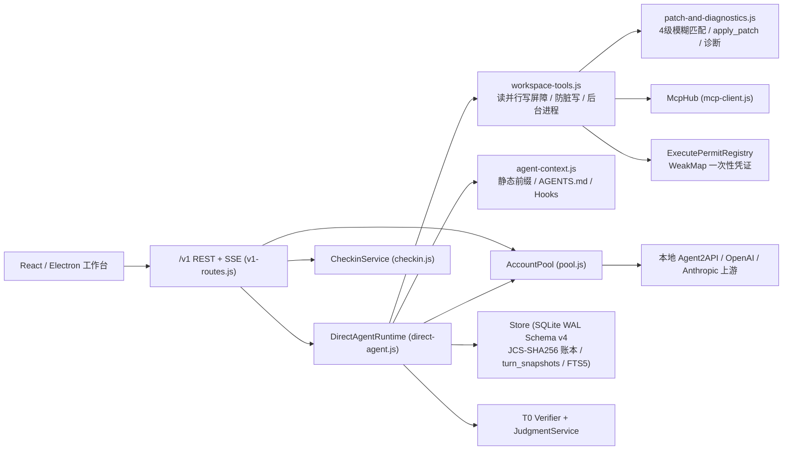

# Agent_US 后端架构说明

## 总体数据流

## 核心模块职责

1. **直连多轮运行时 (`direct-agent.js`)**
   - **Prompt Cache 稳定性**：每个会话持久化固定 `nonce`，静态系统指令与动态运行尾注分离（工作区路径、Git 分支、权限模式与项目规则放尾注），保证多轮对话前缀字节级命中缓存。
   - **读并行 / 写屏障调度 (`scheduleToolBatch`)**：只读工具（`read_file`、`glob`、`grep`、`search_history`、`web_fetch`）并发执行，写文件与命令工具按序串行屏障执行，并严格按原调用顺序持久化结果。
   - **快照回退与上下文预算**：写操作前将原文件 SHA-256 存入 `turn_snapshots`（复用 `blobs` 内容寻址表），支持确定性 `POST /v1/sessions/:id/rewind`（`code` / `conversation` / `both`）；结合模型真实上下文窗口实施两阶段压缩（Stage-1 工具输出裁剪 + Stage-2 LLM 语义交接摘要 `/compact`）。
   - **运行时护栏**：支持运行中实时纠偏 (`POST /v1/sessions/:id/steer`)、防死循环熔断器（连续 3 次同签名工具调用触发告警，第 2 轮熔断）、Agnes T0 确定性验证 (`verifyTurn`) 与可选 `JudgmentService.detectPrematureStop`。

2. **工作区工具、模糊补丁与即时诊断 (`workspace-tools.js`, `patch-and-diagnostics.js`, `mcp-client.js`)**
   - `edit_file` 实现 4 级渐进模糊匹配（exact → 行尾去空白 → 双端去空白 → Unicode 标点归一化）；`apply_patch` 支持 Codex 风格多文件原子增删改移。
   - `read_file` 跟踪文件 SHA-256，写前校验防外部脏写；每次写入后自动触发快速语法诊断（`.json` `JSON.parse`、`.js/.mjs/.cjs` `node --check`）。
   - 引号感知的命令前缀归一化 (`canonicalizeCommandPrefix`) 剥离壳封装并拦截未引用复合符与命令替换，支持安全可靠的会话级命令前缀白名单（`scope: 'session'`）。
   - 内置 `update_plan`、`search_history`（SQLite FTS5）、`start_process`/`read_process_output`/`kill_process`、`spawn_subagent`（支持并行扇出与临时 Git worktree 隔离）以及 `McpHub` stdio MCP 工具挂载。

3. **轻量化内置路由反代网关 (`pool.js`, `gateway-proxy.js`, `web-login.js`)**
   - 单进程内置，**零外部网关依赖、零空闲轮询**：采用本地 AES-256-GCM 密钥库加密存储供应商凭证。
   - 同时对外暴露 OpenAI (`POST /v1/chat/completions`) 与 Anthropic (`POST /v1/messages`，支持 `Bearer` 与 `x-api-key` 鉴权) 双向反代端点，内置无依赖 OpenAI ↔ Anthropic 流式/非流式协议互转与 GitHub Copilot 短期令牌内存自动换票缓存。
   - 内置原生 OpenRouter OAuth2 PKCE、GitHub Copilot OAuth 设备码登录与本机 CLI 凭证一键扫描导入；支持模型别名映射、优先级路由、429 冷却自动故障转移与 OpenAI `reasoning_effort` / Anthropic `thinking` + `cache_control` 透传。

4. **签到中心 (`checkin.js`)**
   - 支持 **Mode A（Agent2API 协议桥接）** 与 **Mode B（本地插件 `checkin-plugins/`）**，提供每日签到、定时计划、补签与记录查询。

5. **持久化与向后兼容 (`store.js`, `integrity.js`, `routes.js`)**
   - SQLite WAL Schema v4 维护 `direct_sessions`、`direct_turns`、`direct_messages`、`direct_messages_fts`、`turn_snapshots`、`provider_accounts`、`pool_models`、`model_mappings`、`checkin_*` 以及 RFC 8785 JCS + SHA-256 链式 `events` 账本。
   - 原 `/api/v1/*` DAG 路由保留挂载以兼容既有集成与自动化回归测试。
