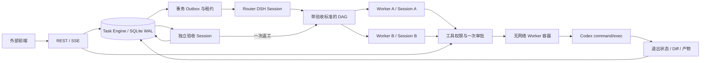
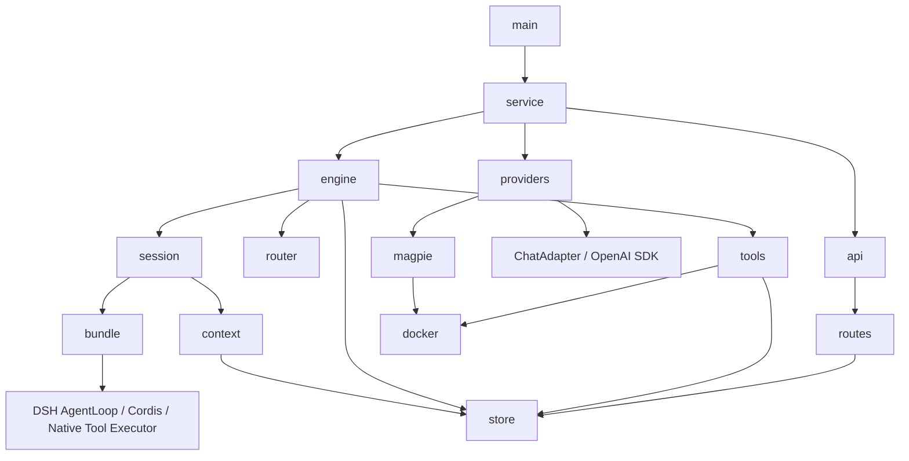

# 运行架构与依赖

`Store` 的实体行保留当前版本，`revisions` 保存旧值。任务提交与幂等键、规划作业一起落库。调度器在 `BEGIN IMMEDIATE` 内领取作业。尝试启动后以 2 秒间隔续租，发布时检查当前租约和任务状态。两条独立连接竞争时，只有当前持有者可以提交结果。

Router 生成拓扑有序的有向无环图，先验证唯一节点键和依赖存在性，再持久化。调度器只领取依赖已完成的节点，最多同时处理四个作业。每次尝试按角色和任务复杂度选择模型，考虑能力、上下文、速度、工具能力和价格。失败时可选择下一个候选模型。

审批绑定具体调用、动作参数、工作快照、Worker、租约和期限。消费授权和创建执行证据共用事务。执行后记录退出码、输出和变更，再由成功分派发布不可变交付记录。工作节点可以消费前驱的产物，任务状态更新仍由 Task Engine 处理。

Provider 通过 DSH `LlmAdapter` 注册。Magpie 的配置和 gateway API 均限于专用进程环境。原生通路与网关共用消息、工具参数增量、usage 和完成原因的协议适配。返回的 token 使用量按管理员指定费率计价。
