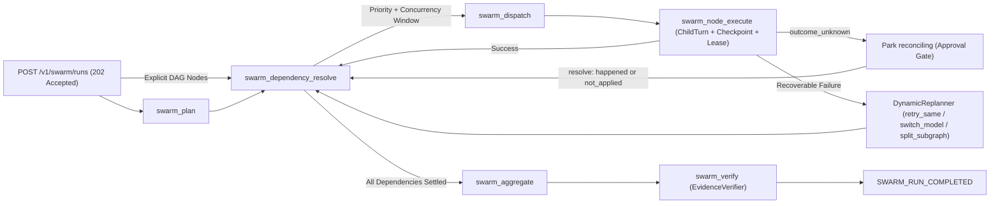
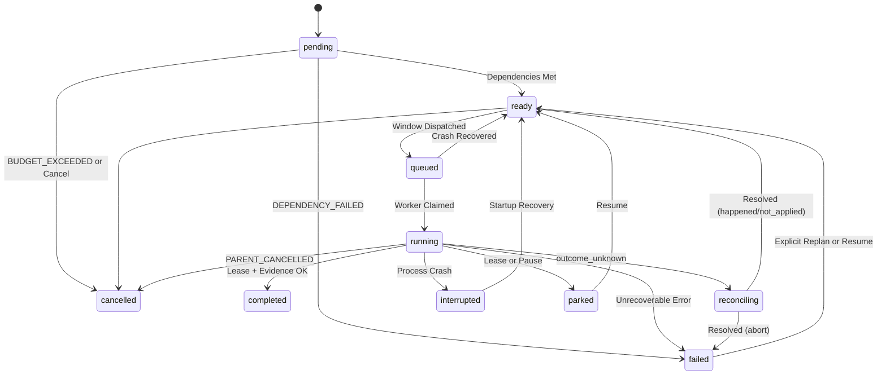

# Agent_US — Autonomous Agent Framework Architecture

> Updated upon completing **Agent_US 2.1 — Runtime Security & Durable Swarm Engineering** on top of the P0–P8 modular baseline (`5b41a04`).
> See also: [`p0-audit-and-research.md`](./p0-audit-and-research.md) for codebase audit and clean-room reference notes.

## 1. Seven-Layer Target Architecture

| Layer | Responsibility | Key Modules |
|---|---|---|
| **Layer 1: Application / Client** | UI presentation, SSE streaming consumer, typed SDKs, desktop host | [`frontend/src/App.tsx`](../../frontend/src/App.tsx), [`frontend/src/api/runtimeClient.ts`](../../frontend/src/api/runtimeClient.ts), [`frontend/src/api/client.ts`](../../frontend/src/api/client.ts), [`frontend/src/components/ReconciliationCard.tsx`](../../frontend/src/components/ReconciliationCard.tsx), [`frontend/src/components/EvidenceBadge.tsx`](../../frontend/src/components/EvidenceBadge.tsx), [`backend/client/index.ts`](../../client/index.ts), [`desktop/main.mjs`](../../desktop/main.mjs) |
| **Layer 2: Control Plane** | Unified routing, approvals, durable cron/timezone schedules, audit views, HTTP/SSE endpoints | [`backend/src/governance/control-plane.js`](../src/governance/control-plane.js), [`backend/src/governance/cron.js`](../src/governance/cron.js), [`backend/src/governance/scheduler.js`](../src/governance/scheduler.js), [`backend/src/routes/runtime-routes.js`](../src/routes/runtime-routes.js), [`backend/src/routes/swarm-routes.js`](../src/routes/swarm-routes.js), [`backend/src/routes/schedule-routes.js`](../src/routes/schedule-routes.js), [`backend/src/v1-routes.js`](../src/v1-routes.js) |
| **Layer 3: Agent Runtime Kernel** | Single Fail-Closed execution contract across profiles (phase transitions, inference, dispatch, cancellation, verification) | [`backend/src/kernel/runtime.js`](../src/kernel/runtime.js), [`backend/src/kernel/agent-loop.js`](../src/kernel/agent-loop.js), [`backend/src/kernel/state-machine.js`](../src/kernel/state-machine.js), [`backend/src/kernel/cancellation.js`](../src/kernel/cancellation.js), [`backend/src/kernel/inference.js`](../src/kernel/inference.js), [`backend/src/kernel/events.js`](../src/kernel/events.js), [`backend/src/kernel/errors.js`](../src/kernel/errors.js), [`backend/src/governance/verifier.js`](../src/governance/verifier.js) |
| **Layer 4: Tool Runtime** | Schema validation, effect classification, Fail-Closed policy & digest-bound permits, strict security/transform/observation hooks, SSRF/sandboxing, worktree leases | [`backend/src/tools/registry.js`](../src/tools/registry.js), [`backend/src/tools/dispatcher.js`](../src/tools/dispatcher.js), [`backend/src/tools/policy.js`](../src/tools/policy.js), [`backend/src/agent-context.js`](../src/agent-context.js), [`backend/src/permits.js`](../src/permits.js), [`backend/src/tools/command-analyzer.js`](../src/tools/command-analyzer.js), [`backend/src/tools/ssrf-guard.js`](../src/tools/ssrf-guard.js), [`backend/src/tools/sandbox.js`](../src/tools/sandbox.js), [`backend/src/tools/mcp-lifecycle.js`](../src/tools/mcp-lifecycle.js) |
| **Layer 5: Context & Memory** | Prompt Cache-preserving tail diff assembly, token budgeting, non-destructive multi-stage compaction, hybrid memory retrieval | [`backend/src/context/assembler.js`](../src/context/assembler.js), [`backend/src/context/budget.js`](../src/context/budget.js), [`backend/src/context/compaction.js`](../src/context/compaction.js), [`backend/src/context/memory.js`](../src/context/memory.js), [`backend/src/context.js`](../src/context.js) |
| **Layer 6: Adaptive Swarm** | Empirical Bayesian routing, job-driven DAG scheduler, state machines, dynamic replanning, persistent child turns & crash recovery | [`backend/src/swarm/capabilities.js`](../src/swarm/capabilities.js), [`backend/src/swarm/feedback.js`](../src/swarm/feedback.js), [`backend/src/swarm/router.js`](../src/swarm/router.js), [`backend/src/swarm/planner.js`](../src/swarm/planner.js), [`backend/src/swarm/jobs.js`](../src/swarm/jobs.js), [`backend/src/swarm/node-state-machine.js`](../src/swarm/node-state-machine.js), [`backend/src/swarm/replan.js`](../src/swarm/replan.js), [`backend/src/swarm/recovery-helpers.js`](../src/swarm/recovery-helpers.js), [`backend/src/swarm/child-lifecycle.js`](../src/swarm/child-lifecycle.js), [`backend/src/swarm/orchestrator.js`](../src/swarm/orchestrator.js), [`backend/src/swarm/mailbox.js`](../src/swarm/mailbox.js) |
| **Layer 7: Persistence / Infrastructure** | SQLite WAL Schema v6, JCS-SHA256 hash-chained ledger, fenced job queue, checkpoints, reconciler, ordered async shutdown | [`backend/src/store.js`](../src/store.js), [`backend/src/runtime/session-repo.js`](../src/runtime/session-repo.js), [`backend/src/runtime/approval-manager.js`](../src/runtime/approval-manager.js), [`backend/src/runtime/shutdown.js`](../src/runtime/shutdown.js), [`backend/src/durable/job-queue.js`](../src/durable/job-queue.js), [`backend/src/durable/checkpoint.js`](../src/durable/checkpoint.js), [`backend/src/durable/reconciliation.js`](../src/durable/reconciliation.js), [`backend/src/durable/recovery.js`](../src/durable/recovery.js), [`backend/src/governance/audit.js`](../src/governance/audit.js), [`backend/src/pool.js`](../src/pool.js) |

## 2. Fail-Closed Security Architecture (2.1)

1. **ToolDispatcher Fail-Closed Gate (`tools/dispatcher.js`)**:
   - Mandatory `ToolPermissionPolicy` defaulting to `permissionMode: 'approval'`.
   - `ASK` requires an injected `requestApproval` handler returning structured approval matching the canonical RFC 8785 (`canonicalJson`) + SHA-256 `argsDigest` of the final tool call. Missing service (`APPROVAL_SERVICE_UNAVAILABLE`), timeout (`APPROVAL_TIMEOUT`), denial (`APPROVAL_DENIED`), error (`APPROVAL_ERROR`), or digest drift (`APPROVAL_ARGS_MISMATCH`) block before permit issuance (`rejected_before_effect`).
   - Re-checks `signal?.aborted`, `leaseGuard?.()`, and `parentGuard?.()` immediately before consuming single-use `ExecutePermit`.
   - `tool_receipts` records final `status` consistently with actual exit code (`failed` on non-zero `exitCode`) and transitions aborted non-replayable/outward executions to `outcome_unknown`.
2. **Hook Semantic Isolation (`agent-context.js`, `tools/dispatcher.js`)**:
   - Strictly separates `security` (default for `PreToolUse`, Fail-Closed on non-zero exit/timeout/block/deny), `transform` (structured `updatedInput`, triggers full Zod schema re-validation and policy re-evaluation before execution), and `observation` (default for `SessionStart`/`PostToolUse`/`Stop`; never grants authorization, never mutates args, surfaces `warnings[]`).
3. **Kernel Fail-Closed Default (`kernel/runtime.js`)**:
   - Removed insecure permissive `DefaultKernelToolDispatcher`. `AgentRuntimeKernel` defaults to real Fail-Closed `ToolDispatcher` + `ToolPermissionPolicy({ permissionMode: 'approval' })`, while still allowing explicit mock dispatchers via `setToolDispatcher(...)` in isolated unit tests.
4. **Fail-Closed Worktree Isolation (`tools/sandbox.js`, `swarm/child-lifecycle.js`)**:
   - Explicit `isolationMode` (`worktree`, `shared_readonly`, `shared_write`) never implicitly downgrades on `git worktree` failure (`WORKTREE_ISOLATION_FAILED`).
   - Only when `allowIsolationFallback: true` is set does a failed worktree clamp strictly to `read-only` (explicitly denying `write_file`, `edit_file`, `apply_patch`, `bash`, `start_process`, `kill_process`).
   - Active temporary worktrees are leased in `worktree_leases` and automatically scrubbed on cancel, exit, shutdown, and startup orphan recovery (`cleanupOrphans()`).

## 3. Durable Job-Driven Swarm & Crash Recovery

- **Swarm Job Types (`swarm/jobs.js`)**: Zod-validated payloads, idempotency keys, retry policies (`swarm_plan`, `swarm_dependency_resolve`, `swarm_dispatch`, `swarm_node_execute`, `swarm_aggregate`, `swarm_verify`), leased execution, and fencing tokens (`LEASE_LOST` blocks stale workers before state commit).
- **10-Node Crash Recovery (`swarm/recovery-helpers.js`)**: On reboot, `RecoveryWorker` delegates Swarm-owned turns (`swarm_nodes.childTurnId`) to `recoverInterruptedRuns()`, preserving all `completed` nodes without re-execution, resuming `running` nodes via saved checkpoints & receipts (or parking `outcome_unknown` into `reconciling`), scheduling dependent `pending` nodes, keeping parent-child trees intact, and refusing to revive `cancelled` runs (`409 SWARM_RUN_CANCELLED`).

## 4. Schema v6, Graceful Shutdown, Durable Cron & Empirical Routing

- **Schema v6 (`store.js`)**:
  - New tables: `worktree_leases`, `swarm_replans`, `child_notifications`, `model_feedback`, `scheduled_task_runs`.
  - New columns: `direct_approvals.argsDigest`, `tool_receipts.{approvedArgsDigest,hookDigest}`, `swarm_runs.{workspaceRoot,permissionMode,planVersion,currentPhase,replanCount,errorCode,errorMessage}`, `swarm_nodes.{taskType,isolationMode,allowIsolationFallback,childTurnId,jobId,reconcileApprovalId,planVersion}`, `scheduled_tasks.{timezone,concurrencyPolicy,misfirePolicy,maxConcurrency}`.
  - Additive `ALTER TABLE` migration checks `user_version` so existing SQLite databases upgrade losslessly.
- **Ordered Idempotent Shutdown (`runtime/shutdown.js`)**: `DirectAgentRuntime.close()` and `service.close()` run synchronous turn/timer abort hooks immediately, share a single idempotent async Promise across concurrent callers, enforce per-stage timeouts, and close SQLite strictly last.
- **Timezone-Aware Durable Scheduler (`governance/cron.js`, `governance/scheduler.js`)**: Strict validator (`400 INVALID_SCHEDULE_CONFIG`), IANA `Intl.DateTimeFormat` timezone calculations, durable `scheduled_task_runs` deduplicated by `sched:<id>:<scheduledFor>`, `concurrencyPolicy` (`skip|queue|allow`), `misfirePolicy` (`fire_once|skip|catch_up`), cancellation (`/v1/schedules/:id/runs/:runId/cancel`), and **zero-idle-polling** (`timer === null` when idle).
- **Bayesian Empirical Model Routing (`swarm/feedback.js`, `swarm/router.js`)**: Computes 8 empirical metrics (`successRate`, `toolSuccessRate`, `verificationPassRate`, `avgLatencyMs`, `timeoutRate`, `avgTokens`, `contextUtilization`, `recoveryRate`) with shrinkage confidence `n / (n + 10)`, blending prior + empirical scores into a structured `explanation`.
- **Backward Compatibility**: `DirectAgentRuntime.startRun()` wraps `submitRun() + waitForRun()`, `POST /v1/swarm/runs` defaults to `202 Accepted` (supporting `wait: true` -> `201`), `POST /v1/schedules/:id/run` preserves `{ schedule, run, session, turn }`, and unawaited legacy `direct.close()` remains safe before `store.close()`.

## 5. Verification & Benchmark Baseline

- **Backend Full Suite**: `cd backend && npm run check && node --test --test-timeout=60000 test/*.test.js` — **84 / 89 tests pass** (100% pass across all new and existing unit, security, durable swarm, `SIGKILL` 10-node recovery, scheduler/shutdown/routing, E2E, and stress tests). The 5 pre-existing environment-gated failures (`integration.test.js`, `providers.test.js`, and 3 in `security.test.js`) fail only when Docker daemon or Magpie CLI is unavailable (`CONTAINER_UNAVAILABLE` / `MAGPIE_UNAVAILABLE`).
- **P8 Stress Benchmark (`stress-benchmark.test.js`)**:
  - `20` concurrent sessions: `1027.3 ms` total (`p50 = 690.81 ms`, `p95 = 975.61 ms`).
  - `50` mixed tool dispatches: `45` succeeded, `5` policy-blocked in `182.2 ms`.
  - `30` contended `DurableJobQueue` jobs across `4` workers: `0` duplicate executions.
  - `5` crash-recovery cycles: `5 / 5` recovered (`100%`).
- **Frontend & Desktop**: `cd frontend && npx tsc --noEmit && npm run build` (exit 0) and `node --check desktop/main.mjs` (exit 0).
