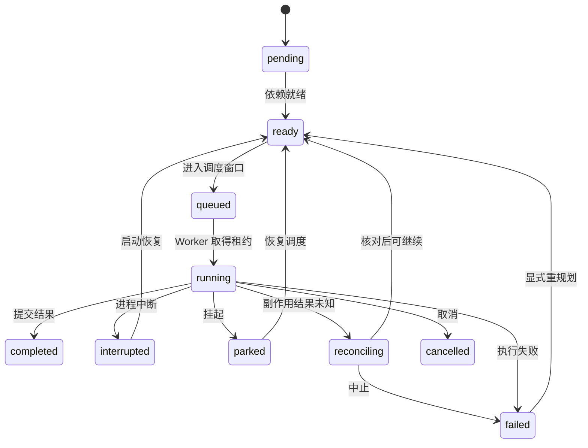

# Agent_US 2.3 后端架构

Agent_US 2.3 以 `DirectAgentRuntime` 组装交互会话和自治执行，普通 turn 与 Swarm 子 turn 共用 `AgentRuntimeKernel`。本文对应 `c7c3558136541b70121fec7b1a84fcedd591b967` 的实现快照。真实 Provider、独立验收与确定性控制对照见 [2.3 验收报告](2.3-general-autonomous-agent-report.md)。

## 七层逻辑架构

[README 的系统架构图](../../README.md#系统架构)展示执行、反馈和持久化关系。下表提供对应的实现入口。

| 层 | 职责 | 代码 |
| --- | --- | --- |
| Application / Client | React 工作台使用类型化 REST/SSE 客户端。Electron 托管桌面进程和本地后端。外部客户端可调用原生 API 或模型兼容端点。 | [App](../../frontend/src/App.tsx)、[REST 客户端](../../frontend/src/api/client.ts)、[Runtime 客户端](../../frontend/src/api/runtimeClient.ts)、[Desktop Host](../../desktop/main.mjs) |
| Control Plane | Fastify API、会话和工作区管理、turn 与 Swarm 入口、审批、调度、模型路由和事件分发。 | [v1-routes](../src/v1-routes.js)、[ControlPlane](../src/governance/control-plane.js)、[Scheduler](../src/governance/scheduler.js)、[模型路由](../src/swarm/router.js)、[EventRouter](../src/kernel/events.js) |
| Agent Runtime Kernel | 运行 Agent Loop，协调 turn 状态、推理、工具分发、取消、上下文与完成门禁。 | [Runtime](../src/direct-agent.js)、[Kernel](../src/kernel/runtime.js)、[AgentLoop](../src/kernel/agent-loop.js)、[ContextAssembler](../src/context/assembler.js)、[EvidenceVerifier](../src/governance/verifier.js) |
| Adaptive Intelligence | 仓库分析、规划、能力画像、团队优化、通信、经验记忆与独立评测。 | [服务装配](../src/intelligence-services.js)、[仓库分析](../src/repo-intelligence.js)、[Planning](../src/planning/)、[Capability Registry](../src/swarm/capability-registry.js)、[TeamOptimizer](../src/swarm/team-optimizer.js)、[Communication](../src/communication/)、[Memory](../src/memory/)、[Evaluation](../src/evaluation/) |
| Execution & Orchestration | 管理运行树、依赖图、并行窗口、子 turn、预算、重规划、产物、Reviewer 与结果聚合。 | [Swarm](../src/swarm/orchestrator.js)、[ChildAgentManager](../src/swarm/child-lifecycle.js)、[Jobs](../src/swarm/jobs.js)、[Replanner](../src/swarm/replan.js)、[Artifacts](../src/swarm/artifacts.js)、[Reviewer](../src/swarm/reviewer.js)、[Aggregator](../src/swarm/result-aggregator.js) |
| Tool & Runtime Infrastructure | 工作区工具、补丁与诊断、子进程管理、MCP、Skills、桌面扩展、策略、Permit 和 worktree 隔离。 | [Workspace tools](../src/workspace-tools.js)、[Patch](../src/patch-and-diagnostics.js)、[Tools](../src/tools/)、[MCP](../src/mcp-client.js)、[Context & Skills](../src/agent-context.js)、[Extension Hub](../../desktop/extension-hub.mjs) |
| Persistence & Observability | SQLite WAL、持久任务队列、Checkpoint、恢复、事件账本、经验记录、产物文件、Metrics、Trace 和结构化日志。 | [Store](../src/store.js)、[Durable](../src/durable/)、[Audit](../src/governance/audit.js)、[Observability](../src/observability/) |

## 执行入口与调用关系

1. [main.js](../src/main.js) 或 [Electron Host](../../desktop/main.mjs) 启动 [service.js](../src/service.js)。服务创建 `Store`、`AccountPool`、`DirectAgentRuntime` 和 `ControlPlane`，并装配 intelligence services。评测服务注册持久任务 handler，能力画像、团队优化、通信与经验记忆注入对应运行时组件。
2. `POST /v1/sessions/:id/turns` 启动交互 turn。`DirectAgentRuntime` 负责会话、队列、审批与上下文，内核运行推理和工具循环。会话使用固定 `nonce` 和稳定的 System Prompt，工作区、Git、日期等动态事实进入上下文尾部。SSE 由 `/v1/stream` 和 `/v1/sessions/:id/stream` 独立读取。见 [Direct Runtime](../src/direct-agent.js)、[AgentLoop](../src/kernel/agent-loop.js)、[ContextAssembler](../src/context/assembler.js) 和 [SSE 路由](../src/v1-routes.js)。
3. `POST /v1/autonomous/runs` 接收目标。`submitAutonomousGoal()` 分析工作区，调用 `DynamicTaskPlanner` 生成节点，再用结构化规划验证、权限上限与预算约束检查 DAG，最后提交 `AdaptiveSwarmOrchestrator`。`POST /v1/plans/execute` 也接受已提供的结构化计划。普通会话继续走自己的 turn 路径。见 [Intelligence 路由](../src/routes/intelligence-routes.js)、[仓库分析](../src/repo-intelligence.js)、[Swarm Planner](../src/swarm/planner.js) 和 [Plan Validator](../src/planning/validator.js)。
4. Swarm 通过 `swarm_plan`、`swarm_dependency_resolve`、`swarm_dispatch`、`swarm_node_execute`、`swarm_aggregate` 和 `swarm_verify` 等持久任务推进运行。调度窗口允许依赖就绪的节点并行。`AdaptiveModelRouter` 和 `TeamOptimizer` 使用任务能力需求、路由候选和反馈，团队规模随工作流与预算变化。子 Agent 在内核中执行，`InterAgentMailbox` 通过 `CommunicationBus` 收发消息。见 [Job 定义](../src/swarm/jobs.js)、[编排器](../src/swarm/orchestrator.js)、[通信](../src/communication/) 和 [Mailbox](../src/swarm/mailbox.js)。
5. Worktree 节点交付持久 Artifact。依赖节点可叠加上游产物，同文件冲突阻止叠加或批量写回。启用 Reviewer 的计划由只读子 Agent 检查上游产物和收据，严格 JSON 结论还要通过代码侧证据检查。失败可在预算内触发 `repair_and_reverify`，并产生新的计划版本。`GET /v1/swarm/runs/:id/delivery` 返回交付信息，`POST /v1/swarm/runs/:id/artifacts/apply-all` 检查验收与冲突后写回父工作区。见 [Artifact Manager](../src/swarm/artifacts.js)、[Reviewer](../src/swarm/reviewer.js)、[动态重规划](../src/swarm/replan.js) 和 [Swarm 路由](../src/routes/swarm-routes.js)。

### 模型、评测与兼容面

- `AccountPool` 为内核推理提供模型选择与流式适配。`GatewayProxy` 单独服务 `POST /v1/chat/completions` 和 `POST /v1/messages`，两条路径共享账号池。见 [AccountPool](../src/pool.js)、[GatewayProxy](../src/gateway-proxy.js) 和 [v1-routes](../src/v1-routes.js)。
- `AdaptivePlanner` 的计划创建、验证与 `AdaptiveReplanner` 的计划修订可独立调用。运行期由 Swarm 的 `DynamicReplanner` 处理受预算限制的修复与复验。团队优化与能力测量也提供独立 API。见 [Planning](../src/planning/)、[Swarm replanner](../src/swarm/replan.js) 和 [Intelligence 路由](../src/routes/intelligence-routes.js)。
- `EvaluationService` 通过独立入口执行数据集、Judge 与回归分析，并更新能力画像和合格的经验记录。Runtime 执行也可产生经验候选，ContextAssembler 和 Swarm 使用经验服务检索。项目上下文记忆与经验记忆分别管理。见 [Evaluation](../src/evaluation/service.js)、[Experience Memory](../src/memory/service.js) 和 [Project Memory](../src/context/memory.js)。
- `/api/v1/*` 继续挂载旧 DAG 入口供 legacy / compatibility 客户端使用。当前自治运行与交互 turn 均使用 `/v1/*`。见 [API 装配](../src/api.js)、[旧路由](../src/routes.js) 和 [旧 Engine](../src/engine.js)。

## 工具与审批边界

- `ToolDispatcher` 校验工具参数、分类副作用并执行策略。子 Agent 的能力受父会话、节点与实时策略交集限制。需要审批的调用在放行后复核参数摘要与租约，命令前缀授权按规则匹配。见 [Dispatcher](../src/tools/dispatcher.js)、[Policy](../src/tools/policy.js)、[Approval Manager](../src/runtime/approval-manager.js) 和 [Permits](../src/permits.js)。
- 文件操作校验工作区边界。终端、网络与 MCP 受对应策略和主机适配器约束，Git worktree 隔离工作区改动。隔离能力取决于实际 profile 与宿主环境。见 [Sandbox](../src/tools/sandbox.js)、[SSRF Guard](../src/tools/ssrf-guard.js) 和 [MCP 生命周期](../src/tools/mcp-lifecycle.js)。
- 工作区 Hook 需要信任校验。`PreToolUse` 的参数转换经过后续策略检查，工具收据和结构化审计可供复核。见 [Hook Trust](../src/tools/hook-trust.js)、[Agent Context](../src/agent-context.js) 和 [Audit](../src/governance/audit.js)。

`BenchmarkSandbox` 和依赖策略在 `c7c3558` 之后作为独立工具加入。当前 `EvaluationService` 与 `DirectAgentRuntime` 调用链尚未使用它们。见 [Benchmark Sandbox](../src/tools/benchmark-sandbox.js) 和 [Dependency Policy](../src/evaluation/dependency-policy.js)。

## Durable Runtime 与状态机

Turn 在 `checkpoint`、`inference`、`tools` 和适用的 `compacting`、`verifying` 等阶段推进。等待或结果未知可进入 `parked` 或 `reconciling`，终态为 `completed`、`failed` 或 `cancelled`。Swarm 节点维护独立状态机，下面保留其主要路径。完整转换以 [Turn State Machine](../src/kernel/state-machine.js) 和 [Swarm State Machine](../src/swarm/node-state-machine.js) 为准。

- 队列以租约和 fencing token 协调 worker，过期持有者无法提交状态。恢复结合 Checkpoint 与工具收据，保留完成节点并推进可恢复任务。对结果未知的外部副作用进入 reconciliation，等待确认已发生、未应用或中止。见 [Job Queue](../src/durable/job-queue.js)、[Lease Guard](../src/durable/lease-guard.js)、[Recovery](../src/durable/recovery.js) 和 [Swarm 恢复](../src/swarm/recovery-helpers.js)。
- Scheduler 持久化计划任务与每次运行，支持时区、并发策略、错过运行处理与取消。`ShutdownCoordinator` 协调有序关闭，SQLite 在服务组件收尾后关闭。见 [Scheduler](../src/governance/scheduler.js)、[Cron](../src/governance/cron.js) 和 [Shutdown](../src/runtime/shutdown.js)。

## 持久化、迁移与观测

`Store` 对文件数据库启用 SQLite WAL，当前顶层 `PRAGMA user_version` 为 **7**。迁移在事务内更新历史结构，包含旧调度值归一化、历史搜索 FTS5、模型反馈数据转换以及重规划、运行序号和产物的唯一索引。迁移中断会回滚，超出支持范围的未来 schema 会被拒绝。经验记忆有独立的 schema 标识。见 [Store](../src/store.js)、[迁移测试](../test/migration-v5-v6-v7.test.js) 和 [Memory Schema](../src/memory/schema.js)。

| 数据 | 持久化或查询入口 |
| --- | --- |
| 会话、turn、消息、SSE 事件、审批、工具收据和 Checkpoint | SQLite，按会话查询。见 [Runtime Routes](../src/routes/runtime-routes.js)。 |
| Job、租约、Swarm 节点、重规划、产物索引与树预算 | SQLite，产物内容通过 Artifact Store 持久化。见 [Artifact Manager](../src/swarm/artifacts.js) 和 [Budget Ledger](../src/swarm/budget-ledger.js)。 |
| 调度、经验记忆、评测与能力反馈 | SQLite，由各服务读写。见 [服务装配](../src/intelligence-services.js) 和 [Scheduler](../src/governance/scheduler.js)。 |
| 审计、指标、Trace 和日志 | 账本使用 JCS-SHA256 哈希链接，运行时提供审计完整性、指标与 Trace 查询，并输出结构化日志。见 [Audit](../src/governance/audit.js) 和 [Observability](../src/observability/)。 |

## 验证口径

- 真实 Provider 的 `agent-us-oss-benchmark@1.0.0` 最终报告为 4/4。四个外部样本的能力画像仍为 `provisional_low_sample`。
- 陌生仓库验收覆盖自主规划、并行 worktree、真实 `SIGKILL`、人工核对恢复、Reviewer、产物应用及应用后测试。`tj/commander.js` 的 `1393 PASS / 0 FAIL / 2 SKIP` 属于该次任务。
- 确定性离线测试覆盖迁移、租约、审批、并行产物冲突、Reviewer 契约和预算边界，独立于真实模型评分。大型仓库仍需按范围复查，外置工具链的验证取决于环境是否已安装所需依赖。

详见 [2.3 验收报告](2.3-general-autonomous-agent-report.md)、[后端启动与测试命令](../README.md) 和 [CI 工作流](../../.github/workflows/ci.yml)。
