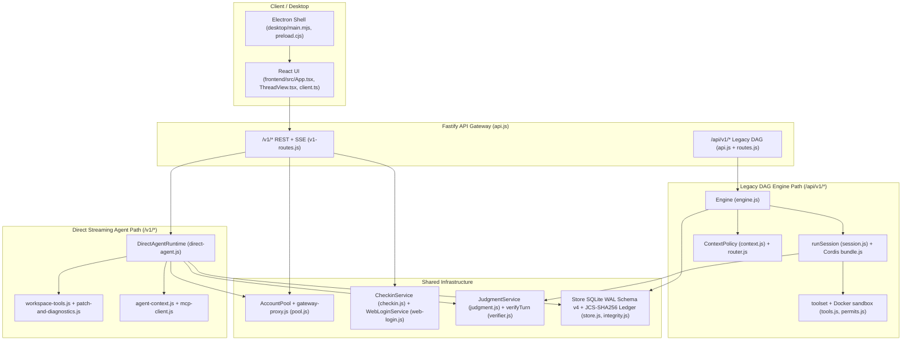

# P0 全仓审计与参考项目源码研究报告

> 生成依据：对 `d:\Agent_US` 工作区 `backend/`、`frontend/`、`desktop/` 源码的真实只读审计，以及对四个参考项目真实源码与测试用例的直接检索与阅读（遵循 clean-room engineering，未触碰 `upstream/` 与 `backend/var/`）。

---

## 一、工作区状态与代码基线

- **Git 分支与状态**：`main...origin/main`（最新提交 `e9b8a0e`），存在并行分支 `codex/agent-backend`，工作区干净。
- **后端技术栈**：Node.js `>=24.9.0` (ESM)、Fastify `5.12.8`、Zod `4.1.12`、OpenAI SDK `6.49.0`、`node:sqlite` (`DatabaseSync`)、Cordis `4.1.0` + `@deepseek-ai/dsh-*` `0.2.2-rc.5`（见 `backend/package.json:6-29`）。
- **前端与桌面**：React `19.1.0` + Vite `6.3.5` + TypeScript `5.8.3`（`frontend/package.json`），Electron 打包脚本与运行时（`desktop/main.mjs`、`desktop/pack-win.mjs`）。
- **源码规模统计**（34 个 `backend/src/*.js` 文件，共 15,764 行）：
  - 超大型聚合模块：`pool.js` (3,130 行)、`direct-agent.js` (1,725 行)、`workspace-tools.js` (1,040 行)、`checkin.js` (929 行)、`tools.js` (902 行)、`web-login.js` (807 行)、`v1-routes.js` (767 行)、`gateway-proxy.js` (748 行)。
  - 传统 DAG 引擎侧：`engine.js` (619 行)、`context.js` (617 行)、`store.js` (573 行)、`session.js` (227 行)、`providers.js` (206 行)、`routes.js` (184 行)、`api.js` (179 行)、`service.js` (174 行)、`verifier.js` (162 行)、`seams.js` (149 行)、`permits.js` (119 行)、`router.js` (109 行)、`bundle.js` (48 行)。
  - 辅助安全/上下文/评估模块：`patch-and-diagnostics.js` (529 行)、`judgment.js` (412 行)、`agent-context.js` (397 行)、`refinement.js` (238 行)、`mcp-client.js` (211 行)、`integrity.js` (196 行)、`provider.js` (184 行)、`eval-harness.js` (142 行)、`envelope.js` (118 行)、`magpie.js` (88 行)、`docker.js` (33 行)、`vault.js` (26 行)、`main.js` (25 行)。

---

## 二、现有代码架构与模块依赖关系

---

## 三、核心执行链路与双引擎差异审计

### 3.1 两条执行链路对照

| 维度 | DirectAgentRuntime (`/v1/*`, `direct-agent.js`) | Legacy DAG Engine (`/api/v1/*`, `engine.js` + `session.js`) |
| --- | --- | --- |
| 任务入口 | `POST /v1/sessions` → `POST /v1/sessions/:id/turns` (`v1-routes.js:114-158`) | `POST /api/v1/tasks` → `Store.submit` 入队 `jobs` (`api.js:74-101`, `store.js:525-569`) |
| 执行循环 | 内部自研两套循环：`#runTurnLoop` (`direct-agent.js:1142-1724`) 与 `#runSubagentQuery` (`1005-1140`) | Cordis `@deepseek-ai/dsh-agent-loop` 驱动 `runSession` (`session.js:12-227`) |
| 持久化与队列 | **无任务队列、无租约/Fence、无崩溃恢复**；轮次直接 `void this.#runTurnLoop(...)` (`direct-agent.js:894`) | 有 `jobs` 表 + `claim` + 15s lease/fence + 2s heartbeat + 崩溃重领 (`engine.js:114-257`) |
| 未知外部副作用核对 | **缺失** | 有 `outcome_unknown` 检测 + `reconciliation` 人工审批停泊 (`engine.js:125-200`, `tools.js:236-320`) |
| 事件审计账本 | 写入 `direct_events`（无哈希链）；仅 turn 完成写一条 `events` (`direct-agent.js:121-135, 1662`) | 每次状态变更均在事务内写入 RFC 8785 JCS + SHA-256 链式 `events` (`store.js:345-393`, `integrity.js:65-196`) |
| 工具隔离 | 本机 `powershell.exe` / `sh` 或临时 Git Worktree (`workspace-tools.js:267-350`, `direct-agent.js:1027-1040`) | Docker 容器隔离 `--network=none --read-only --cap-drop=ALL` (`tools.js:193-234`) |
| Permit 执行凭据 | `ExecutePermitRegistry` 连续 `issue` 后立即 `consume`（形式主义，未真正跨越异步策略边界，`workspace-tools.js:470-471`） | `issue` 与 `dispatchWithPermit` 严格绑定 approval + evidence 记录 (`tools.js:659-866`) |
| 审批等待与恢复 | 内存 `pendingApprovals` Map (`direct-agent.js:92, 731-803`)，重启即丢失等待句柄 | 持久化 `approvals` + `parked` 作业释放 worker slot 并支持重启恢复 (`engine.js:558-583`, `tools.js:352-395`) |
| 模型路由与多 Agent | `spawn_subagent` 仅支持简单单次调研；直接使用 `session.model` (`direct-agent.js:846-850`) | `router.js` 硬编码 5 个固定角色 (`Researcher/Planner/Coder/Reviewer/Tester`) 线性加权打分 (`router.js:3, 81-106`) |
| 前端实际使用面 | **100% 前端 `/v1/*` 均走此链路**（`frontend/src/api/client.ts`） | 仅 `desktop/main.mjs:145` 探测 `/api/v1/projects` 与回归测试使用 |

### 3.2 关键代码缺陷、安全漏洞、重复逻辑与未完成接口清单

1. **三套割裂的 Agent 执行循环（违反 DRY 与统一 Runtime Contract）**：
   - `direct-agent.js:1142-1724` (`#runTurnLoop`)
   - `direct-agent.js:1005-1140` (`#runSubagentQuery`)
   - `session.js:12-227` (`runSession`)
2. **上下文压缩事件死分支 bug (`direct-agent.js:1334`)**：
   - `compactTwoStage()` (`context.js:285,319,354,369`) 返回的 `stage` 是字符串 `'none' | 'prune' | 'summary' | 'prune-fallback'`，但 `direct-agent.js:1334` 判断 `if (compacted.stage > 0)`，字符串与 `0` 比较恒为 `false`，导致 `context/compacted` 事件永远不会触发。
3. **Direct 模式确定性验证器失效 (`direct-agent.js:1449-1452`)**：
   - `direct-agent.js:1449` 仅向 `verifyTurn()` 传入只包含 `tool/result` 的 `turnEventsForVerifier` (`1579-1582`)，缺少 `assistant/message`、`turn/end`、`argRecovery` 与工作区真实文件检查，导致 `verifier.js:45-124` 的 7 项检查中绝大多数在 Direct 模式下实质失效。
4. **破坏性上下文压缩 (`direct-agent.js:596-613`)**：
   - `compactSession()` 直接执行 `DELETE FROM direct_messages WHERE sessionId=? AND seq<=?`，永久销毁历史消息与全文检索数据源，且未独立持久化任务目标、约束、已修改文件、执行证据与计划状态。
5. **Prompt Cache 前缀污染 & `liveContextNotes` 未接入 (`direct-agent.js:1284-1290`, `context.js:385-423`)**：
   - `#runTurnLoop` 将易变信息（`gitBranch`、`planState`、`memoryText`、`hookContexts`）拼接成 `messages[1]` 置于 `...history` **之前**，一旦分支/计划/记忆更新就击穿全量历史 KV Cache；同时 `context.js:385-423` 已实现并测试通过的 `liveContextNotes()` 却没有任何生产代码调用。
6. **Windows 命令注入与策略绕过风险 (`workspace-tools.js:58-60, 273-284, 753, 796`)**：
   - Windows 下实际通过 `powershell.exe -Command` 执行 (`workspace-tools.js:274-276`)，但前置阻断却调用 `checkHardBlockedCommand(['sh', '-c', command])` (`753, 796`)，且 `SAFE_READONLY_CMD_RE` (`58-59`) 未针对 PowerShell 特殊语法（`Invoke-Expression`/`iex`、`$(...)`、`&`、重定向、`Remove-Item`）做解析器级校验。
   - `runLocalCommand` / `BackgroundProcessManager` 直接透传 `{ ...process.env }` (`79, 282`)，向子进程暴露敏感环境变量；`resolveSafePath` (`153-175`) 未做 `realpathSync` 符号链接逃逸校验；`SIGTERM` 在 Windows 上不会终止子进程树。
7. **SSRF 跳转与 DNS 重绑定绕过 (`workspace-tools.js:958-965`)**：
   - `web_fetch` 仅在请求前对 URL hostname 字符串做 `isPrivateOrLocalHost` 检查，未校验 DNS 解析结果（可被 DNS Rebinding 绕过），且设置 `redirect: 'follow'` 允许 301/302 重定向到 `127.0.0.1` 或云元数据地址。
8. **MCP 工具未强制受控审批 (`workspace-tools.js:1026-1037` vs `tools.js:674`)**：
   - 在 `tools.js:674` 中 `mcp` 标记为 `outward: true` 且绝不可绕过人工审批；但在 `workspace-tools.js:360, 1032` 中 `full-access` 直接绕过所有审批，且未在工具元数据中区分 `effectClass` / `outward`。
9. **空实现/存根/前后端状态越界**：
   - `v1-routes.js:766`：`GET /v1/plans` 硬编码返回 `{ items: [] }`。
   - `service.js:105`：`Engine` 仅接收静态 `providers.models`，未联动 `pool.getEngineModels()` (`pool.js:2299`)。
   - `frontend/src/App.tsx:727-762`：前端持有自动审批循环，将安全策略决策放在客户端内存执行。
   - `frontend/src/components/TasksView.tsx` + `App.tsx:168`：定时任务仅存在 React `useState([])` 中，刷新即失且无调度器。
   - `backend/scripts/check.js:3-4`：仅扫描单层目录 `src/*.js`，嵌套子目录新增文件不会被 `npm run check` 校验。
10. **工具契约与参数不一致**：
    - `tools.js:433-436` `read_blob` 使用 `{ uri, offset, limit }`，而 `workspace-tools.js:919-925` 使用 `{ uri, start, maxChars }`。
    - `workspace-tools.js` 缺少 Zod 参数入参校验与 `tool_receipts` 结构化审计回执。

---

## 四、数据库 Schema v4 审计与权威边界

### 4.1 现有 Schema v4 (`backend/src/store.js:42-159`)

| 表名 | 所属子系统 | 当前权威性 | 缺陷与演进需求 |
| --- | --- | --- | --- |
| `records`, `revisions`, `submissions` | Legacy DAG | 权威账本（乐观锁 `version` + `preserve_revision` 触发器） | 保持兼容，不破坏现有字段 |
| `events`, `ledger_meta` | JCS-SHA256 审计链 | **唯一权威审计账本** | DirectAgent 事件需同步桥接或归档到此防篡改链 |
| `jobs` | Legacy DAG 队列 | 权威队列（lease/fence） | 仅服务 `/api/v1`；Direct/Swarm 需要统一的 `runtime_jobs` |
| `blobs` | 内容寻址仓库 | 权威不可变存储（`artifact://<sha256>`） | 继续复用作为统一 Artifact Store |
| `direct_sessions`, `direct_turns`, `direct_messages`, `direct_messages_fts`, `direct_events`, `direct_approvals`, `turn_snapshots` | DirectAgent | 权威会话/回滚存储 | 缺父子会话谱系、checkpoint、compaction 快照、tool receipts、reconciliation 绑定 |
| `provider_accounts`, `provider_priorities`, `pool_models`, `model_mappings` | AccountPool | 权威号池配置与加密凭证 | `pool_models.capabilities` 需扩展至 8 维模型能力画像 |
| `checkin_schedules`, `checkin_records` | CheckinService | 权威签到数据 | 保留不变 |
| `kv_settings`, `nexus_memory`, `nexus_usage` | 设置/记忆/用量 | 权威配置与指标 | 保留并接入 `ProjectMemoryService` 检索与治理 |

### 4.2 权威状态 vs 可重建缓存划分
- **SQLite 权威状态 (Source of Truth)**：会话与消息历史、`runtime_jobs`（租约/Fence）、`runtime_checkpoints`、`tool_receipts`、`direct_approvals`（含 reconciliation）、`context_compactions`、`swarm_runs`/`swarm_nodes`、`agent_messages`、`scheduled_tasks`、`events` (JCS 链)、`blobs`、`turn_snapshots`、`provider_accounts`/`pool_models`/`nexus_memory`。
- **可重建内存缓存/投影 (Ephemeral Projections)**：`activeTurns`、`CancellationManager` epoch 树、`readFileStates` 脏写哈希缓存、`JudgmentService` LRU 缓存、`BackgroundProcessManager` 进程表、`McpHub` stdio 连接池、SSE 订阅总线与前端 `liveStreams`。

---

## 五、基线测试覆盖率实测

执行 `cd backend && npm run check && node --test test/*.test.js`（21 个测试文件，共 53 个用例）：
- **通过：48 / 53**（覆盖 DirectAgent、`patch-and-diagnostics`、`context`、`envelope`、`integrity`、`permits`、`judgment`、`refinement`、`pool`、`gateway-proxy`、`web-login`、`checkin`、`crash`、`recovery`、`verifier`、`router`、`seams`、`eval-harness`、`foundation`）。
- **失败：5 / 53**（均为环境依赖 Docker Desktop / Magpie 容器二进制缺失导致的 `503 CONTAINER_UNAVAILABLE` / `MAGPIE_UNAVAILABLE`：`integration.test.js` 1 例、`providers.test.js` 1 例、`security.test.js` 3 例）。
- **未覆盖关键能力（审计发现缺口）**：DirectAgent 崩溃恢复、`tool_receipts` 幂等与 `outcome_unknown` 核对、Windows PowerShell 命令语义解析、SSRF DNS/跳转拦截、非破坏性多阶段压缩后目标/约束保留、动态自适应 Swarm 编排与父子预算继承、CompletionGate 跨回执证据防虚报、端到端高并发压力测试。

---

## 六、四个参考项目真实源码研究索引

| 参考项目 | 许可证 | 研究的核心源码文件与接口 | 关键设计原理与测试文件索引 |
| --- | --- | --- | --- |
| **Agnes Harness** `AgnesAI-Labs/agnes-harness` | Apache-2.0 | `packages/core/src/kernel.ts` (`CORE_DIAG_NAMES`, `SeamRuntime`, 6 必填 seam 校验) `packages/loop-default/src/index.ts` (`create(ctx): LoopDriver`, checkpoint-driven `step(signal)`) `packages/core/src/loop/ports.ts` (`createLoopContext`, checkpoint 恢复与未确认 steer 重放) `packages/core/src/execution/turn/resume.ts` (`setCallsCompleted`, `askUnknownOutcome`) `packages/core/src/execution/turn/unknown-outcome.ts` (`unknownOutcomeRows`, `reconciledMessage`) `packages/core/src/execution/turn/gate.ts` (`beforeStepGate`, `stopGate`, `turnVerifyInput`) `packages/core/src/child/lifecycle.ts` (`bindChildLifecycle`, `revokeChildLifecycle`, `renewChildLifecycle`) `packages/core/src/child/role-authority.ts` (`rolePolicyCeiling`, `captureAuthority`) `packages/core/src/child/runtime-budget.ts` (`TreeReservationHandle`, `reserveTreeBudgetPermit`) `packages/daemon/src/supervisor/*` (assembly & authorization journal) | 1. **确定性恢复**：基于事件账本 + LoopCheckpoint + 阶段机恢复，不凭猜测重放不可重放副作用。 2. **Unknown Outcome Reconciliation**：中断的外部副作用先转人工三态确认（`happened` / `not-happened` / `abort`），绝不静默重跑。 3. **子代理权限上限与树预算**：子代理策略取父子交集（只减不增），预算在树根共享预留。 测试索引：`packages/core/fixtures/crash/01..40*.jsonl`、`packages/worker-runtime/test/workspace-fork-acceptance.e2e.test.ts`、`worker-isolation.test.ts` |
| **DeepSeek Harness** `deepseek-ai/deepseek-harness` | MIT | `packages/core/agent-loop/src/agent.ts` (`ReactLoopAgent`, `Phase`, `abortedCancelCause`, `RequestHeader`) `packages/core/tools/src/contracts.ts` (`ToolDefinition`, `ToolOutputDefinition`, `isConcurrencySafe`, `ResolvedToolSet`) `packages/core/tools/src/pipeline.ts` (`ToolExecutionPipeline`, `executionMode`, `WeakMap` 取消/投影隔离) `packages/core/agent/src/model-selection.ts` (`modelSelectionProjectionDefinition`, `AgentModel`, `modelSwitchNotice`) `packages/core/session/src/fork.ts` (`buildForkSeed` + `openTurnClosers`) `packages/subagent/subagent/src/index.ts` (`startActivation`, `sendMessage`, `resolveAgentPath`) `packages/team/agent-team/src/index.ts` (`TeamTaskBoard`, `TeamJournal`) `packages/compaction/compaction/src/index.ts` `packages/session/session-persistence-sqlite/src/index.ts` | 1. **声明式工具契约与管道**：`isConcurrencySafe` 仅严格返回 `true` 才并行，其余 fail-closed 串行；`ToolExecutionPipeline` 统一 schema 校验、策略拦截、超时与内容投影。 2. **无损 Fork 构造**：按精确事件边界复制前缀并合成闭合器，支持多分支并行探索与复用。 3. **共享任务板与事件折叠投影**：使用 `ProjectionDefinition` 从不可变日志折叠出模型选择、子代理目录与团队任务板。 测试索引：`packages/core/agent-loop/tests/{agent,cancel,fork-source,inbox,request-cache.e2e,resume,tool-order}.spec.ts` |
| **OpenAI Codex** `openai/codex` | Apache-2.0 | `codex-rs/core/src/tasks/lifecycle.rs` (`emit_turn_start_lifecycle`, `emit_turn_stop_lifecycle`, `emit_thread_idle_lifecycle_if_idle`) `codex-rs/core/src/state/turn.rs` (`ActiveTurn`, `TurnState`, `MailboxDeliveryPhase` CurrentTurn/NextTurn, `PendingApproval`) `codex-rs/core/src/tools/approvals.rs` (`ApprovalContext`, `ApprovalAction`, `requires_human_approval`) `codex-rs/core/src/sandboxing/mod.rs` (`ExecRequest`, `PreparedLocalExecRequest`, `WindowsSandboxLevel`) `codex-rs/core/src/exec_policy/inheritance.rs` (`InheritedExecPolicy::from_inherited`) `codex-rs/core/src/agent/control/spawn.rs` (`SpawnInitialInput`, `effective_spawn_config`) `codex-rs/core/src/agent/control/mailbox.rs` (`Mailboxes::enqueue/take/watch`) `codex-rs/app-server/src/daemon_thread_recovery.rs` | 1. **Turn 状态与邮箱投递时机**：`MailboxDeliveryPhase` (`CurrentTurn` vs `NextTurn`) 防止终态回答发出后被晚到子消息静默污染。 2. **统一审批路由器**：结构化 `ApprovalAction` 枚举驱动策略校验、Guardian 复核与会话前缀缓存，Managed 人类检查点不可被 Hook/自动审批绕过。 3. **线程常驻与邮箱持久化**：卸载或重启期间保留线程邮箱，唤醒时按序投递。 测试索引：`codex-rs/core/src/agent/control/*_tests.rs`、`tools/approvals_tests.rs`、`exec_policy_tests.rs`、`exec_policy_windows_tests.rs` |
| **Claude Code Research** `Eternite-0/Claude-Code-compilable` | Reference | `QueryEngine.ts` (`QueryEngineConfig`, `query` 协调循环) `Tool.ts` (`ToolPermissionContext`, `alwaysAllowRules`/`alwaysDenyRules`/`alwaysAskRules`, `shouldAvoidPermissionPrompts`) `query/tokenBudget.ts` (`checkTokenBudget`, `DIMINISHING_THRESHOLD`, 90% 续跑判断) `tools/AgentTool/forkSubagent.ts` (`FORK_AGENT`, `isInForkChild`, `buildForkedMessages` 缓存共享占位结果) `tools/AgentTool/runAgent.ts` (`createSubagentContext`, 独立 MCP/Hook 生命周期清理) `tools/BashTool/readOnlyValidation.ts` (`COMMAND_ALLOWLIST`, `validateFlags`, 严格 flag 级只读校验) `tools/FileEditTool/FileEditTool.ts` `utils/hooks/*` (`PreToolUse`, `PostToolUse`, `Stop`, `ssrfGuard.ts`) | 1. **缓存友好的 Fork**：通过完全相同的 system prompt 字节与统一 `FORK_PLACEHOLDER_RESULT` 工具响应，仅在末尾附加子指令，实现父子前缀 KV Cache 100% 命中。 2. **Flag 级只读白名单**：不只用正则匹配命令头，而是逐 flag 检查危险选项（如禁止 `xargs -I`/`-i`、禁止 `fd -x`）。 3. **边际收益熔断 (`tokenBudget.ts`)**：连续多步 token 增量低于阈值时自动收尾，避免预算空转。 |

---

## 七、目标七层架构设计、关键架构决策 (ADR) 与风险清单

### 7.1 目标七层架构与目录映射

| 层级 | 核心职责 | 目标模块落地位置 |
| --- | --- | --- |
| **Layer 1: Application / Client** | React UI、Electron Desktop、Typed SDK (`connectRuntime`)、SSE 客户端（不持有核心执行与策略状态） | `frontend/src/*`、`desktop/*`、`backend/client/index.ts` |
| **Layer 2: Control Plane** | `SessionManager`、`TaskManager`、`WorkspaceManager`、`AdaptiveModelRouter`、`AgentCapabilityRegistry`、`ApprovalCenter`、`EventRouter`、`ExecutionScheduler` (`ScheduledTaskRunner`) | `backend/src/governance/control-plane.js`、`backend/src/v1-routes.js`、`backend/src/swarm/router.js`、`backend/src/swarm/capabilities.js` |
| **Layer 3: Agent Runtime Kernel** | `AgentRuntimeKernel`、`AgentLoop`、`TurnManager`、`InferenceEngine`、`DecisionEngine`、`TurnStateMachine`、`CancellationManager` | `backend/src/kernel/{runtime,agent-loop,inference,state-machine,cancellation,events,errors}.js` |
| **Layer 4: Tool Runtime** | `ToolRegistry` (Zod Schema + 4 类风险/副作用分级)、`ToolPermissionPolicy` (POSIX/PowerShell/SSRF)、`SandboxAdapter` (Host/Docker/Worktree)、`ToolDispatcher` (`ExecutePermitRegistry` + `tool_receipts`)、`McpLifecycleManager` | `backend/src/tools/{registry,policy,sandbox,dispatcher,mcp-lifecycle}.js`、`backend/src/workspace-tools.js` |
| **Layer 5: Context / Memory** | `ContextAssembler` (静态前缀 + `liveContextNotes` 尾注)、`TokenBudgetManager`、`MultiStageCompactor` (非破坏性 + TaskStateAnchor)、`ProjectMemoryService` | `backend/src/context/{assembler,budget,compaction,memory}.js`、`backend/src/context.js` |
| **Layer 6: Adaptive Swarm** | `ModelCapabilityRegistry` (8 维能力画像)、`AgentCapabilityRegistry` (动态模板与按需合成)、`DynamicTaskPlanner` (自适应 DAG + 动态增删改)、`InterAgentMailbox`、`AdaptiveSwarmOrchestrator` (spawn/fork/pause/resume/interrupt/cancel/collect + 树预算与权限上限) | `backend/src/swarm/{capabilities,router,planner,mailbox,orchestrator}.js` |
| **Layer 7: Persistence / Infrastructure** | SQLite Schema v5 (`runtime_jobs`, `runtime_checkpoints`, `tool_receipts`, `swarm_runs`, `swarm_nodes`, `agent_messages`, `context_compactions`, `scheduled_tasks`)、`DurableJobQueue` (lease/fence)、`CheckpointStore`、`UnknownOutcomeReconciler`、`RecoveryWorker`、JCS-SHA256 `events` 账本、`AccountPool` | `backend/src/store.js`、`backend/src/durable/{job-queue,checkpoint,reconciliation,recovery}.js`、`backend/src/governance/{verifier,audit}.js`、`backend/src/pool.js` |

### 7.2 重大架构决策记录 (ADR)

1. **ADR-01：保持单进程 Node.js 24 ESM + SQLite WAL 演进内核，而不是重写为外部 Redis/Worker 微服务**
   - *依据*：保留 Electron 单文件 `.exe` 离线本地体验、零空闲轮询约束及现有 `node:sqlite` WAL 事务原子性；通过 `runtime_jobs` 租约与 `fence` 令牌即可在同进程或后续多进程 Worker 间保证互斥提交。
   - *替代方案*：引入 Redis/BullMQ 或独立 Rust daemon（运维重且破坏 Windows 桌面打包）。
   - *风险与验收*：风险为 SQLite 写锁竞争；通过短同步事务 `BEGIN IMMEDIATE` + `busy_timeout=5000` 缓解，并由并发/崩溃恢复压测验证。
2. **ADR-02：Additive Schema v5 迁移 + DirectAgent 向后兼容桥接，而不是推倒重来或废弃 `/api/v1/*`**
   - *依据*：保护用户现有 `engine.sqlite` 会话/账号/记忆数据与既有测试集；所有新能力通过新表和可空列增量扩展。
   - *回滚策略*：v4 数据库迁移前纯增量 `CREATE TABLE IF NOT EXISTS` / `ALTER TABLE ADD COLUMN`，不删除、不修改任何现有列语义。
3. **ADR-03：非破坏性上下文压缩 (`context_compactions`) 取代 `DELETE FROM direct_messages`**
   - *依据*：保留原始审计、FTS5 全文检索、`/rewind` 确定性回退与任务状态锚点；通过 `coveredThroughSeq` + `TaskStateAnchor` 投影喂给推理层。
4. **ADR-04：移除前端自动审批循环，所有策略与审批门禁收归后端 Control Plane + `ToolPermissionPolicy`**
   - *依据*：防止客户端状态漂移、绕过风险与双端策略不一致；前端只展示需要人类决策的审批与 `reconciliation` 卡片。

### 7.3 迁移风险清单与缓解措施

| 风险项 | 影响范围 | 缓解与回滚手段 |
| --- | --- | --- |
| 零空闲轮询回归 (`gateway-proxy.test.js`) | `RecoveryWorker` / `ScheduledTaskRunner` | 严格事件驱动唤醒 (`store.onJobWake`)，仅存在活动作业或已启用定时任务时 arm `setInterval`，空闲即刻 `clearInterval` |
| SQLite `store.tx()` 误入异步 | `DurableJobQueue` / `ControlPlane` | 所有 `tx()` 回调保持 100% 同步；网络/LLM/工具执行全部放在事务外，提交前校验 `fence` |
| Windows 进程树杀不干净导致测试句柄泄漏 | `HostSandboxAdapter` | 使用 `taskkill /PID <pid> /T /F` 兜底 + `windowsHide: true` + `closeAll()` 钩子 |
| Prompt Cache 意外失效 | `ContextAssembler` | 静态系统提示词仅含 session-pinned `nonce` 与静态准则；动态上下文全部通过 `liveContextNotes` 增量尾注推送 |
| Docker 未启动环境下测试误报 | `integration/providers/security.test.js` | 忠实保留现有 5 个 Docker/Magpie 用例不修改、不删测；在测试报告中明确区分环境受限项与真实通过率 |
